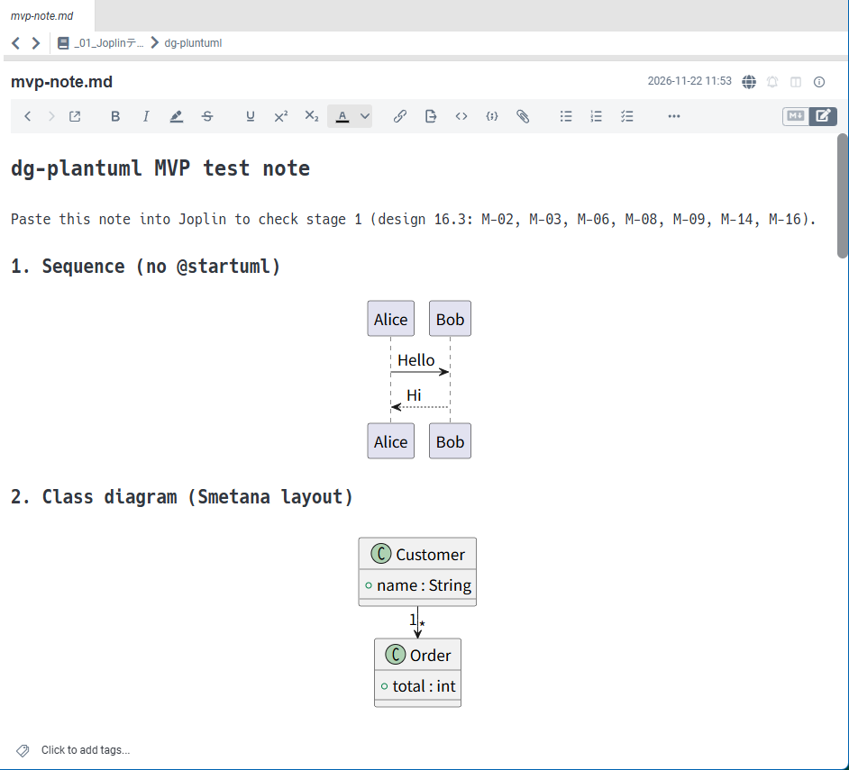
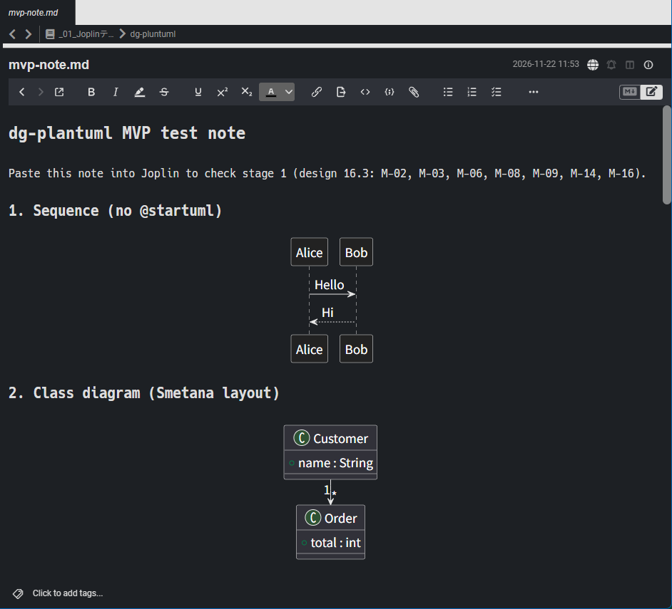
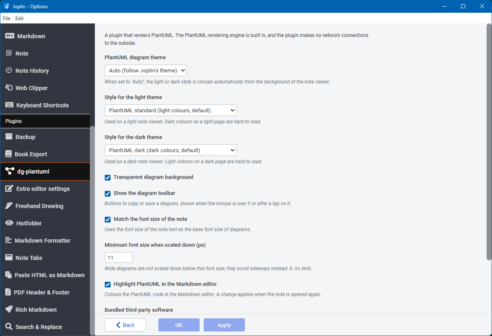

# dg-plantuml

Render [PlantUML](https://plantuml.com/) diagrams in [Joplin](https://joplinapp.org/) notes, with the rendering engine bundled inside the plugin.

> **Bundled engine, no network access.**
> The PlantUML rendering engine is bundled inside this plugin.
> No external server (such as the public PlantUML server) is used, and the plugin
> makes no network requests. Your diagrams are rendered locally, and the plugin
> never sends your notes anywhere. It works fully offline.

This statement covers what the plugin itself does. Joplin's own features, such as synchronisation, are not part of the plugin.

日本語：[このページの後半](#日本語)（[README.ja.md](README.ja.md) と同じ内容）

| Light theme | Dark theme |
| ----------- | ---------- |
|  |  |



## Features

- Renders `plantuml` and `puml` code blocks in the note viewer and in the Rich Text editor, like Joplin's built-in Mermaid support.
- Uses the official PlantUML JavaScript engine ([`@plantuml/core`](https://www.npmjs.com/package/@plantuml/core)), bundled in the plugin. No Java, no Graphviz, no server.
- Follows Joplin's light and dark themes automatically.
- Shows syntax errors with the line number and the line in question.
- Keeps the diagram on screen while you type, and caches rendered diagrams.
- Works with Japanese, Chinese and Korean text.
- Settings for the diagram theme, styles (including built-in PlantUML themes), font size and more.
- The user interface (settings screen, messages, toolbar and so on) is translated with gettext, and the main languages are already translated. It follows Joplin's display language. Supported languages (11): English, Japanese, Chinese (Simplified and Traditional), Korean, German, French, Spanish, Italian, Portuguese (Brazil) and Russian.
- A toolbar on each diagram to copy it (SVG or PNG), save it as a file, or copy its source.
- Links in diagrams open Joplin notes or web pages.
- Syntax highlighting of PlantUML in the Markdown editor.

## Installation

Open Joplin's plugin screen (Tools → Options → Plugins on Windows and Linux, Joplin → Settings → Plugins on macOS), search for **dg-plantuml**, and install it.

You can also download the `.jpl` file from [GitHub Releases](https://github.com/akiratamcat/joplin-plugin-dg-plantuml/releases) and install it with "Install from file" on the plugin screen. To build the plugin yourself, see [CONTRIBUTING.md](CONTRIBUTING.md).

Requirements: Joplin 3.1 or later, desktop. Tested with the latest stable version of Joplin.

## Usage

Write PlantUML in a fenced code block with the language `plantuml` or `puml`:

````markdown
```plantuml
Alice -> Bob : Hello
Bob --> Alice : Hi
```
````

- `@startuml` / `@enduml` can be omitted.
- Other diagram types work with their own start tag: `@startmindmap`, `@startgantt`, `@startjson`, `@startyaml`, `@startwbs`, `@startsalt` and so on.
- Fences of three or more backticks or tildes work. To put ```` ``` ```` inside a diagram, use a longer fence such as ````` ```` `````.

### Block options

Options can follow the language name:

````markdown
```plantuml theme=dark align=left
Alice -> Bob
```
````

| Option  | Values                      | Meaning                                                                 |
| ------- | --------------------------- | ----------------------------------------------------------------------- |
| `theme` | `light` / `dark` / `none`   | Style of this diagram. `none` adds no styling at all                    |
| `align` | `left` / `center` / `right` | Position of the diagram (default: `center`)                             |

Other Markdown tools ignore these options, so the notes stay portable.

## Limitations

- **Standard library**: `!include <...>` (C4, AWS icons and other libraries of the PlantUML standard library) is not available. It is shown as an error.
- **Files and URLs**: `!include` of local files and `!includeurl` are not available, because the plugin reads no files and makes no network requests.
- **Layout**: Graphviz is not bundled, because Joplin's viewer cannot run WebAssembly. Class, use case, state and component diagrams use PlantUML's built-in Smetana layout. They can look slightly different from diagrams made on plantuml.com.
- **Size**: diagrams larger than 8192 pixels in width or height are shown as an error by the engine.
- **One diagram per block**: only the first diagram of a block is shown.
- **Rich Text editor**: when you edit the source in Joplin's edit dialog and press OK, Joplin rewrites the fence with three backticks. A block whose source contains ```` ``` ```` can then break. This is how Joplin handles all code blocks, including Mermaid.
- **Mobile**: desktop only for now.

## Reporting problems

Please use the [Issues](https://github.com/akiratamcat/joplin-plugin-dg-plantuml/issues) page for bugs, questions and requests. For security problems, see [SECURITY.md](SECURITY.md). To build the plugin or contribute, see [CONTRIBUTING.md](CONTRIBUTING.md).

## License

dg-plantuml is released under the [MIT License](LICENSE).

The plugin package also contains the third-party software below. The full license texts are in [THIRD_PARTY_NOTICES.md](THIRD_PARTY_NOTICES.md), which is also included in the plugin package. The same list is shown on the plugin's settings screen in Joplin.

| Name | Version | License | Website |
| ---- | ------- | ------- | ------- |
| PlantUML (`@plantuml/core`), the rendering engine | 1.2026.10 | MIT | <https://plantuml.com/> |
| Twemoji graphics (emoji, inside the engine) | as bundled in PlantUML 1.2026.10 | CC-BY 4.0 | <https://github.com/twitter/twemoji> |
| Open Iconic (icons, inside the engine) | as bundled in PlantUML 1.2026.10 | MIT | <https://github.com/iconic/open-iconic> |
| DOMPurify (cleans the SVG output) | 3.4.17 | Apache-2.0 (dual-licensed Apache-2.0 / MPL-2.0) | <https://github.com/cure53/DOMPurify> |
| regenerator-runtime (inside DOMPurify) | as bundled in DOMPurify 3.4.17 | MIT | <https://github.com/facebook/regenerator> |

Diagrams you make are yours. PlantUML's license says that generated images belong to the author of the diagram source.

## AI-assisted development

This plugin is developed with extensive use of generative AI (Anthropic's Claude).
A large share of the design documents, source code, tests, documentation, and
translations was produced with Claude. The maintainer reviews each output step by
step, decides what to adopt, and makes corrections as needed. The maintainer is
responsible for the final content. If you find a problem, please report it on the
Issues page.

---

## 日本語

<!-- The Japanese half below is generated from README.ja.md by npm run readme. Edit README.ja.md, not this part. -->
<!-- ja:start -->

[Joplin](https://joplinapp.org/) のノートで [PlantUML](https://plantuml.com/) の図を表示するプラグインです。描画エンジンをプラグインに内蔵しています。

> **描画エンジン内蔵・外部通信なし**
> PlantUML の描画エンジンをプラグインに内蔵しています。
> PlantUML の公開サーバーなどの外部サーバーは使わず、プラグインはネットワーク通信を一切行いません。
> 図は手元で描画され、ノートの内容が本プラグインによって外部に送られることはありません。オフラインでも動作します。

これは本プラグイン自身の動作についての説明です。Joplin 本体の同期などの機能は含みません。

| Light のテーマ | Dark のテーマ |
| -------------- | ------------- |
|  |  |


画面は英語の表示で撮影しています。

### 機能

- `plantuml` と `puml` のコードブロックを、ノートビューアとリッチテキストエディタで図として表示します。Joplin 本体の Mermaid と同じ扱いです。
- PlantUML 公式の JavaScript 版のエンジン（[`@plantuml/core`](https://www.npmjs.com/package/@plantuml/core)）をプラグインに内蔵しています。Java、Graphviz、サーバーは不要です。
- Joplin の Light / Dark のテーマに自動で合わせます。
- 構文エラーは、行番号と該当する行を表示します。
- 入力中も図を表示したままにし、描画した図をキャッシュします。
- 日本語・中国語・韓国語の文字を含む図も表示できます。
- 図のテーマ、スタイル（PlantUML の内蔵テーマを含む）、文字サイズなどを設定できます。
- 画面の文字（設定画面、メッセージ、ツールバーなど）は gettext の仕組みで翻訳しており、主要な言語に翻訳済みです。Joplin の表示言語に合わせて切り替わります。対応している言語は、英語、日本語、中国語（簡体字・繁体字）、韓国語、ドイツ語、フランス語、スペイン語、イタリア語、ポルトガル語（ブラジル）、ロシア語の11言語です。
- 図ごとのツールバーで、図のコピー（SVG・PNG）、ファイルへの保存、ソースのコピーができます。
- 図の中のリンクから、Joplin のノートやウェブページを開けます。
- Markdown エディターで、PlantUML のコードを色分けして表示します。

### インストール

Joplin のプラグインの画面（Windows と Linux はツール → オプション → プラグイン、macOS は Joplin → 設定 → プラグイン）で **dg-plantuml** を検索して、インストールします。

[GitHub Releases](https://github.com/akiratamcat/joplin-plugin-dg-plantuml/releases) から `.jpl` のファイルをダウンロードし、プラグインの画面の「ファイルからインストール」でインストールすることもできます。プラグインを自分でビルドする場合は、[CONTRIBUTING.ja.md](CONTRIBUTING.ja.md) をご覧ください。

動作環境：Joplin 3.1 以降のデスクトップ版。動作確認は Joplin の最新の安定版で行っています。

### 使い方

言語名を `plantuml` または `puml` にしたコードブロックに、PlantUML を書きます。

````markdown
```plantuml
Alice -> Bob : Hello
Bob --> Alice : Hi
```
````

- `@startuml` / `@enduml` は省略できます。
- ほかの種類の図は、それぞれの開始タグで書けます（`@startmindmap`、`@startgantt`、`@startjson`、`@startyaml`、`@startwbs`、`@startsalt` など）。
- フェンスは、バッククォートまたはチルダの3文字以上が使えます。図の中に ```` ``` ```` を書きたいときは、````` ```` ````` のような長いフェンスで囲みます。

#### ブロックのオプション

言語名の後ろにオプションを書けます。

````markdown
```plantuml theme=dark align=left
Alice -> Bob
```
````

| オプション | 値                          | 意味                                                         |
| ---------- | --------------------------- | ------------------------------------------------------------ |
| `theme`    | `light` / `dark` / `none`   | この図のスタイル。`none` はスタイルの指定を一切加えない      |
| `align`    | `left` / `center` / `right` | 図の配置（既定は `center`）                                  |

ほかの Markdown のツールはこれらのオプションを無視するので、ノートの互換性は保たれます。

### 制限事項

- **標準ライブラリ**：`!include <...>`（C4、AWS のアイコンなど、PlantUML の標準ライブラリ）は使えません。エラーとして表示します。
- **ファイルと URL**：ローカルのファイルの `!include` と `!includeurl` は使えません。本プラグインはファイルを読まず、ネットワーク通信も行わないためです。
- **レイアウト**：Joplin のビューアでは WebAssembly が動かないため、Graphviz は同梱していません。クラス図、ユースケース図、状態図、コンポーネント図は、PlantUML 内蔵の Smetana レイアウトで描きます。plantuml.com で作った図と少し見た目が違うことがあります。
- **大きさ**：幅か高さが 8192 ピクセルを超える図は、エンジンがエラーとして表示します。
- **1ブロックに1つの図**：ブロックの中の最初の図だけを表示します。
- **リッチテキストエディタ**：Joplin の編集画面でソースを編集して OK を押すと、Joplin がフェンスを3文字のバッククォートに書き直します。ソースに ```` ``` ```` を含むブロックは、壊れることがあります。Mermaid を含め、Joplin のすべてのコードブロックで同じです。
- **モバイル**：今のところデスクトップ版だけに対応しています。

### 問題の報告

不具合、質問、要望は [Issues](https://github.com/akiratamcat/joplin-plugin-dg-plantuml/issues) でお知らせください。セキュリティの問題は [SECURITY.ja.md](SECURITY.ja.md) をご覧ください。プラグインのビルドや開発への参加については [CONTRIBUTING.ja.md](CONTRIBUTING.ja.md) をご覧ください。

### ライセンス

dg-plantuml は [MIT ライセンス](LICENSE) で公開しています。

プラグインのパッケージには、次の外部のソフトウェアも含まれています。ライセンスの全文は [THIRD_PARTY_NOTICES.ja.md](THIRD_PARTY_NOTICES.ja.md)（英語版は [THIRD_PARTY_NOTICES.md](THIRD_PARTY_NOTICES.md)）にあり、プラグインのパッケージにも同梱しています。同じ一覧は、Joplin の本プラグインの設定画面にも表示されます。

| 名称 | バージョン | ライセンス | 公式サイト |
| ---- | ---------- | ---------- | ---------- |
| PlantUML（`@plantuml/core`）。描画エンジン | 1.2026.10 | MIT | <https://plantuml.com/> |
| Twemoji の画像（絵文字。エンジンに含まれる） | PlantUML 1.2026.10 に含まれるもの | CC-BY 4.0 | <https://github.com/twitter/twemoji> |
| Open Iconic（アイコン。エンジンに含まれる） | PlantUML 1.2026.10 に含まれるもの | MIT | <https://github.com/iconic/open-iconic> |
| DOMPurify（SVG の出力の無害化） | 3.4.17 | Apache-2.0（Apache-2.0 と MPL-2.0 のデュアルライセンス） | <https://github.com/cure53/DOMPurify> |
| regenerator-runtime（DOMPurify に含まれる） | DOMPurify 3.4.17 に含まれるもの | MIT | <https://github.com/facebook/regenerator> |

`LICENSE` は法的な文面のため、英語の原文だけを置いています。

作成した図は作者のものです。PlantUML のライセンスでは、生成された画像は図のソースの作者に属するとされています。

### 生成 AI の利用について

本プラグインは、生成 AI（Anthropic の Claude）を全面的に用いて開発しています。
設計書、ソースコード、テスト、ドキュメント、翻訳のかなりの部分を Claude で作成しました。
作者が Claude の出力を逐次確認し、採用するかどうかの判断と修正を行っており、
最終的な内容の責任は作者が負います。問題を見つけた場合は Issue でお知らせください。

<!-- ja:end -->
