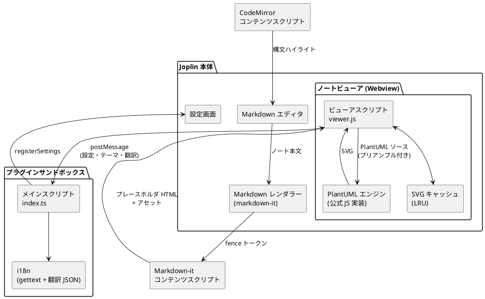
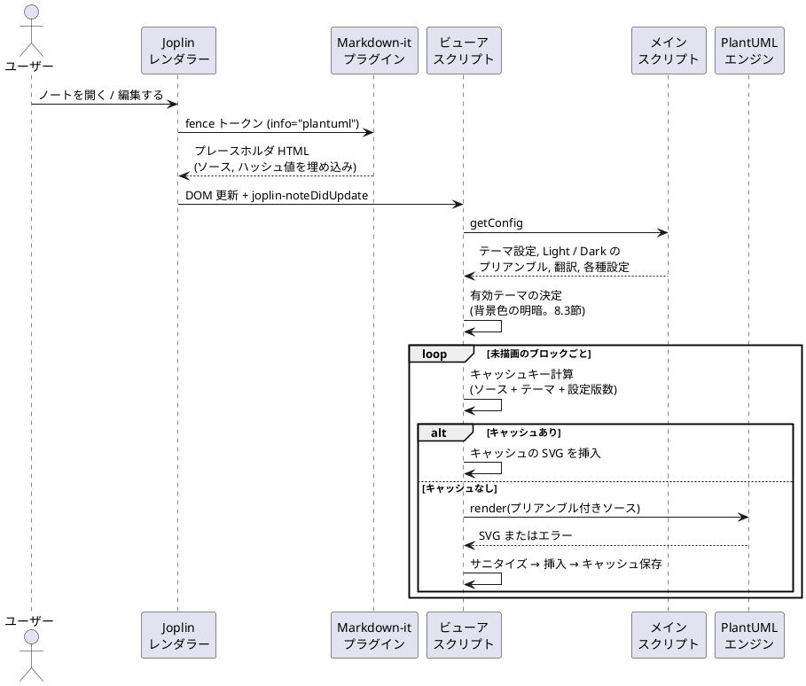

# Joplin PlantUML プラグイン 設計書

| 項目     | 内容                                                                                                                                                           |
| -------- | -------------------------------------------------------------------------------------------------------------------------------------------------------------- |
| 文書種別 | 基本設計書（初版ドラフト）                                                                                                                                     |
| 対象     | Joplin プラグイン「dg-plantuml」（プラグイン ID: `io.github.akiratamcat.dg-plantuml`、npm パッケージ名と GitHub のリポジトリ名: `joplin-plugin-dg-plantuml`。19章 D-01、D-14） |
| 版       | 0.29                                                                                                                                                           |
| 作成日   | 2026-11-18                                                                                                                                                     |
| 作成方法 | 本書は生成 AI（Anthropic の Claude）を用いて作成し、オーナーが出力を逐次確認して修正・承認している（22章）                                                     |
| 状態     | レビュー待ち。「要検証」と記した事項は、実装前のスパイク（技術検証）で確定させる（17章）。オーナーが決定すべき事項は 19章にまとめる                            |

改訂履歴:

| 版   | 日付       | 内容                                                                                                                                                                                                                                                                                                                                                                                                        |
| ---- | ---------- | ----------------------------------------------------------------------------------------------------------------------------------------------------------------------------------------------------------------------------------------------------------------------------------------------------------------------------------------------------------------------------------------------------------- |
| 0.1  | 2026-11-18 | 初版                                                                                                                                                                                                                                                                                                                                                                                                        |
| 0.2  | 2026-11-18 | 追加要求の取り込み: テーマを設定での選択のみに変更、Markdown エディタの構文ハイライト、3文字以上のフェンス、図の最小文字サイズ、MIT ライセンスの決定、ライセンスの章（20章）の追加                                                                                                                                                                                                                          |
| 0.3  | 2026-11-18 | GitHub での公開・リリースと Joplin 公式プラグイン一覧への掲載に対応: リポジトリ運用とリリースの章（21章）の追加、`manifest.json` と `package.json` の公開用の項目、公開の決定（D-12）、決定事項 D-14〜D-16、要検証事項 V-16 の追加                                                                                                                                                                          |
| 0.4  | 2026-11-18 | 名前の大文字・小文字は各仕組みの規則に従う方針を決定（15.2節）。GitHub のリポジトリ名を npm パッケージ名と同じ小文字の名前に決定（D-14）                                                                                                                                                                                                                                                                    |
| 0.5  | 2026-11-18 | 生成 AI（Claude）の利用を明記する方針を追加: 生成 AI の利用の章（22章）、設計方針、要求事項 R16、公開前チェックリスト                                                                                                                                                                                                                                                                                       |
| 0.6  | 2026-11-18 | モバイル対応の見通しを追加（14.1節）。ブロック挿入コマンドを将来も含めて対象外に変更。公開する場で「描画エンジンを内蔵し、外部通信がない」ことを明記する方針と、その検証を追加（21.7節）。要求事項 R17〜R19                                                                                                                                                                                                 |
| 0.7  | 2026-11-18 | 16章を、自動テストと手動テストを区別した構成に変更（16.1〜16.3節）。オーナーの環境（Windows、Apple silicon の macOS、仮想マシンの Linux）に合わせた手動テストの環境と範囲、手動テストのチェックリストを追加。外部通信なしの検査を 16.4節に移動                                                                                                                                                              |
| 0.8  | 2026-11-18 | 最低対応バージョンは考えない方針に決定（D-05）。手動テストは最新の安定版のみで行う                                                                                                                                                                                                                                                                                                                          |
| 0.9  | 2026-11-18 | 公式ドキュメントの調査結果に基づき、最低対応バージョンを Joplin 3.1 に決定（D-05、4.1節）。3.1 での動作確認は行わない                                                                                                                                                                                                                                                                                       |
| 0.10 | 2026-11-18 | 要求事項 R8 を修正: 「リッチテキストエディタでの編集は行わない」を、「編集と表示の扱いは Joplin 本体の Mermaid サポートと同じにする。PlantUML コードは Markdown エディタ（編集モード）で編集でき、ノートビューア（ビューモード）での編集は考えない」に変更。画面ごとの扱い（14.2節）と要検証事項 V-17 を追加。用語（2章）、スコープ（1.3節）、7.1節、図の UI（11章）、手動テスト M-14、付録A を合わせて修正 |
| 0.11 | 2026-11-18 | ローカルのリポジトリのフォルダ名を `joplin-plugin-PlantUML-2` から `joplin-plugin-dg-plantuml` に変更したことを反映（文書情報の「対象」、15章のプロジェクト構成、15.2節） |
| 0.12 | 2026-11-19 | 19章の決定事項を反映。D-01（名前「dg-plantuml」、ID `io.github.akiratamcat.dg-plantuml`、npm パッケージ名 `joplin-plugin-dg-plantuml`）、D-04（暫定案どおり）、D-06（v1.0 で 10.2節の11言語すべてに対応。翻訳は Claude が作成し、日本語はオーナーが確認。未翻訳の文字列は英語で表示）、D-07・D-09（暫定案どおり）、D-08（Light 時の既定を `plantuml-default`、最小文字サイズの既定を 11px に変更）、D-10（エンジンはセキュリティ修正や必要な不具合修正があるときだけ更新。見た目が変わる更新は MINOR 以上）、D-15（50MB 未満なら (a)、以上なら (b)）、D-16（`author` は `akira tamcat`、連絡は GitHub で受け付ける。npm は公開用のアカウントを新しく作る）。オーナーの GitHub アカウント `akiratamcat` を 15章と 21章の URL に記入。D-03、D-11、D-13 と D-16 の npm アカウント名は保留 |
| 0.13 | 2026-11-19 | Joplin のテーマへの自動追従を戻し、テーマ設定に Auto を追加して既定にした（1.2節、1.3節、R5、8.2節、8.3節、9章、19章 D-08、要検証事項 V-18）。PlantUML の標準ライブラリ（`!include <...>`）は、採用ビルドに含まれていれば許可する方針とし、12章の表を分けた。要検証事項 V-19 を追加 |
| 0.14 | 2026-11-19 | 段階0（スパイク）の段階A（調査）の結果を反映。エンジンの第一候補を PlantUML 公式の npm パッケージ `@plantuml/core`（TeaVM 版。1.2026.6 以降は MIT）とした（4.2節）。V-01・V-03・V-19 は確認済み、V-02・V-16 は一部確認済み（17章）。D-13 は不要、D-15 は (a) に確定（19章）。標準ライブラリは v1.0 では同梱せずエラーとする（12章）。パッケージサイズ（13章）、外部コードの一覧（20.2節）、掲載条件（21.5節）、段階0 の進め方（18章）を更新 |
| 0.15 | 2026-11-19 | 段階0 の段階B（エンジン単体の試作）の結果を反映。エンジンを `@plantuml/core` 1.2026.10 に確定（4.2節）。V-02・V-04・V-06・V-08・V-15 を確認済みとし、Joplin のビューアで WASM を実行できるかを確かめる V-20（優先度「高」）を追加（17章）。絵文字とアイコンを同梱し、使われたときだけ読む（7.5節、12章）。エンジンのエラー画像から行番号を読み取って自前のエラー表示にする（7.4節）。Dark の既定プリセットを、エンジンの `dark` オプションで描く `plantuml-dark` に変更し、`joplin-dark` を廃止（8.4節、9章）。D-03 は「(a) 未対応と明記」、D-11 は「10MB を目安」に決定（19章）。性能の実測値（13章）、外部コードのライセンス（20.2節）を更新 |
| 0.16 | 2026-11-19 | エンジンが返すエラーの扱い（4.2節の段階B の結果、7.4節）の書き方を修正。エラーは画像（ビットマップ）ではなく SVG（XML のテキスト）で返り、その `<text>` 要素の文字を文字列として読み取ることを明記した。画像解析は行わない |
| 0.17 | 2026-11-19 | 段階0 の段階C（最小限のプラグイン）の1回目の結果を反映（Joplin 3.7.22、Windows で確認）。ノートビューアの CSP が WASM を許さないため（V-20）、Graphviz（`viz-global.js`）は使わず、プリアンブルで常に Smetana レイアウトを指定する（4.2節、8.5節）。Web Worker は使えないため、メインスレッドで動かす（V-05、7.5節）。V-07・V-18 は確認済み。パッケージサイズ（13章）、同梱するファイル（15章）、外部コードの一覧（20.2節）、ビルド時にエンジンを圧縮し直さない規則（15.1節）を更新 |
| 0.18 | 2026-11-19 | 段階C の2回目の結果を反映し、段階0 を完了とした。Graphviz なしの Smetana、構文ハイライト（V-14）、リッチテキストエディタでの表示とソース編集（V-17）を確認済みとした（4.2節、17章）。`pre.joplin-source` へのソースの入れ方を Joplin 本体のコードブロックに合わせて修正（末尾の改行を1つ除く。`data-joplin-language` に info 文字列全体を入れる。7.1節）。Joplin の編集画面がフェンスを3文字に組み立て直す制約を記載（6.1節、14.2節、M-14）。V-09〜V-11 は段階1 以降で確認する（18章） |
| 0.19 | 2026-11-19 | 段階1（MVP）の結果を反映し、段階1 を完了とした。Markdown-it の HTML から `data-plantuml-key` と `data-plantuml-opts` を除き、オプションは `data-joplin-language` から読む（7.1節）。エンジンのファイルはアセットとして宣言せず、必要なときに読み込む（7.1節、15.1節）。描画済みの印は図の出力の要素に付ける（リッチテキストエディタの編集画面は外側の要素を残して中身だけ差し替えるため。7.2節）。直前の図を残す条件、エラーの下に直前の図を残すこと、タイムアウトでは描画を止められないことを追記（7.3節、7.4節、12章）。エンジンの状態が次の描画に残る不具合への対策（4.2節、7.5節）。`RenderResult` に失敗の理由を追加（7.6節）。図とページの明暗が違うときに CSS で背景を敷く（8.5節）。プリアンブルは段階1 では `@startuml` の図だけに入れる（8.5節）。モジュール一覧（5.3節）、プロジェクト構成（15章）、テストの実行方法と外部通信なしの検査の実装（16.2節、16.4節）を更新。段階0.5 のうち GitHub への公開は後回しにし、ローカルでできる部分を段階1 と合わせて行う（18章）。調査・テストで判明した事柄は `docs/lessons-learned.md` に記録する。絵文字の画像は Twemoji（CC-BY 4.0）、アイコンは Open Iconic（MIT）であることを確認した（20.2節） |
| 0.20 | 2026-11-19 | D-16 の残りを決定: npm の公開用アカウントの名前は `akiratamcat`（2要素認証はログインと公開の両方で有効）。これで 19章の決定事項はすべて決まった（21.4節、19章）。PlantUML の開発元への不具合（描画の間に残る状態）の報告は、当面は行わない（`docs/lessons-learned.md` 2.1節） |
| 0.21 | 2026-11-21 | 段階2（テーマと文字サイズ、設定画面）の結果を反映し、段階2 を完了とした。ビューアへの設定の受け渡し（7.2節、8.3節）、プリセットと選択肢の表示名、読めることを確かめた内蔵テーマだけを選択肢に出すこと（8.4節）、プリアンブルの並び順と図の種類ごとの対応表（8.5節）、文字サイズの実装（8.7節）、設定項目の実際の内容（9章）を更新。V-09（設定画面の入力欄は1行。`\n` で改行を表す）と V-10（設定を変えると Joplin がビューアを描き直すので、すぐに反映される）を確認済みとした（17章）。モジュール一覧（5.3節）、プロジェクト構成（15章）、段階2 の進め方と結果（18章）を追記 |
| 0.22 | 2026-11-21 | 段階3（i18n）の結果を反映し、段階3 を完了とした。翻訳の実装（自作の gettext、11言語の複数形の規則、10.1節）、翻訳の体制と結果（オーナーが日本語の訳を確認し、9個は英語の原文から直した。10.2節）、ロケールの対応表（10.3節）、ビューアへ翻訳の表をまるごと渡すこと（10.4節）、i18n の道具と検査（10.5節）を追記。GitHub に公開する前の確認（`npm run check:publish`、push は `main` だけ）を公開前チェックリストに加えた（21.6節）。モジュール一覧（5.3節）、プロジェクト構成（15章）、テストの件数（16.2節）、段階3 の進め方と結果（18章）を更新 |
| 0.23 | 2026-11-21 | 段階4（UI の仕上げ）の結果を反映し、段階4 を完了とした。図のツールバー（5つのボタン、メインスクリプトによるコピーと保存、フォルダを選ぶ保存、PNG の背景）、リンクの扱い（ビューアで受け止めて `openItem` で開く。開いてよいリンクの制限）、アクセシビリティを追記（11章）。構文ハイライトの実装（字句解析、エディターのテーマの色を使う方法、エラーの抜粋の色分け。7.7節）、設定の2項目（9章）、ライセンスの検査と通知ファイルの生成（20.4節）を追記。V-11 は確認不要とした（17章）。モジュール一覧（5.3節）、プロジェクト構成（15章）、テストの件数（16.2節）、段階4 の進め方と結果（18章）を更新 |
| 0.24 | 2026-11-21 | 生成 AI を使わない人が引き継げるように整備した（オーナーの依頼による）。`docs/` の文書と、`tests/manual/` の手動テストの手順・記録を、日本語版と分かる名前（`*.ja.md`）に変えた（15章。Joplin に貼り付けるテスト用のノートは英語なので変えない）。リポジトリの直下の文書に日本語版（`CHANGELOG.ja.md`、`CONTRIBUTING.ja.md`、`SECURITY.ja.md`、`THIRD_PARTY_NOTICES.ja.md`）を加えた。`LICENSE` は法的な文面なので英語の原文だけにする（15章、21.1節）。同梱する外部のソフトウェアの名称・バージョン・ライセンス・公式サイトを、README の表と設定画面の最下部の選択リストにも載せる（`src/thirdParty.ts`。5.3節、9章、20.4節）。`npm run licenses:check` は、日本語版のライセンス表示、`src/thirdParty.ts` の版数、README の表の版数も検査する（20.4節）。コードのコメントを見直し、古くなった記述を直した。手順書（`CONTRIBUTING.md`、`vendor/plantuml/SOURCE.md` のエンジンの更新手順、`docs/release.ja.md`）を最新化した |
| 0.25 | 2026-11-21 | ブランチの運用を決めた（オーナーの依頼による）。GitHub Flow とし、ブランチ名の接頭辞、マージの方法（マージコミット）、`main` の保護、マージ済みのブランチの削除、修正版の出し方を定めた（21.2節）。PATCH の説明にあった「見た目のスナップショット」は、該当するテストがないため書き直した（21.2節） |
| 0.26 | 2026-11-21 | GitHub への公開の前に、VS Code のワークスペースのファイルの扱いを決めた（オーナーの決定）。リポジトリの直下の `__joplin-plugin-dg-plantuml__.code-workspace`（フォルダの指定だけで、個人の設定を含まない）は公開する。過去のコミットにあった古いワークスペースのファイル（名前を変える前のものを含む）は、履歴を書き換えて消した（push の前なので影響はない）。`.gitignore` と `npm run check:publish` は、このファイルだけを例外として許す（21.6節） |
| 0.27 | 2026-11-21 | GitHub のリポジトリのページと Releases に、英語と日本語の両方を載せる（オーナーの依頼による）。GitHub は `README.md` だけを表示し、タブを言語ごとに分けることはできないため、`README.md` を前半が英語、後半が日本語の構成にした。後半は `README.ja.md` から `npm run readme`（`scripts/readme.mjs`）で作り、`npm run readme:check` で一致を検査する。リリースノートも、前半が英語（定型文と `CHANGELOG.md`）、後半が日本語（定型文と `CHANGELOG.ja.md`）の二部構成にした（21.4節、21.7節） |
| 0.28 | 2026-11-21 | v1.0.0 のリリースに向けて、手動テストの手順書 `tests/manual/release-manual-tests.ja.md` を作った。M-01〜M-16 の手順と、環境ごとの記録の表をまとめ、生成 AI を使わずに進められるようにした。図のツールバーとリンク（M-10、M-11）の確認用のノート `release-links-note.md` を加えた。開発環境のない PC では、GitHub Actions の CI の成果物から `.jpl` を入手する（16.3節） |
| 0.29 | 2026-11-22 | v1.0.0 の準備（オーナーの決定）。v1.0.0 から npm にも公開する。アイコンの図案と置き場所を決め（15章）、スクリーンショットは Light・Dark の図と設定画面の3枚とした（21.5節）。Joplin の manifest の `icons` と `screenshots` の形式を公式の文書で確認し直した（V-16） |

---

## 1. 概要

### 1.1 目的

Joplin のノート（Markdown）に書かれた PlantUML のコードブロックを、Joplin 本体のノートビューア上で図（SVG）として表示するプラグインを提供する。

Joplin 本体は Mermaid をサポートしており、` ```mermaid ` と書くだけで図が表示される。本プラグインは **「インストールするだけで、Mermaid と同等の使い勝手で PlantUML が使える」** ことを目標とする。

### 1.2 設計方針

1. **ゼロ設定で動く**: インストール直後から、追加のソフトウェア（Java、Graphviz、PlantUML サーバー）や設定なしで描画できる。
2. **オフライン・外部通信なし**: PlantUML の処理は、PlantUML 公式の JavaScript 実装を同梱してローカルで実行する。本プラグインはネットワーク通信を一切行わず、ノートの内容を外部に送らない。これを本プラグインの主なアピールポイントとして、公開する場で明記する（21.7節）。
3. **Joplin の流儀に従う**: Markdown-it コンテンツスクリプト、`joplin-editable` 構造、設定 API、テーマなど、Joplin 本体および Mermaid 実装と同じ仕組み・見た目に揃える。
4. **最初から国際化**: UI 文字列はすべて gettext（`gettext()` 関数）と PO ファイルで管理する。
5. **テーマは Joplin に合わせる**: 図のスタイル（Light / Dark）は、既定では Joplin のテーマの明暗に自動で合わせる。設定画面で Light / Dark に固定することもできる（0.13 で変更）。
6. **MIT ライセンスで、エンジンを内蔵して配布する**: 本プラグインは MIT ライセンスとし、PlantUML の JavaScript 実装をプラグインに内蔵した状態で配布する（20章）。
7. **公開を前提に作る**: ソースは GitHub で公開し、GitHub Releases と npm でリリースして、Joplin 公式プラグイン一覧に掲載する（21章）。リポジトリの構成、ドキュメント、ビルドは、第三者が読んで再現できる状態を保つ。
8. **生成 AI の利用を明記する**: 本プラグインは生成 AI（Anthropic の Claude）を全面的に用いて開発する。オーナーが出力を逐次確認して管理していることと合わせて、その事実を README などに明記する（22章）。

### 1.3 スコープ

| 区分         | 内容                                                                                                                                                                                                                                                                                                                          |
| ------------ | ----------------------------------------------------------------------------------------------------------------------------------------------------------------------------------------------------------------------------------------------------------------------------------------------------------------------------- |
| 対象（v1.0） | ノートビューアでの描画、Light/Dark スタイル（Joplin のテーマに自動で追従。設定で固定も可）、図の最小文字サイズの保証、Markdown エディタ（CodeMirror）での PlantUML の構文ハイライト、設定画面、i18n、エラー表示、図のコピー・保存、デスクトップ版（Windows / macOS / Linux）、GitHub でのソース公開とリリース、npm への公開、Joplin 公式プラグイン一覧への掲載 |
| 対象（v1.x） | モバイル版（Android / iOS）対応（14.1節の検証で実用的と確認できた場合）、エクスポート（HTML / PDF / 印刷）での描画、PlantUML 標準ライブラリ（C4 など）のうちよく使うものの同梱（要望があれば。12章）                                                                                                                                                                                                            |
| 対象外       | PlantUML サーバーとの連携、Java 版 PlantUML の呼び出し、PlantUML コードの補完、ノートビューア（図を画像で表示している状態）での PlantUML の編集、Joplin 本体の Mermaid にない独自の編集機能（リッチテキストエディタ用の専用エディタなど）、ブロック挿入コマンド（将来も含めて不要。0.6 で変更）  |

---

## 2. 用語

| 用語                             | 説明                                                                                             |
| -------------------------------- | ------------------------------------------------------------------------------------------------ |
| メインスクリプト                 | Joplin のプラグインサンドボックスで動く `index.ts`。設定・コマンド・メッセージ処理を担当する     |
| Markdown-it コンテンツスクリプト | Joplin の Markdown レンダラーに組み込まれる Markdown-it プラグイン。Markdown → HTML 変換時に動く |
| ビューア                         | ノートを表示する Webview。コンテンツスクリプトが登録したアセット（JS / CSS）が読み込まれる       |
| ビューアスクリプト               | アセットとしてビューアに読み込まれる JS。PlantUML エンジンを呼び出して SVG を挿入する            |
| PlantUML エンジン                | PlantUML 公式の JavaScript 実装（後述）。PlantUML ソースから SVG を生成する                      |
| プリアンブル                     | テーマ用に PlantUML ソースの先頭へ自動挿入する `skinparam` / `<style>` / `!theme` 記述           |
| 有効テーマ                       | 設定、ブロック単位の指定、Joplin のテーマの明暗から最終的に決まる `light` または `dark`                                 |
| CodeMirror コンテンツスクリプト  | Joplin の Markdown エディタ（CodeMirror 6）に組み込む拡張。PlantUML の構文ハイライトを担当する   |
| Markdown エディタ（編集モード）  | Markdown のテキストを直接編集する Joplin のエディタ。PlantUML のコードはここで編集する           |
| ノートビューア（ビューモード）   | Markdown を描画して表示する Joplin の画面。PlantUML は図（画像）として表示され、編集はしない     |
| リッチテキストエディタ           | Joplin の WYSIWYG 形式のエディタ。Markdown エディタとは別の編集モード                            |

---

## 3. 要求事項との対応

| #   | 要求事項                                                                                                                                                                                                                                  | 設計上の対応                                                                                                                                                                                                                                      | 参照                       |
| --- | ----------------------------------------------------------------------------------------------------------------------------------------------------------------------------------------------------------------------------------------- | ------------------------------------------------------------------------------------------------------------------------------------------------------------------------------------------------------------------------------------------------- | -------------------------- |
| R1  | Markdown 内の PlantUML コードを画像として Joplin 本体で表示する                                                                                                                                                                           | Markdown-it コンテンツスクリプトでフェンスを検出し、ビューアで SVG に描画する                                                                                                                                                                     | 5章, 6章, 7章              |
| R2  | Mermaid と同等の使い勝手                                                                                                                                                                                                                  | 同じフェンス記法、自動描画、エラー表示、コピー・保存ボタン、`joplin-editable` 構造を採用する                                                                                                                                                      | 6章, 11章, 付録A           |
| R3  | 外部サーバーを使わず、PlantUML 公式の JavaScript 実装を使う                                                                                                                                                                               | エンジンをプラグインに同梱し、ビューア内でローカル実行する。`!include` などのネットワークアクセスを遮断する                                                                                                                                       | 4.2節, 12章                |
| R4  | `gettext()` と PO ファイルによる i18n。CJK と主要言語に対応                                                                                                                                                                               | 英語を原文とし、PO → JSON をビルド時に変換して同梱する。Joplin のロケールから言語を決める                                                                                                                                                         | 10章                       |
| R5  | Light/Dark スタイル。Joplin のテーマに自動で追従し、設定画面で固定もできる（0.2 で設定のみに変更し、0.13 で自動追従を戻した）                                                                                                                                                                   | 既定では、ビューアの背景色から Joplin のテーマの明暗を判定して Light / Dark を切り替える。設定画面で Light / Dark への固定と、テーマごとのプリセットを選べるようにする                                                                                                                                                                      | 8章, 9章                   |
| R6  | コード表示の時は構文ハイライトを行う                                                                                                                                                                                                      | CodeMirror コンテンツスクリプトで、Markdown エディタ内の PlantUML コードブロックを色分けする                                                                                                                                                      | 7.7節                      |
| R7  | PlantUML コードの補完は行わない                                                                                                                                                                                                           | 対象外とする                                                                                                                                                                                                                                      | 1.3節                      |
| R8  | 編集と表示の扱いは、Joplin 本体の Mermaid サポートと同じにする。PlantUML コードは Markdown の編集モード（Markdown エディタ）で編集でき、ビューモード（ノートビューア。図を画像で表示している状態）での編集は考えない（0.10 で表現を修正） | 画面ごとの扱いを Mermaid に合わせる（14.2節）。Markdown エディタで編集し、構文ハイライトを付ける。ノートビューアは図を表示するだけ。リッチテキストエディタは、Mermaid と同じく `joplin-editable` 構造により Joplin 標準の仕組みで表示・編集される | 1.3節, 7.1節, 11章, 14.2節 |
| R9  | 3文字以上のコードフェンス（` ```` ` など）にも対応する                                                                                                                                                                                    | CommonMark の規則どおり3文字以上のフェンスを受け付け、実際のフェンス文字列を保持する                                                                                                                                                              | 6.1節, 7.1節               |
| R10 | 図の文字が読めないほど小さくならないようにする                                                                                                                                                                                            | 基本文字サイズをビューアの本文に合わせ、縮小表示しても最小文字サイズを下回らないようにする                                                                                                                                                        | 8.7節                      |
| R11 | MIT ライセンスとする                                                                                                                                                                                                                      | 本プラグインのコードを MIT ライセンスで公開する                                                                                                                                                                                                   | 20章                       |
| R12 | PlantUML の JavaScript コードを内蔵した状態で配布する                                                                                                                                                                                     | エンジンを配布パッケージ（`.jpl`）に含め、実行時のダウンロードを行わない                                                                                                                                                                          | 15.1節, 20章               |
| R13 | プラグインのコードと外部コードのライセンスを設計書に記載する                                                                                                                                                                              | ライセンスの章を設ける                                                                                                                                                                                                                            | 20章                       |
| R14 | GitHub のオーナーのアカウントへ push し、リリースを行う                                                                                                                                                                                   | 公開リポジトリの構成、ブランチとバージョンの規則、CI、GitHub Releases でのリリース手順を定める                                                                                                                                                    | 21.1〜21.4節               |
| R15 | Joplin 公式プラグイン一覧に掲載する                                                                                                                                                                                                       | 一覧の掲載条件（npm パッケージ名・キーワード・`.jpl`・manifest の項目）を満たし、公開前チェックリストで確認する                                                                                                                                   | 15章, 21.5節, 21.6節       |
| R16 | 生成 AI（Claude）を全面的に用いていることを明記する。オーナーが出力を逐次確認・管理していることも記載する                                                                                                                                 | README、本書、CONTRIBUTING、コミットに記載する場所と文面を定める                                                                                                                                                                                  | 22章                       |
| R17 | モバイル向けに対応できる設計か。実現困難ならモバイルは考えなくてよい                                                                                                                                                                      | 構成上は対応できる。実用性はエンジンのサイズと性能の検証で判断し、v1.x の候補とする。設計はモバイルを妨げないようにする                                                                                                                           | 14.1節                     |
| R18 | ブロック挿入コマンドは将来も不要                                                                                                                                                                                                          | 対象外とする                                                                                                                                                                                                                                      | 1.3節                      |
| R19 | ビルド済みプラグインを公開する場で、描画エンジンを内蔵し外部通信がないことを明記する（アピールポイント）                                                                                                                                  | GitHub Releases、README、manifest、npm、GitHub の About に記載し、通信がないことを検査で確かめる                                                                                                                                                  | 21.7節                     |

---

## 4. 前提となる技術要素

### 4.1 Joplin プラグインの仕組み

本プラグインで使う Joplin プラグイン API は以下のとおり。

| API                                                                            | 用途                                                                 |
| ------------------------------------------------------------------------------ | -------------------------------------------------------------------- |
| `joplin.contentScripts.register(ContentScriptType.MarkdownItPlugin, id, path)` | Markdown-it プラグインとアセットの登録                               |
| `joplin.contentScripts.register(ContentScriptType.CodeMirrorPlugin, id, path)` | Markdown エディタへの構文ハイライト拡張の登録                        |
| `joplin.contentScripts.onMessage(id, handler)`                                 | ビューアスクリプトからの問い合わせ（設定・翻訳の取得など）に応答する |
| `webviewApi.postMessage(id, message)`（ビューア側）                            | メインスクリプトへの問い合わせ。応答は Promise で返る                |
| `joplin.settings.registerSection` / `registerSettings`                         | 設定画面の作成                                                       |
| `joplin.settings.value` / `globalValue` / `onChange`                           | 設定値と Joplin 本体のロケール（`locale`）の取得                     |
| ビューアのイベント `joplin-noteDidUpdate`                                      | ノート本文の再描画後に、ビューアスクリプトの処理を開始する合図       |

最低対応バージョン（`app_min_version`）は **Joplin 3.1** とする（0.9 で決定。19章 D-05）。ただし、3.1 での動作確認（テスト）は行わない。開発と手動テストには、その時点の最新の安定版を使う。

3.1 とした根拠: 公式ドキュメントを調べた結果（2026-11-18）、本プラグインが使う各 API（Markdown-it コンテンツスクリプト、`postMessage`、設定 API、manifest の各項目）が追加された版は書かれていなかった。唯一の手がかりは、CodeMirror 6 の新しいエディタが Joplin 3.1 から標準になったこと（それより前は設定で有効にする必要がある）であり、構文ハイライト（7.7節）を標準の状態で使えるのは 3.1 以降である。そこで、確かめられる範囲で最も低い版として 3.1 を採用する。

注意点と運用:

- 3.1 で他の機能がすべて動くことは確かめていない。README の対応環境の欄には「Joplin 3.1 以降（動作確認は最新の安定版 X.Y で実施）」のように、最低バージョンと動作確認したバージョンを区別して書く。
- 3.1〜最新版の間のバージョンで動かないという報告があった場合は、`app_min_version` を引き上げるか、原因を直すかをその時点で判断する。
- 実装の途中で、3.1 より後に追加された API を使うと分かった場合は、`app_min_version` をその版に引き上げる。
- 古いバージョンのための作り分けや回避策は入れない。

参考: Joplin 公式の manifest の説明では、`app_min_version` は "In general it should be whatever version you are using to develop the plugin." とされている。本プラグインは、より多くの利用者にインストールしてもらうことを優先し、この推奨より低い 3.1 を採用する。

### 4.2 PlantUML 公式 JavaScript 実装

PlantUML プロジェクトは、Java 版をブラウザで動かすための公式 JavaScript 版を公開している（TeaVM による JS 変換版と、CheerpJ による JVM 実行版が知られている）。本プラグインでは次の基準で採用するビルドを選ぶ。

| 基準                 | 必須/推奨 | 説明                                                                                                                                                                                                                        |
| -------------------- | --------- | --------------------------------------------------------------------------------------------------------------------------------------------------------------------------------------------------------------------------- |
| 完全オフラインで動く | 必須      | 実行時に CDN などからランタイムを取得しないこと。CheerpJ 版は既定でランタイムを CDN から読むため、同梱できない場合は不採用                                                                                                  |
| ライセンス           | 必須      | MIT ライセンスの本プラグインに内蔵して再配布できること。PlantUML 本体は GPL のほか、LGPL / Apache-2.0 / EPL / MIT などのライセンスでも配布されている（ライセンスによって含まれる機能が異なる場合がある）。採用基準は 20.3節 |
| SVG 出力             | 必須      | テーマの適用、拡大縮小、文字サイズの調整のため、SVG を出力できること                                                                                                                                                        |
| Graphviz 不要        | 必須      | クラス図・ユースケース図などのレイアウトに外部の `dot` を使わないこと。PlantUML 内蔵の Smetana レイアウト、または同梱できる WASM 版 Graphviz を使う                                                                         |
| サイズ・起動時間     | 推奨      | モバイルでも実用的に読み込めること                                                                                                                                                                                          |
| 非同期 API           | 推奨      | UI を止めないよう、Promise を返すか Web Worker で動かせること                                                                                                                                                               |

**採用方針**: PlantUML 公式の npm パッケージ `@plantuml/core`（TeaVM で JavaScript に変換したもの）を第一候補とする（0.14。段階A の調査結果）。エンジンは差し替えられるよう、7.6節の `RenderEngine` インターフェースで包む。段階B（エンジン単体の試作）で描画品質と動作を確かめ、**1.2026.10 に確定した**（0.15）。以後の更新は 19章 D-10 の方針による。

**段階A の調査結果**（2026-11-19。最新版 1.2026.10 で確認）:

| 項目 | 内容 |
| ---- | ---- |
| 入手方法 | npm の `@plantuml/core`。PlantUML 公式のビルドから作られ、ほぼ毎月新しい版が出ている |
| ライセンス | 1.2026.6 以降は MIT（それより前の版は GPL）。LICENSE ファイルと `package.json` で確認した |
| 使うファイル | `plantuml.js`（エンジン本体。3.2MB）、`themes.js`（`!theme` の定義。0.3MB）、`emoji.js`（絵文字。1.9MB）、`openiconic.js`（アイコン。0.05MB）。絵文字とアイコンは同梱し、図で使われたときだけ読む（0.15 で決定。7.5節）。`viz-global.js`（Graphviz。1.4MB）は、Joplin のビューアで動かないため同梱しない（0.17。V-20） |
| API | `renderToString(lines, onSuccess, onError, options)` で SVG を文字列として受け取る。呼び出しはエンジンの中で順番に処理される。`options` には Dark 用の `dark` と、巨大な図をエラーにする `maxSvgSize` がある |
| 外部からの読み込み | エンジン本体には通信の API（`fetch`、`XMLHttpRequest` など）がない。Graphviz の WASM はファイル内に埋め込まれている。エンジンが外部から読もうとするのは、`themes.js`、標準ライブラリ、ローカルの `!include` の3つだけで、いずれもプラグイン側で制御できる（12章） |
| 使わないもの | CheerpJ 版（`plantuml-core`。古い方式で、実行時に CDN からランタイムを読む）。同梱されている試験的な WebAssembly 版（CSP で `unsafe-eval` が必要で、`.wasm` を取得するため）。まず JS 版を使い、速度が足りなければ段階B 以降で検討する |

**段階B の試作の結果**（2026-11-19。ヘッドレスの Chrome で、試験用ページ以外へのリクエストをすべて止め、CSP で通信を禁止して実施。試作のコードは `spike/engine` ブランチにある）:

| 項目 | 結果 |
| ---- | ---- |
| 外部通信 | 止めたリクエストは0件、CSP の違反は0件。通信を遮断した状態で、すべての図が描けた（V-02） |
| 図の品質 | シーケンス、クラス、ユースケース、アクティビティ、状態、コンポーネント、配置、マインドマップ、ガント、JSON、WBS のすべてが正しく描けた。描けない図の種類は見つからなかった（V-04） |
| CJK | 日本語・中国語・韓国語の混在、全角と半角の混在でも、文字のはみ出しや重なりはなかった（V-08） |
| 速度 | エンジンの読み込み約 0.3 秒、最初の図約 0.15 秒、2回目以降は1図あたり 5〜30ms（13章） |
| 文字サイズ | SVG の `font-size` から読み取れる。`skinparam defaultFontSize` はすべての文字に効いた（V-15） |
| エラー | 構文エラー、`!include` などの失敗は、`onError` ではなく、エラーの内容を描いた SVG として返る。SVG は XML のテキストで、エラーの文は `<text>` 要素の文字として入っている。その文字の中の `[From textarea (line N) ]` から、文字列の処理で行番号を読み取れる（7.4節） |
| WASM と CSP | Graphviz（`viz-global.js`）は WASM を使うため、CSP に `'wasm-unsafe-eval'` が必要。許されていないと、Graphviz を使う図（クラス図など）がエラーになる。Joplin のビューアで許されているかは段階C で確かめる（V-20） |
| Smetana | WASM が使えない状態でも、`!pragma layout smetana` を入れると、PlantUML 内蔵の Smetana レイアウトで Graphviz とほぼ同じ品質に描けた。V-20 の結果が悪い場合の代わりの手段にする |

**段階C（1回目）の結果**（2026-11-19。Joplin 3.7.22、Windows。試作のプラグインは `spike/plugin` ブランチにある）:

| 項目 | 結果 |
| ---- | ---- |
| ノートビューアの CSP | `script-src 'self' joplin-plugin://* joplin-content://*`。`'wasm-unsafe-eval'` を含まない。`child-src` は YouTube などの決まったサイトだけ。ページは `about:`、プラグインのアセットは `file:` の URL で読み込まれる |
| WASM（V-20） | 実行できない。Graphviz を使う図（クラス図など）はエラーになる。**Smetana（`!pragma layout smetana`）なら描ける**（1図あたり約 10ms）。そのため、Graphviz は使わず、常に Smetana を使う（8.5節） |
| Web Worker（V-05） | アセットの URL からも Blob URL からも作れない。エンジンはメインスレッドで動かす（7.5節） |
| エンジンの読み込み | ES モジュールの動的な `import` で読み込めた（40〜140ms） |
| `joplin-noteDidUpdate`（V-07） | 届く。ノートを編集すると、入力のたびに届く。編集中はビューアは読み込み直されず、本文だけが差し替えられる |
| テーマの追従（V-18） | Joplin のテーマを切り替えると、ノートビューアが丸ごと読み込み直される。ビューアスクリプトが最初から動き、背景色から明暗を判定し直せた（Light: `rgb(255, 255, 255)`、Dark: `rgb(29, 32, 36)`） |
| 絵文字・標準ライブラリ | 絵文字は使われたときだけ読み込めた。標準ライブラリは設計どおり止まり、行番号つきのエラーとして判定できた |
| 日本語 | 正しく表示された |

**段階C（2回目）の結果**（2026-11-19。Joplin 3.7.22、Windows）:

| 項目 | 結果 |
| ---- | ---- |
| Graphviz なしの描画 | `viz-global.js` を読み込まず、`!pragma layout smetana` を自動で入れた版で、クラス図も描けた。エンジンは Graphviz がないと自動で Smetana を使う（ヘッドレスの Chrome でも確認） |
| 行番号のずれ | プリアンブルを1行入れると、エラーの行番号が1つずれた。7.4節の補正が必要 |
| 構文ハイライト（V-14） | `ViewPlugin` と `Decoration.mark` で、Markdown エディタの PlantUML のブロックの中だけに色を付けられた。4文字のフェンスやオプション付きのフェンスにも対応できた（7.7節） |
| リッチテキストエディタ（V-17） | 図が描かれる（プラグインのスクリプトが動く）。Joplin 標準の編集画面でソースを編集でき、図と Markdown に反映された |
| ソースの往復 | 最初の試作では、`pre.joplin-source` にソースの末尾の改行を残していたため、リッチテキストエディタで保存するたびに空行が増えた。Joplin 本体のコードブロック（`packages/renderer/MdToHtml.ts`）と同じく、末尾の改行を1つ除いて閉じフェンスを改行から始めると、切り替えでも編集画面でも空行は増えなくなった（7.1節） |
| ブロックオプション | `data-joplin-language` に info 文字列全体（例: `plantuml theme=dark`）を入れると、編集画面の言語の欄に表示され、OK を押しても残った |
| フェンスの長さ | 編集画面で OK を押すと、Joplin はフェンスを必ず3文字の ```` ``` ```` で組み立て直す（`useEditDialog.ts` の `newBlockSource`）。4文字のフェンスは3文字に変わった。Joplin 本体の挙動で、Mermaid やコードブロックも同じ（6.1節、14.2節） |

**段階1（MVP）で判明したこと**（2026-11-19。Joplin 3.7.22 とヘッドレスの Chrome。詳細は `docs/lessons-learned.ja.md`）:

| 項目 | 結果 |
| ---- | ---- |
| 描画の間に残る状態（エンジンの不具合） | クラス図、ユースケース図、状態図、コンポーネント図のどれかを描くと、その次に描く「参加者を宣言していないシーケンス図」（メッセージが10行程度以上）がクラス図として描かれる。エンジン単体でも起きる。別の種類の図を1回描くと元に戻る。対策として、描画のたびに直前に小さなシーケンス図を描かせて結果を捨てる（7.5節） |
| 背景 | エンジンは Light でも Dark でも図の背景を塗らない。図とページの明暗が違うと線や文字が背景に埋もれるため、CSS で背景を敷く（8.5節） |
| 大きさの上限 | 縦か横が 8192px を超える図は、エンジンが「Diagram too large for browser rendering」のエラーにする（オプション `maxSvgSize` で変えられる）。1000行のシーケンス図で起きた |
| 異常な入力 | `!while` の無限ループや無限の再帰は、エンジンが検出して行番号つきのエラーにする。2万文字の1行は、意味の読めないメッセージのエラーになる。どれも Joplin は固まらなかった（M-16） |
| 絵文字の名前 | `thumbsup` などの名前で使う。`+1` は含まれない |

---

## 5. アーキテクチャ

### 5.1 構成

描画処理は Joplin の Mermaid 実装と同じく **ビューア内で実行する**。Markdown-it プラグインはプレースホルダ HTML を出力するだけにして、重いエンジン処理はビューアスクリプトが非同期で行う。

理由:

- Markdown-it の変換処理は同期処理なので、重いエンジンを動かすと入力中の再描画が遅くなる。
- ビューアの Webview はノートを切り替えても再利用されるため、エンジンの読み込みとキャッシュを一度で済ませられる。
- メインスクリプトから SVG を送る方式に比べ、大きなデータのプロセス間転送がない。



### 5.2 描画シーケンス



### 5.3 モジュール一覧

| モジュール                              | 実行場所           | 責務                                                                                           |
| --------------------------------------- | ------------------ | ---------------------------------------------------------------------------------------------- |
| `src/index.ts`                          | サンドボックス     | 起動処理、設定登録、コンテンツスクリプト登録、メッセージ応答（コマンドやメニューは登録しない） |
| `src/settings.ts`                       | サンドボックス     | 設定項目の定義と既定値、ビューア用の設定の組み立て（`buildViewerConfig`）、プリセットの解決（0.21）                                                               |
| `src/thirdParty.ts` | サンドボックス | 同梱する外部のソフトウェアの名称・バージョン・ライセンス・公式サイトの一覧。設定画面の最下部の選択リスト（`plantuml.thirdParty`）に表示する（20.4節。0.24） |
| `src/i18n/`                             | 両方               | gettext 実装、ロケール解決（`gettext.ts`）、翻訳カタログ（`catalog/catalogs.json`。PO から生成。0.22）                                                       |
| `src/contentScript/markdownItPlugin.ts` | レンダラー         | fence の検出と HTML 出力、アセット宣言                                                         |
| `src/contentScript/viewer.ts`           | ビューア           | ビューアスクリプトの入口。部品を組み立て、イベントと `MutationObserver` で描画を始める（0.19） |
| `src/contentScript/controller.ts`       | ビューア           | 描画の流れ（7.2節〜7.4節）。キャッシュ、直前の図の表示、デバウンス、直列キュー、エラー表示。段階4 でツールバーを加える（0.19） |
| `src/contentScript/engine.ts`           | ビューア           | PlantUML エンジンの読み込みと呼び出し（`RenderEngine`）、読み込み関数、タイムアウト、描画の前の状態のリセット                                        |
| `src/contentScript/engineError.ts`      | ビューア           | エンジンのエラーの SVG から、行番号とメッセージを読み取る（7.4節。0.19） |
| `src/contentScript/cache.ts`            | ビューア           | LRU キャッシュとキャッシュキー（7.3節。0.19） |
| `src/contentScript/theme.ts`            | ビューア           | 背景色からの明暗の判定（8.2節。0.19） |
| `src/contentScript/viewerConfig.ts`     | ビューア           | ビューアの設定と既定値。段階2 から `getConfig` で受け取る（0.19） |
| `src/shared/hash.ts`                    | 両方               | キャッシュキー用のハッシュ値（Node.js の機能を使わない。0.19） |
| `src/contentScript/preamble.ts`         | ビューア           | プリアンブルの挿入と行番号の補正                                                               |
| `src/contentScript/sanitize.ts`         | ビューア           | SVG のサニタイズ                                                                               |
| `src/contentScript/fontSize.ts`         | ビューア           | 基本文字サイズの決定と、最小文字サイズを守る表示倍率の計算                                     |
| `src/contentScript/codeMirrorPlugin.ts` | エディタ           | Markdown エディタでの PlantUML の構文ハイライト                                                |
| `src/contentScript/toolbar.ts`          | ビューア           | 図のツールバー（11章。0.23）                                                                   |
| `src/contentScript/image.ts`            | ビューア           | SVG から PNG への変換（11章。0.23）                                                            |
| `src/actions.ts`                        | サンドボックス     | ツールバーとリンクの依頼の処理（コピー、保存、リンク。11章。0.23）                             |
| `src/shared/tokenizer.ts`               | エディタ・ビューア | PlantUML の字句解析（ハイライト用。エディタとエラー表示で共用）                                |
| `src/shared/editorHighlight.ts`         | エディタ           | エディターで色分けする範囲（PlantUML のフェンスの中、見えている行だけ。0.23）                   |
| `src/shared/fence.ts`                   | 両方               | フェンスの判定（言語名、3文字以上のフェンス、info オプション）                                 |
| `src/presets/`                          | 両方               | 同梱スタイルプリセット（`joplinLight.ts`）と、内蔵テーマの一覧（`builtinThemes.ts`。全テーマと、Light 用・Dark 用に出すもの。0.21）                                       |

---

## 6. 記法の仕様

### 6.1 対象とするコードブロック

Mermaid と同じく、フェンス付きコードブロックの言語名で判定する。

````markdown
```plantuml
Alice -> Bob : Hello
Bob --> Alice : Hi
```
````

| 項目                    | 仕様                                                                                                                                                                                                                                                              |
| ----------------------- | ----------------------------------------------------------------------------------------------------------------------------------------------------------------------------------------------------------------------------------------------------------------- |
| 言語名                  | `plantuml`（既定）と `puml`。大文字・小文字は区別しない。設定で別名を追加できる                                                                                                                                                                                   |
| `@startuml` / `@enduml` | 省略できる。省略時は自動で補う                                                                                                                                                                                                                                    |
| その他の開始タグ        | `@startmindmap`、`@startgantt`、`@startjson`、`@startyaml`、`@startwbs`、`@startsalt` など、PlantUML が対応する `@startXXX` はそのまま渡す                                                                                                                        |
| 1ブロック内の複数図     | v1.0 では最初の図だけ描画し、残りは無視したうえで警告を表示する                                                                                                                                                                                                   |
| フェンスの長さ | バッククォート（`` ` ``）またはチルダ（`~`）の **3文字以上**。` ```` `（4文字）や `~~~~~` なども受け付ける。閉じフェンスは開きフェンスと同じ文字で、同じ長さ以上とする（CommonMark の規則）。ソース内に ` ``` ` を含めたい場合は、4文字以上のフェンスで囲めばよい。ただし、リッチテキストエディタの編集画面でソースを編集して OK を押すと、Joplin 本体がフェンスを3文字の ```` ``` ```` に組み立て直す（0.18。14.2節）。ソースに ```` ``` ```` を含むブロックは、編集画面を通すと壊れることがある |
| インデント              | Markdown-it の標準どおり対応する（最大3文字のインデント）                                                                                                                                                                                                         |

4文字のフェンスの例:

`````markdown
````plantuml
note right
  ```
  ここに ``` を書いても閉じフェンスにならない
  ```
end note
````
`````

### 6.2 ブロック単位のオプション

言語名の後ろにオプションを書けるようにする（Markdown-it の info 文字列を利用）。書かなければ設定画面の値が使われる。Mermaid にない独自仕様だが、入れることに決定した（0.12。19章 D-07）。

````markdown
```plantuml theme=none
...
```
````

| オプション | 値                          | 説明                                                                |
| ---------- | --------------------------- | ------------------------------------------------------------------- |
| `theme`    | `light` / `dark` / `none`   | このブロックだけテーマを指定する。`none` はプリアンブルを挿入しない |
| `align`    | `left` / `center` / `right` | 図の配置（既定は `center`）                                         |

Joplin 本体の Markdown エディタや他の Markdown ツールとの互換性を保つため、オプションは任意とし、不明なオプションは無視する。

---

## 7. 描画処理の詳細

### 7.1 Markdown-it プラグインの出力

`markdownIt.renderer.rules.fence` を上書きし、対象の言語名なら以下の HTML を出力する。それ以外は元のルールに処理を任せる。

```html
<div class="joplin-editable joplin-plantuml">
  <pre class="joplin-source"
       data-joplin-language="{info 文字列}"
       data-joplin-source-open="{開きフェンス}{info 文字列}&#10;"
       data-joplin-source-close="&#10;{閉じフェンス}">{エスケープ済みソース（末尾の改行を1つ除く）}</pre>
  <div class="joplin-plantuml-output" aria-busy="true">
    <span class="joplin-plantuml-status"></span>
  </div>
</div>
```

- `joplin-editable` と `pre.joplin-source` は、Joplin 本体が数式や Mermaid で使っている構造。これに従うことで、リッチテキストエディタでの表示・編集が Mermaid と同じ Joplin 標準の仕組みで行われ、往復でソースが失われない（14.2節）。
- `{開きフェンス}` と `{閉じフェンス}` には、ノートに書かれた実際のフェンス文字列（Markdown-it の `token.markup`。例: ` ```` `）を入れる。` ``` ` 固定にすると、4文字以上のフェンスで書いたブロックがリッチテキストエディタとの往復で壊れるため。`{info 文字列}` も `plantuml theme=dark` のように元のまま入れる。
- ソースは、Markdown-it の `token.content` から末尾の改行を1つ除いて入れる。閉じフェンスの前の改行は `data-joplin-source-close` の側に持たせる。Joplin 本体のコードブロックと同じ形で、Joplin の編集画面はソースをそのまま表示し、OK を押すと「改行＋フェンス＋言語＋改行」「ソース」「改行＋フェンス＋改行」をつないで組み立て直すため。末尾の改行を残すと、保存や編集のたびに空行が増える（0.18。段階C の試作で確認）。
- `data-joplin-language` には、言語名だけでなく info 文字列全体（例: `plantuml theme=dark`）を入れる。Joplin の編集画面はこの値を言語の欄に表示し、OK を押すとそのまま info 文字列として使うため、ブロックオプション（6.2節）が残る（0.18）。
- `pre.joplin-source` は CSS で非表示にする。
- ブロックオプション（`theme=`、`align=`）は、ビューアスクリプトが `data-joplin-language` の info 文字列から読み取る（`src/shared/fence.ts` の `parseInfo`）。0.18 までの設計にあった `data-plantuml-key`（ソースのハッシュ値）と `data-plantuml-opts`（オプションの JSON）は、同じ情報を二重に持つことになるため使わない（0.19）。キャッシュキーはビューアスクリプトが計算する（7.2節）。
- 初期表示は、記号のみのスピナー（CSS）とする。Markdown-it プラグインは翻訳を持たないため、「描画中…」などの文字列は、ビューアスクリプトが翻訳済みの文字列で入れる。

アセットとして宣言するのは `viewer.js` と `plantuml.css` だけとする。エンジンのファイルは宣言しない。宣言したスクリプトはノートを表示するたびに読み込まれ、図のないノートでも数 MB のエンジンが読まれてしまうため（0.19）。エンジンは `dist/contentScript/engine/` に置き、`viewer.js` が **ページ内に PlantUML ブロックがあるときだけ** 動的に読み込む（7.5節）。

### 7.2 ビューアスクリプトの処理の流れ

1. `joplin-noteDidUpdate` イベント（補助として `MutationObserver`）で起動する。どちらも、未処理のブロックがあるときだけ処理する。ビューアスクリプトは複数回実行されることがあるため、1ページで1回だけ初期化する。
2. メインスクリプトに `getConfig` を問い合わせる（0.21 で実装）。
   - 問い合わせは `webviewApi.postMessage(Markdown-it プラグインの ID, { type: 'getConfig' })`。メインスクリプトは `joplin.contentScripts.onMessage` で、設定の値から組み立てたビューア用の設定（`settings.ts` の `buildViewerConfig`）を返す。
   - 設定版数は、設定の値のハッシュ値とする。数え上げる仕組みがいらず、同じ値なら同じ版数になる。
   - 最初の表示だけは、応答を待ってから描く（最大 2 秒。既定値で描いてから描き直すと、ちらつくため）。2回目以降は手元の設定ですぐに描き、裏で問い合わせ直して、版数が変わっていたときだけすべての図を描き直す（キャッシュからの表示を、問い合わせの往復で遅らせないため）。
   - 受け取った設定は検査し（`normalizeConfig`）、型や範囲がおかしい値は既定値に置き換える。`webviewApi` がない場合や問い合わせに失敗した場合も、既定値（`viewerConfig.ts`）で描く。
   - 言語名の別名（`fenceAliases`）は、HTML を作る Markdown-it プラグインが `pluginOptions.settingValue()` で直接読む。
3. 未処理の `.joplin-plantuml` 要素を集める。「描画済み」の印（`data-plantuml-state`）は、ブロックの外側の要素ではなく、図の出力の要素（`.joplin-plantuml-output`）に付ける。リッチテキストエディタの編集画面で OK を押すと、Joplin はブロックの外側の要素を残して中身だけを差し替えるため、外側に印を付けると新しい中身が描画されない（0.19。段階1 で発見）。
4. 各要素について、キャッシュキー `hash(ソース + 有効テーマ + プリアンブル + 基本文字サイズ + 設定版数 + エンジン版数)` を計算する。
5. キャッシュがあれば SVG をすぐに挿入する。なければエンジンの描画キューに入れる。
6. 描画結果をサニタイズして挿入し、キャッシュに保存する。
7. 最小文字サイズを守る表示倍率を計算して適用する（8.7節）。
8. ツールバー（11章）を取り付ける。

### 7.3 ちらつき対策（編集中の再描画）

Joplin は入力のたびにノートを再描画するため、Mermaid と同等以上に滑らかに見せる工夫をする。

| 対策           | 内容                                                                                                                |
| -------------- | ------------------------------------------------------------------------------------------------------------------- |
| SVG キャッシュ | ビューア内に LRU キャッシュ（既定 100 件）を持つ。変更のないブロックは即座に表示される                              |
| 直前の図を残す | 同じ位置のブロックが編集中の場合、新しい図ができるまで直前の SVG を半透明で表示し続ける（高さが急に変わるのを防ぐ）。「同じ位置」はページ内で何番目のブロックか。ノートを切り替えたときに前のノートの図を出さないよう、直前のソースと新しいソースの先頭と末尾の共通部分が全体の半分以上のときだけ、編集中とみなす（0.19） |
| デバウンス     | 編集中とみなしたブロックだけ、描画開始を 300ms 遅らせ、入力が続いている間は最新のソースだけ描画する。新しく開いたノートの図はすぐ描く（0.19）                                               |
| 直列キュー     | エンジン呼び出しは1件ずつ行い、古い要求は破棄する。同じ位置の古い要求と、Joplin の差し替えでページから消えた要素の要求は、描画せずに捨てる                                                                   |
| タイムアウト   | 1図あたりの描画時間に上限（既定 10 秒）を設け、超えたらエラー表示にする。エンジンはメインスレッドで動くため、表示はエラーに切り替えられるが、描画そのものは止められない（0.19）                                             |

編集中の操作感は、M-06 で Mermaid と比べて問題ないことを確認した（段階1）。

### 7.4 エラー表示

- エンジンが構文エラーを返したら、Mermaid と同様に図の位置へエラーボックスを表示する（エラーメッセージ、行番号、該当行の抜粋）。該当行の抜粋は、エディタと同じ字句解析（7.7節）で構文ハイライトして表示する。
- プリアンブルを挿入した分だけ行番号がずれるため、`preamble.ts` が挿入行数を記録して元の行番号に補正する。
- エンジンは構文エラーや `!include` の失敗を、`onError` ではなく、エラーの内容を描いた SVG として返す（0.15 の試作で確認）。SVG はビットマップの画像ではなく XML のテキストで、エラーの文は `<text>` 要素の文字として入っている。そこで、次のように文字列として処理する。画像解析（OCR など）は行わない。
  1. 受け取った SVG の `<text>` 要素の文字を集める。
  2. その中から `[From textarea (line N) ]` を正規表現で探す。見つかればエラーと判定し、行番号 N を取り出す。
  3. 続く文（例: `Syntax Error? (Assumed diagram type: sequence)`、`cannot include common.puml`）をメッセージとして取り出し、上記の自前のエラーボックスで表示する。
  4. エンジンが返した SVG そのものは表示しない。版数の欄に `$version$` という埋められていない文字が出るため。
- エンジンの読み込み失敗など、プラグイン側の問題は別の文言で表示し、詳細を開発者ツールのコンソールに出力する。
- 編集中（7.3節で編集中とみなした場合）にエラーになったときは、エラーボックスの下に直前の図を半透明で残す。入力の途中は構文エラーになりやすく、そのたびに図が消えると高さが上下するため（0.19）。
- エラーメッセージなど、エンジンから来た文字は、HTML としてではなく文字として挿入する（12章）。
- 段階1 では、該当行の抜粋は構文ハイライトせずに表示する。構文ハイライトは、字句解析（7.7節）を作る段階4 で加える。

### 7.5 エンジンの読み込み

- `viewer.js` は最初の PlantUML ブロックを見つけたときに、エンジンを動的に読み込む（遅延読み込み）。
- エンジンはビューアのメインスレッドで動かす。Joplin のビューアでは、アセットの URL からも Blob URL からも Web Worker を作れないため（0.17。V-05）。1図あたりの描画は約 10ms で、入力中の再描画はデバウンス（7.3節）で抑えるため、UI が止まる問題は小さい。
- 読み込み中は「PlantUML エンジンを読み込み中…」と表示する。
- エンジンの前に、`themes.js` を読み込む。`themes.js` は `!theme` の定義を登録する（12章）。
- `emoji.js` と `openiconic.js` は最初には読み込まない。図で絵文字やアイコンが使われると、エンジンが標準ライブラリの読み込み処理（`PLANTUML_STDLIB_LOADER`）を呼ぶので、そのときに同梱のファイルを読み込んで渡す。それ以外の要求は失敗させる（12章）。
- エンジンは ES モジュールなので、`import(/* webpackIgnore: true */ URL)` で読み込む。URL は、ビューアスクリプト自身の URL（`document.currentScript.src`）のフォルダの下の `engine/` とする。
- **描画の前の状態のリセット**（0.19）: エンジンは描画の間で状態を持ち越す（4.2節の段階1 の結果）。そのため、描画のたびに、その直前に小さなシーケンス図（`@startuml` / `participant Reset` / `@enduml`）を描かせ、結果は捨てる（`engine.ts` の `RESET_LINES`）。これで、どの図も新しいエンジンで描いたときと同じ結果になる。1回あたり数ミリ秒の負担。描画テストで、各図を単独で描いた結果と他の図に続けて描いた結果が一致することを確かめる（16.1節）。エンジンを更新したときは、この対策なしでも直っているかを確かめる。

### 7.6 エンジン抽象化インターフェース

エンジンの差し替え（ビルドの変更・更新）に備えて、次のインターフェースで包む。

```ts
interface RenderEngine {
  readonly name: string;      // 例: "plantuml-teavm"
  readonly version: string;   // PlantUML のバージョン。キャッシュキーに含める
  init(): Promise<void>;
  renderSvg(source: string, opts: RenderOptions): Promise<RenderResult>;
}

interface RenderOptions {
  timeoutMs: number;
  dark: boolean;        // エンジンの dark オプション（プリセット plantuml-dark のとき true。8.4節）
}

type RenderResult =
  | { ok: true; svg: string }
  | { ok: false; reason: RenderFailure; message: string; line?: number };

// syntax: 図の誤り（エラーの SVG。7.4節）、crash: エンジンのクラッシュや例外、
// timeout: 時間切れ、engine: onError や未読み込みなど
type RenderFailure = 'syntax' | 'crash' | 'timeout' | 'engine';
```

- `line` はエンジンに渡したソースでの行番号。利用者の行番号への補正は、呼び出す側（`controller.ts`）が `preamble.ts` で行う。
- 0.18 までの設計にあった、失敗時の `svg`（エンジンのエラーの SVG）は返さない。エラーの SVG は表示しないため（7.4節）。代わりに、表示の文言を分けるための `reason` を加えた（0.19）。

### 7.7 Markdown エディタでの構文ハイライト

Markdown エディタ（CodeMirror 6）で PlantUML のコードブロックを表示するとき、PlantUML の構文に沿って色分けする。補完は行わない。

**仕組み**:

- `ContentScriptType.CodeMirrorPlugin` でコンテンツスクリプトを登録する。
- PlantUML 用の字句解析器（`src/shared/tokenizer.ts`）を CodeMirror の `StreamLanguage` として用意する。Joplin の Markdown モードのコードブロック用の言語として組み込めればそれを使う。組み込めない場合は、`ViewPlugin` で画面に見えている範囲の PlantUML ブロックを探し、`Decoration.mark` で色を付ける（要検証 V-14）。
- CodeMirror のパッケージ（`@codemirror/*`）は Joplin が実行時に提供するものを使い、プラグインには同梱しない（同じパッケージが二重に読み込まれると動かないため）。
- 対象ブロックの判定は描画と同じ `src/shared/fence.ts` を使い、3文字以上のフェンスと言語名の別名にも対応する。

**色分けの対象**:

| 種類           | 例                                                | 割り当てるハイライトタグ |
| -------------- | ------------------------------------------------- | ------------------------ |
| 開始・終了タグ | `@startuml`、`@enduml`、`@startmindmap`           | `keyword`（強調）        |
| キーワード     | `participant`、`class`、`if`、`note`、`skinparam` | `keyword`                |
| プリプロセッサ | `!theme`、`!include`、`!define`、`!if`            | `processingInstruction`  |
| コメント       | `' 1行コメント`、`/' 複数行 '/`                   | `comment`                |
| 文字列         | `"Alice"`                                         | `string`                 |
| 矢印           | `->`、`-->`、`<\|--`、`..>`                       | `operator`               |
| 色             | `#FF0000`、`#LightBlue`                           | `color`                  |
| ラベル         | `: メッセージ` 以降                               | 色分けしない             |

**テーマ**: 色そのものは指定せず、CodeMirror の標準のハイライトタグに割り当てる。これにより、Joplin のエディタのテーマ（Light / Dark など）の配色がそのまま使われ、図のテーマ設定とは独立して見やすい色になる。
 段階C の試作では、`Decoration.mark` に独自のクラスを付け、Light / Dark の2組の色を自分で指定して確認した（V-14）。Joplin のエディタのテーマの配色をそのまま使う具体的な方法は、段階1 で決める。

**実装**（0.23。段階4。`src/shared/tokenizer.ts`、`src/shared/editorHighlight.ts`、`codeMirrorPlugin.ts`）:

- 字句解析は、上の表の種類（開始・終了タグ、キーワード、プリプロセッサ、1行と複数行のコメント、文字列、矢印、色）に分ける。`:` の後のラベルは色分けしない。`my-node` のようにハイフンでつないだ名前は1つの名前として読む（キーワードと間違えない）。`is` のように、ふつうの文によく出る語はキーワードにしない。
- 色分けする範囲（`editorHighlight.ts`）は、CodeMirror に頼らない関数にして、単体テストできるようにした。描画と同じ `fence.ts` でフェンスを判定する。文書の先頭から、画面に見えている最後の行までを読み（上から続く複数行のコメントを正しく扱うため）、範囲を作るのは見えている行だけにする。見えている範囲より後は読まない。
- **色はエディターのテーマの色を使う**: CodeMirror の `highlightingFor(state, [tag])` で、今のエディターのテーマが `keyword`、`string` などのハイライトタグに使っているクラスを調べて付ける。テーマに色がない種類だけ、自前の Light / Dark の色（`EditorView.baseTheme`）を使う。開始・終了タグは太字にする。CodeMirror の設定が組み直されたとき（テーマの変更など）は作り直す。
- `@codemirror/*` と `@lezer/highlight` は Joplin が実行時に提供するものを使い、同梱しない（webpack の externals）。
- 設定「Markdown エディターで PlantUML を色分けする」（`editorHighlight`）と言語名の別名は、エディターのコンテンツスクリプトがメインスクリプトに問い合わせて受け取る。変更は、ノートを開き直したときに反映される。
- エラーボックスの該当行の抜粋（7.4節）も、同じ字句解析で色分けする。色はビューアの CSS で決め、ページが暗いときは暗い背景向けの色にする。
- 段階4 の確認: M-07 で、明るい・暗いテーマでの色分け、ラベル、フェンス、ほかのコードブロック、入力の軽さ、設定を確かめた。

**性能**: 画面に見えている範囲だけ処理し、入力の遅延を増やさない（13章）。

---

## 8. テーマとスタイル

### 8.1 PlantUML 側のスタイル手段

PlantUML は次の手段で見た目を変えられる。本プラグインはこれらをプリアンブルとして挿入する。

| 手段               | 例                                      | 用途                                                                       |
| ------------------ | --------------------------------------- | -------------------------------------------------------------------------- |
| `skinparam`        | `skinparam backgroundColor transparent` | 個別の色・フォント指定                                                     |
| `<style>` ブロック | CSS 風の記述                            | 新しいスタイル指定方式。図の種類ごとの指定に向く                           |
| `!theme`           | `!theme cyborg`                         | PlantUML 内蔵テーマ。採用ビルドに含まれているものだけ使える（要検証 V-06） |

### 8.2 テーマモード

設定 `themeMode` で次の3つから選ぶ。0.2 で自動追従をやめて設定のみとしたが、0.13 で自動追従を既定に戻した。既定の設定のまま Joplin を Dark 系のテーマで使うと、PlantUML 標準の黒い文字や線が暗い背景の上に描かれ、読みにくくなるためである。

| モード       | 動作                                                                        |
| ------------ | --------------------------------------------------------------------------- |
| Auto（既定） | Joplin のテーマの明暗に合わせて、Light 用 / Dark 用のプリセットを切り替える |
| Light        | 常に Light 用プリセットを使う                                               |
| Dark         | 常に Dark 用プリセットを使う                                                |

**Auto の判定方法**: ビューアスクリプトが、ノートビューアの背景色（`getComputedStyle(document.body).backgroundColor`）の明るさ（相対輝度）を計算し、暗ければ Dark、明るければ Light とする。

- Joplin のテーマの種類（Light、Dark、Solarized、Dracula など）の一覧を持たずに済む。利用者が独自の CSS で背景色を変えている場合にも合う。
- 背景色が透明などで判定できない場合は Light とする。
- Joplin のテーマを切り替えると、ノートビューアが丸ごと読み込み直され、ビューアスクリプトが背景色から判定し直す。Joplin 3.7.22 で確認した（0.17。V-18）。スタイルの変化を見張る仕組みは不要。

### 8.3 有効テーマの決定

1. ブロックに `theme=` の指定があれば、それを使う（6.2節）。
2. なければ、設定 `themeMode` が Light / Dark ならその値を使う。
3. Auto なら、ビューアの背景色から判定した値を使う（8.2節）。

有効テーマはビューアスクリプトが決める。そのため、`getConfig` の応答には Light 用と Dark 用の両方のプリアンブルを入れる。有効テーマはキャッシュキーに含まれるので（7.2節）、テーマが変わると図は描き直される。設定を変えた場合も、設定版数が変わって図は描き直される。設定を変えると Joplin がノートビューアを描き直すため、ノートに戻った時点で新しい設定が反映される（0.21。V-10）。

### 8.4 同梱プリセット

| プリセット ID      | 対象          | 内容                                                                                        |
| ------------------ | ------------- | ------------------------------------------------------------------------------------------- |
| `plantuml-default` | Light（既定） / Dark  | 何も挿入しない（PlantUML 標準の見た目）。表示名は「PlantUML standard (light colours)」                                                     |
| `joplin-light`     | Light | 文字と線を Joplin の Light テーマの色（`#32373F`、`#5F6B7A`）にし、シーケンス図の参加者を薄い灰色、ノートを淡い黄色にする（`src/presets/joplinLight.ts`）。開始・終了の黒丸やクラス図の「C」「I」の丸の色など、意味を持つ色は変えない（0.21） |
| `plantuml-dark`    | Dark（既定）  | プリアンブルは挿入せず、エンジンの `dark` オプションで描く（PlantUML 標準の Dark の見た目。0.15 で追加）。表示名は「PlantUML dark (dark colours)」 |
| `builtin:<name>`   | Light / Dark  | PlantUML 内蔵テーマ（`!theme <name>`）。`themes.js` の43個のうち、オーナーが見本で読めると確かめたものだけを、Light 用・Dark 用それぞれの選択肢に出す（0.21。下記）          |
| `custom`           | Light / Dark  | 設定画面に書いたプリアンブルをそのまま使う。エンジンの `dark` オプションは使わない                                                  |

**選択肢の表示名**（0.21）: 段階2 の手動テストで、オーナーが Dark 用に「PlantUML default」を選んでいたため、Dark 系のテーマで図が読めず、不具合のように見えた。名前が似ていて取り違えやすかったので、表示名に配色の明暗を入れ（例: 「PlantUML standard (light colours)」）、既定の選択肢には「default」を付けた。Light 用・Dark 用の設定の説明文にも、反対の明暗の配色は読みにくいと書いた。設定の値（`plantuml-default` など）は変えていない。

**内蔵テーマの選び方**（0.21）: 内蔵テーマには明暗を示す情報がなく、テーマ自体の配色で読めない部分があるものも多い（例: Cerulean のクラス図の「C」の丸、Amiga の白い線）。そこで、43個のテーマを実際のビューアで白いページと暗いページに描いた見本（`tests/render/themeGallery.probe.ts`）をオーナーが確かめ、読めるものだけを選んだ（`tests/manual/theme-review.ja.md`）。Light 用に25個、Dark 用に17個を出し、どちらでも読めない9個は出さない。選択肢の一覧（`LIGHT_THEMES`・`DARK_THEMES`）は記録の表から作り、表と一致することをテストで確かめる。選択肢に出さないテーマも、設定されていれば使える。エンジンを更新したときは、テーマの一覧が `themes.js` と一致するかをテストで確かめ、見本を作り直して確かめ直す。

既定の見た目は、テーマ設定が Auto、Light 時のプリセットが `plantuml-default`、Dark 時のプリセットが `plantuml-dark`、背景透明が有効である（19章 D-08。テーマ設定は 0.13 で Auto に、Dark 時のプリセットは 0.15 で `plantuml-dark` に変更）。そのため、設定を変えずに使うと、Joplin が Light 系のテーマなら PlantUML 標準の見た目に、Dark 系のテーマなら PlantUML 標準の Dark の見た目になり、どちらも背景は透明になる（8.5節）。

0.14 までは、Dark 用に独自の配色の `joplin-dark` を用意する予定だった。段階B の試作で、エンジンの `dark` オプションの見た目が暗い背景の上で十分読みやすいと確かめたため、`joplin-dark` は作らず、`plantuml-dark` を Dark の既定にした（0.15）。配色の表を作って保守する手間がなくなる。

### 8.5 プリアンブルの挿入規則

- 最初の `@startXXX` 行の **直後** に挿入する。ユーザーが図の中で書いた `skinparam` / `<style>` / `!theme` は後に評価されるため、ユーザーの指定が優先される。
- Graphviz を使う図の種類（クラス図、ユースケース図、状態図、コンポーネント図など）のために、常に `!pragma layout smetana` を加える。Joplin のビューアでは WASM 版 Graphviz が動かないため（0.17。V-20）。ユーザーが図の中で `!pragma layout` を書いた場合は加えない。シーケンス図など Graphviz を使わない図には影響しない。
- 設定「背景を透明にする」が有効なら、プリセットに関係なく `skinparam backgroundColor transparent` を加える。
- **背景を敷く場合**（0.19）: エンジンは Light でも Dark でも図の背景を塗らない（4.2節の段階1 の結果）。そのため、図のスタイルの明暗とビューアの背景の明暗が違うと、線や文字が背景に埋もれる（Light 系のテーマで `theme=dark` の図、Dark 系のテーマで `theme=light` や `theme=none` の図、テーマ設定を Light / Dark に固定してビューアの明暗と違う場合）。このときだけ、CSS で SVG の後ろに背景色を敷く（Light の図には `#ffffff`、Dark の図には `#181818`）。プリアンブルには何も足さないので、`theme=none` は「プリアンブルを挿入しない」のままである。明暗が同じとき（Auto の既定の動き）は背景は透明のまま。図の明暗は、有効テーマが Dark なら暗い、それ以外は明るいとみなす。
- 設定「フォント」が空でなければ `skinparam defaultFontName` を加える。
- 設定「図の文字サイズをノートの本文に合わせる」が有効なら `skinparam defaultFontSize` を加える（8.7節）。
- **並び順**（0.21）: `!pragma layout smetana` → 内蔵テーマ（`!theme <name>`）→ プリセットの行 → 背景の透明 → フォント → 文字サイズ。設定画面で選んだ項目（背景、フォント、文字サイズ）をプリセットより後に置き、プリセットより優先させる。「背景を透明にする」が「プリセットに関係なく」効くのは、この順のため。図の中に利用者が書いた指定は、プリアンブル全体より後にあるので、すべてに優先する。
- エンジンは、背景色の指定がなければ背景を出力しない（PlantUML 標準の見た目でも、内蔵テーマでも）。そのため、「背景を透明にする」が実際に効くのは、プリセットやカスタムのプリアンブルで背景色を指定した場合である（0.21）。
- **図の種類ごとの対応表**（0.21。段階2 で、各図の種類にプリアンブルの候補を入れてエンジンで確かめた）:

| 図の種類 | 入れるもの | 理由 |
| -------- | ---------- | ---- |
| `@startuml`（シーケンス、クラス、アクティビティなど。`@startuml` を省略したブロックを含む） | 上の規則のすべて（`skinparam` のフォントと文字サイズ） | − |
| `mindmap`、`wbs`、`gantt`、`json`、`yaml`、`ebnf`、`regex` | 内蔵テーマ、プリセットの行、背景の透明、フォントと文字サイズ。フォントと文字サイズは `<style>` の `root { FontName … / FontSize … }` で書く。Smetana の指定は入れない | `skinparam defaultFont*` は JSON、YAML、正規表現に効かないが、`<style>` はすべてに効いた。どの候補もエラーにならず、利用者が図の中に書いた指定は優先された。これらの図は Graphviz を使わない |
| それ以外（`salt`、`chronology`、`ditaa`、`dot`、`math`、`latex` など） | 何も入れない | `salt` と `chronology` は指定が効かない。`ditaa`、`dot`、`math` などは中身が PlantUML の書き方ではなく、行を足すと図が壊れる。確かめた種類だけに入れる許可リストの方式にした |

- エンジンの `dark` オプションはプリアンブルとは別なので、どの図の種類にも効く。
- ブロックオプション `theme=none` の場合も、`!pragma layout smetana` だけは入れる。見た目の指定ではなく、Joplin のビューアで描画するために必要なため（0.19）。
- 挿入した行数を記録し、エラー行番号の補正に使う（7.4節）。

### 8.6 CJK のフォント

PlantUML は文字幅を測って図の大きさを決めるため、日本語・中国語・韓国語で文字がはみ出したり詰まったりしやすい。

- 既定では、ビューアの CSS で SVG のテキストに CJK を含むフォントスタック（例: `system-ui, "Noto Sans CJK JP", "Hiragino Sans", "Yu Gothic UI", "Microsoft YaHei", "Malgun Gothic", sans-serif`）を当てる。
- エンジンが文字幅をどう測るか（Canvas で実測するか、内蔵のフォント情報を使うか）で対策が変わるため、スパイクで確認する（要検証 V-08）。
- ユーザーが設定でフォント名を指定できるようにする。

### 8.7 図の文字サイズ

図の文字が読めないほど小さくなることを避けるため、次の2段階で文字サイズを扱う。

**(1) 基本文字サイズをノートの本文に合わせる**

- ビューアの本文の文字サイズ（`getComputedStyle(document.body).fontSize`。Joplin のビューアのフォントサイズ設定が反映された値）を取得し、プリアンブルに `skinparam defaultFontSize <値>` として入れる。
- PlantUML の SVG は、等倍で表示すると 1 単位が CSS の 1px になるため、等倍表示なら図の基本の文字がノートの本文と同じ大きさになる。
- 図の中でユーザーが `skinparam defaultFontSize` などを書いた場合は、ユーザーの指定を優先する（8.5節の規則による）。
- タイトルや注記など、PlantUML が基本サイズと違う大きさで描く要素はそのままにする。
- 設定でこの動作を無効にすると、PlantUML 標準の文字サイズになる。

**(2) 縮小表示しても最小文字サイズを下回らないようにする**

横に長い図は表示幅に合わせて縮小するため（11章）、文字も小さくなる。そこで、描画後に表示倍率を次のように決める。

1. SVG の本来の幅 `W` と、表示領域の幅 `C` から、幅に合わせた倍率 `s = min(1, C / W)` を求める。
2. SVG 内のテキスト要素の `font-size` から最小の文字サイズ `f_min` を求める。
3. `f_min × s` が設定の最小文字サイズ `m` を下回る場合は、倍率を `max(s, min(1, m / f_min))` に引き上げる。図は表示領域からはみ出すので、横スクロールで見られるようにする。
4. 倍率は等倍（1）を上限とし、拡大はしない（ユーザーが意図的に小さい文字を指定した図を大きくしないため）。
5. ペインの幅が変わったら `ResizeObserver` で計算し直す。

Joplin 全体のズーム（表示倍率）は図とノートの本文の両方に同じようにかかるため、計算には影響しない。SVG から文字サイズを確実に読み取れるかは、スパイクで確認する（要検証 V-15）。

**実装**（0.21。`src/contentScript/fontSize.ts`）:

- 本文の文字サイズは、四捨五入した px の整数にする。キャッシュキーの「基本文字サイズ」に入るので、文字サイズが変わると図は描き直される。`@startuml` 以外の図の種類では、`<style>` で入れる（8.5節）。ブロックオプション `theme=none` の図には入れない。
- 描画した SVG に、幅と高さを px で直接設定する（`width = W × 倍率`）。CSS の `max-width: 100%` による縮小はやめた。はみ出した分は、図の出力の要素の `overflow-x: auto` で横スクロールになる。
- 表示領域の幅 `C` は、図の出力の要素の幅から、背景を敷いたとき（8.5節）の SVG の余白と枠の幅を引いたもの。
- `ResizeObserver` は図の出力の要素を見張り、幅が変わったときだけ計算し直す。ページから消えた要素は見張りをやめる。
- 段階2 の確認（ヘッドレスの Chrome と M-05）: 細いペインで横に長い図が最小の文字サイズまで縮小されて横スクロールになること、最小を 0 にするとペインの幅に収まること、ペインの幅を変えると計算し直されること、本文の文字サイズ（例: 20px）が図の文字に効くことを確かめた。

---

## 9. 設定画面

Joplin の「設定 → プラグイン」に「dg-plantuml」セクションを追加する。ラベルと説明文はすべて翻訳対象とする。

| キー                             | 型               | 既定値         | 詳細設定 | 説明                                                        |
| -------------------------------- | ---------------- | -------------- | -------- | ----------------------------------------------------------- |
| `plantuml.themeMode`             | 列挙             | `auto`         | いいえ   | Auto / Light / Dark（8.2節）                                                |
| `plantuml.lightPreset`           | 列挙             | `plantuml-default` | いいえ   | Light 時のスタイル                                          |
| `plantuml.darkPreset`            | 列挙             | `plantuml-dark` | いいえ   | Dark 時のスタイル                                           |
| `plantuml.transparentBackground` | 真偽値           | `true`         | いいえ   | 図の背景を透明にする                                        |
| `plantuml.showToolbar`           | 真偽値           | `true`         | いいえ   | 図にマウスを乗せたときにツールバーを表示する                |
| `plantuml.matchNoteFontSize`     | 真偽値           | `true`         | いいえ   | 図の文字サイズをノートの本文に合わせる（8.7節）             |
| `plantuml.minFontSizePx`         | 整数             | `11`           | いいえ   | 縮小表示時の最小文字サイズ（px）。`0` で無効（8.7節）       |
| `plantuml.editorHighlight`       | 真偽値           | `true`         | いいえ   | Markdown エディタで PlantUML を構文ハイライトする（7.7節）  |
| `plantuml.lightCustomPreamble`   | 文字列（複数行） | 空             | はい     | Light 用プリセットが `custom` のときに挿入する記述          |
| `plantuml.darkCustomPreamble`    | 文字列（複数行） | 空             | はい     | Dark 用プリセットが `custom` のときに挿入する記述           |
| `plantuml.fontFamily`            | 文字列           | 空             | はい     | 図のフォント名（空なら既定）                                |
| `plantuml.fenceAliases`          | 文字列           | 空             | はい     | 追加の言語名（カンマ区切り。`plantuml`、`puml` は常に有効） |
| `plantuml.renderTimeoutMs`       | 整数             | `10000`        | はい     | 1図あたりの描画時間の上限                                   |
| `plantuml.maxSourceLength`       | 整数             | `100000`       | はい     | 描画するソースの最大文字数                                  |
| `plantuml.cacheSize`             | 整数             | `100`          | はい     | ビューア内キャッシュの件数                                  |
| `plantuml.thirdParty`            | 列挙             | `plantuml`     | いいえ   | 同梱している外部のソフトウェアの一覧（表示のためだけの選択リスト。値は使わない。最下部に置く。20.4節。0.24） |

- 既定値のうち、プリセット、背景透明、最小文字サイズは 19章 D-08 で決定したもの（0.12）。テーマの既定は 0.13 で Auto に変更した（8.2節）。
- 列挙型は `SettingItemType.String` と `isEnum: true`、`options` で実装する。
- 複数行入力は Joplin の設定画面で使えない（0.21。V-09）。カスタムのプリアンブルは1行で入力し、`\n`（バックスラッシュと n）で改行を表す。本物の改行も受け付ける。上の表の「文字列（複数行）」は、この意味である。
- 設定を変えると、設定版数（設定の値のハッシュ値）が変わり、キャッシュキーが変わる。設定を変えると Joplin がノートビューアを描き直すため、すぐに反映される（0.21。V-10）。
- 段階2 で登録したのは、上の表のうち `showToolbar` と `editorHighlight` を除く13項目。この2つは、ツールバーと構文ハイライトを作る段階4 で加える（0.21）。段階4 で2つを加え、上の表の15項目すべてを登録した（0.23）。`editorHighlight` の変更は、ノートを開き直したときに反映される（7.7節）。
- 設定画面の文字列（ラベル、説明、選択肢の表示名）は、段階3 で翻訳するまで英語とする（0.21）。
- Light 用・Dark 用のスタイルの選択肢は 8.4節のとおり。表示名に配色の明暗を入れ、既定には「default」を付ける。

---

## 10. 国際化（i18n）

### 10.1 方針

- 原文は英語とし、ソースコード内では `gettext('...')`（短縮形 `_()`）で囲む。複数形は `ngettext()`、文脈の区別が必要なら `pgettext()` を使う。
- 翻訳は GNU gettext の PO ファイルで管理する。翻訳者は Poedit や Weblate などの一般的なツールで作業できる。
- 実行時は、ビルド時に PO から変換した JSON を読み込む（PO の解析処理を同梱しない）。
- Joplin 本体の翻訳関数はプラグインに公開されていないため、プラグイン内に小さな gettext 実装（または `gettext-parser` 等の軽量ライブラリ）を持つ。
- **実装**（0.22。`src/i18n/gettext.ts`）: 自作の小さな実装（`Translator` クラス）とした。`_()`、`ngettext()`、`pgettext()`（文脈と原文を `\u0004` でつないだものをキーにする）、名前付きの置換（`{name}`）を持つ。翻訳がない、または空の訳は英語の原文を使う。複数形の選び方は、PO の `Plural-Forms` の式を実行時に評価すると `eval` が必要になるため使わず、11言語の規則をコードに持つ（`PLURAL_RULES`）。PO の読み書きには `gettext-parser` 9.1.1（MIT）を使うが、ビルドの道具の中だけで、プラグインには同梱しない。

### 10.2 対象言語（v1.0）

| ロケール     | 言語                     | 複数形              |
| ------------ | ------------------------ | ------------------- |
| `en`（原文） | 英語                     | 2形                 |
| `ja`         | 日本語                   | 1形                 |
| `zh_CN`      | 中国語（簡体字）         | 1形                 |
| `zh_TW`      | 中国語（繁体字）         | 1形                 |
| `ko`         | 韓国語                   | 1形                 |
| `de`         | ドイツ語                 | 2形                 |
| `fr`         | フランス語               | 2形（0 は単数扱い） |
| `es`         | スペイン語               | 2形                 |
| `pt_BR`      | ポルトガル語（ブラジル） | 2形                 |
| `it`         | イタリア語               | 2形                 |
| `ru`         | ロシア語                 | 3形                 |

v1.0 では、上の11言語（英語の原文と10言語の翻訳）すべてに対応する（0.12 で決定。19章 D-06）。CJK（日本語、中国語の簡体字・繁体字、韓国語）と、利用者の多い主要な欧州言語を選んでいる。

翻訳の体制:

- 翻訳は Claude が作成する。日本語の翻訳はオーナーが確認する（16.1節の「翻訳の確認」）。
- 日本語以外の翻訳は、Claude が作成したものであることを README に書き、ネイティブ話者による確認と修正を Issue やプルリクエストで受け付ける（22.4節）。Weblate などの翻訳サービスは使わない。
- 翻訳されていない文字列や、上の表にない言語は英語で表示する（10.3節）。新しい文字列を追加したときに、すべての言語の翻訳が揃うまでリリースを止めることはしない。
- 言語の追加は PO ファイルを置くだけで済むようにする（ビルドスクリプトが `locales/*.po` を自動で拾う）。実装では、言語の一覧と複数形の規則を `scripts/i18n-common.mjs` と `src/i18n/gettext.ts` の2か所に持つため、言語を加えるときはこの2か所に1行ずつ足す（0.22。`CONTRIBUTING.md` に記載）。

**段階3 の結果**（0.22）:

- 段階3 の時点の文字列は44個（設定画面とビューア）。10言語すべてを Claude が翻訳した。
- 日本語の訳は、Joplin の日本語の画面の用語に合わせた（テーマの「明るい」「暗い」、「ビューアー」など）。オーナーが確認表（`tests/manual/ja-translation-review.ja.md`）で確かめ、44個のうち35個が OK、9個を直した。直した9個は、どれも「英語やほかの言語もあわせて直す」という判断だったため、英語の原文を書き換え、10言語の訳を作り直した（例: 「…」をピリオド3つの「...」にする、「Diagram font」を「Font used in diagrams」にする、プラグインの説明文を書き直す）。
- 日本語の訳を直すとき、日本語の表現だけを変えるなら `ja.po` だけを直す。意味や内容を変えるなら英語の原文を直し、全言語の訳を作り直す（原文は翻訳を探すときの見出しを兼ねるため、原文を変えるとすべての言語で未翻訳になる）。
- PlantUML のエンジンが出すエラーの本文（例: `Syntax Error? …`）は、英語のまま表示する。

### 10.3 ロケールの決定

1. `joplin.settings.globalValue('locale')` で Joplin の表示言語を取得する（例: `ja_JP`、`zh_TW`、`pt_BR`）。
2. 次の順で翻訳を探す: 完全一致（`pt_BR`）→ 言語部分のみ（`pt`）→ 対応表による読み替え（`zh_HK` → `zh_TW` など）→ 英語。
3. Joplin は言語を変えると再起動を求めるため、ロケールは起動時に1度だけ決める。

実装（0.22。`resolveLocale`）の対応表: `zh_HK`・`zh_MO`・`zh_Hant` → `zh_TW`、`zh_SG`・`zh_Hans`・`zh` → `zh_CN`、`pt`・`pt_PT` → `pt_BR`。`ko-KR` のようにハイフンで区切られた値も受け付ける。翻訳を用意していない言語（例: `nl_NL`）は英語になる。M-13 で、日本語、英語、中国語、翻訳のない言語の切り替えを確かめた。

### 10.4 ビューアへの翻訳の受け渡し

ビューアスクリプトは自分でロケールを知る手段がないため、`getConfig` の応答に **ビューアで使う文字列だけの翻訳済み辞書** を入れて渡す。ビューア側の `_()` はこの辞書を引く。

実装（0.22）: 文字列の数が少ないため、ビューアで使うものだけに絞らず、そのロケールの翻訳の表をまるごと（`locale` と `catalog`）`getConfig` の応答に入れる。ビューアは同じ `Translator` を使うので、複数形（`ngettext`）もビューアで扱える。ロケールは設定版数（ハッシュ値）に含める（翻訳の表はロケールで決まるので、表そのものはハッシュに含めない）。受け取った表は検査し、文字列の配列でない項目は捨てる。

### 10.5 ファイル構成と作業手順

```text
locales/
  plantuml.pot      … 抽出したテンプレート（自動生成）
  ja.po
  zh_CN.po
  ...
scripts/
  i18n-common.mjs   … 言語の一覧、文字列の抽出の処理（0.22）
  i18n-extract.mjs  … ソースから文字列を抽出して .pot を更新し、各 PO にマージ
  i18n-compile.mjs  … .po → src/i18n/catalog/catalogs.json（全言語を1つの JSON に。git 管理外）
  i18n-check.mjs    … PO の検査
```

実装（0.22）: 道具は `gettext-parser` を使う ES モジュールのスクリプト（`.mjs`）とした。`i18n:extract` は、`_()`・`ngettext()`・`pgettext()` の引数が文字列リテラルの呼び出しを抽出し、直前の行の `// TRANSLATORS:` コメントを PO の `#.` に残す。各 PO では、既存の訳を残し、新しい文字列を未翻訳として加え、使われなくなった文字列を消す（あいまい一致による引き継ぎは行わない）。`i18n:check` は、複数形の数、置換箇所の一致（`{count}` は省いてよい）、`fuzzy` の訳、`.pot` とソースのずれ（抽出のし忘れ）を検査し、未翻訳の数を表示する。`npm run test:unit` と `npm run typecheck` と `npm run dist` は、先に `i18n:compile` を実行する（`test:unit` は `i18n:check` も）。

| コマンド               | 内容                                                                                                                            |
| ---------------------- | ------------------------------------------------------------------------------------------------------------------------------- |
| `npm run i18n:extract` | `_()` / `gettext()` / `ngettext()` / `pgettext()` を抽出し、`plantuml.pot` を更新する。既存の PO に `msgmerge` 相当でマージする |
| `npm run i18n:compile` | PO を JSON に変換する（`npm run dist` から自動で呼ぶ）                                                                          |
| `npm run i18n:check`   | 構文エラー、未翻訳率、プレースホルダの不一致を検査する（CI で実行）                                                             |

### 10.6 文字列の書き方の規則

- 置換箇所は名前付きにする（`_('Rendering failed: {message}', { message })`）。言語によって語順が変わるため、`%s` の並びに頼らない。
- 文を分割して連結しない。文単位で翻訳する。
- 翻訳者向けの補足は `// TRANSLATORS:` コメントで書き、抽出時に PO に残す。
- PlantUML のキーワード（`skinparam`、`@startuml` など）と設定キーは翻訳しない。

---

## 11. 図の UI

Joplin の Mermaid 表示に合わせ、図にマウスを乗せたとき右上に小さなツールバーを出す。マウスのないタッチ操作の環境（将来のモバイル対応。14.1節）では、図をタップしたときに表示する。ホバーでしか操作できない UI は作らない。

| ボタン         | 動作                                                                                  |
| -------------- | ------------------------------------------------------------------------------------- |
| SVG をコピー   | SVG のテキストをクリップボードへコピーする                                            |
| PNG をコピー   | SVG を Canvas で PNG に変換してクリップボードへコピーする                             |
| 画像を保存     | SVG / PNG を選んでファイルに保存する（ビューアからのダウンロード。可否は要検証 V-11） |
| ソースをコピー | PlantUML のソースをコピーする                                                         |

- ボタンにはアイコンとツールチップ（翻訳済み）を付け、キーボードでも操作できるようにする（`aria-label` を付ける）。
- 図は横幅に合わせて縮小する。ただし、文字が最小文字サイズを下回る場合はそれ以上縮小せず、横スクロールにする（8.7節）。
- ノートビューアでは、Joplin 本体の Mermaid と同じく図を表示するだけで、図をクリックしても編集の状態にはならない。PlantUML のコードの編集は Markdown エディタで行う（3章 R8、14.2節）。
- PlantUML の `[[リンク]]` で作られたリンクをクリックしたとき、`:/ノートID` 形式なら Joplin のノートを開き、外部 URL なら Joplin の通常のリンク処理に任せる。

**実装**（0.23。段階4。`toolbar.ts`、`image.ts`、`actions.ts`）:

- **ボタン**: 「SVG をコピー」「PNG をコピー」「SVG を保存」「PNG を保存」「PlantUML のソースをコピー」の5つ。「画像を保存」は、SVG と PNG で別のボタンにした。アイコンはインラインの SVG で描き、文字色に合わせる。各ボタンに翻訳した `aria-label` とツールチップを付け、ツールバー全体は `role="toolbar"` にする。
- **表示**: 図にマウスを乗せたとき、ボタンにキーボードのフォーカスがあるとき（`:focus-within`）、図をタップしたときに表示する。隠れている間もボタンは Tab で移れる。描けた図にだけ付け、エラーのときと、編集中に直前の図を薄く表示しているときは付けない。設定「図のツールバーを表示する」（`showToolbar`）で消せる。
- **コピーと保存はメインスクリプトが行う**: ビューアは `postMessage` で依頼し、メインスクリプトが Joplin の API で行う。コピーは `joplin.clipboard`（`writeText`、`writeImage`）。保存は、API に「名前を付けて保存」のダイアログがないため、`joplin.views.dialogs.showOpenDialog` でフォルダを選んでもらい、`joplin.require('fs-extra')` で「ノートの題名-図の番号.svg / .png」の名前で書き込む。同じ名前があれば「-2」「-3」を足し、上書きしない。前回のフォルダを覚えておき、次のダイアログの最初の場所にする。結果は `joplin.views.dialogs.showToast` で知らせる。ビューアから直接保存できるか（V-11）は試していない。
- **PNG**: ビューアで SVG を Canvas に2倍の大きさで描いて作る。エンジンは背景を塗らないため、図の明暗に合わせて背景を塗る（明るい図は `#ffffff`、暗い図は `#181818`）。透明のままだと、暗い図の PNG を明るい場所に貼ると読めないため。
- **受け取ったデータの検査**: メインスクリプトは、テキストと画像の大きさ（50MB まで）、PNG の data URL の形式、SVG が `<svg` で始まることを確かめてから処理する。
- **リンク**: エンジンの SVG ではリンクが `<a target="_top" href="…">` になっており、そのままクリックさせるとビューアのページ自体が切り替わるおそれがある。そこで、ビューアでクリックを先に受け止め（キャプチャの段階）、メインスクリプトに依頼する。メインスクリプトは Joplin のコマンド `openItem` で開く（`:/ノートID` はノートを開き、外部の URL はブラウザで開く。ノートの中のリンクを Joplin が開くのと同じ動き）。開いてよいのは、`:/` の後に32桁の ID が続くものと、`http`・`https`・`mailto` だけで、`file:` などはトーストで断る。
- **アクセシビリティ**: 描けた図の出力の要素に `role="figure"` と、翻訳した名前（「PlantUML の図」）を付ける。図の中のリンクは、そのままキーボードで移れる。
- **段階4 の確認**: Joplin で、ツールバー、コピー、保存、トースト、リンク、設定を確かめた（M-10、M-11）。キーボードでの操作は、ヘッドレスの Chrome では確かめたが、Joplin ではオーナーの判断で確かめていない（Joplin のビューアに先にフォーカスを移す必要がある）。

---

## 12. セキュリティ

| 脅威                                                                          | 対策                                                                                                                                               |
| ----------------------------------------------------------------------------- | -------------------------------------------------------------------------------------------------------------------------------------------------- |
| SVG に含まれるスクリプトの実行                                                | 挿入前に DOMPurify（SVG プロファイル）でサニタイズし、`<script>`、`on*` 属性、`javascript:` URL を取り除く。エンジンの設定 `PLANTUML_ALLOW_JAVASCRIPT_IN_LINK` は有効にしない                                         |
| `!include` / `!includeurl` / `!import` による外部・ローカルファイルの読み込み | エンジンへのファイル・ネットワークアクセス手段を与えない（ファイルを読む関数 `PLANTUML_FILE_LOADER` を渡さない）。ファイルのパスや URL を参照する記述はエラーとして表示する（外部サーバーを使わないという要求にも合わせる） |
| `!include <...>`（山括弧の形式）による PlantUML 標準ライブラリ（C4、AWS のアイコンなど）の読み込み | `@plantuml/core` には標準ライブラリが含まれない（0.14 の調査。V-19）。v1.0 では同梱せず、読み込みはエラーとして表示し、README に書く（0.14 で決定）。エンジンが標準ライブラリを読む処理（`PLANTUML_STDLIB_LOADER`）をプラグインの関数に差し替えて常に失敗させ、外部やページからの読み込みが起きないようにする。よく使うもの（C4 など）の同梱は、要望があれば v1.x で検討する。絵文字（`emoji.js`）とアイコン（`openiconic.js`）も同じ読み込み処理を通るため、この2つだけは同梱のファイルを渡す（7.5節） |
| `!theme` の定義の読み込み | エンジンは `themes.js` をページと同じ場所から取得しようとするため、プラグインが先に `themes.js` を読み込んで定義を登録しておく（`PLANTUML_THEMES`）。取得は起きない |
| 巨大な入力や無限ループによるフリーズ                                          | 最大文字数とタイムアウトを設ける。エンジンはメインスレッドで動くため（7.5節）、タイムアウトでは表示をエラーに切り替えるだけで、描画そのものは止められない。段階1 の確認では、`!while` の無限ループや無限の再帰はエンジン自身が検出してエラーにし、大きな図や壊れた入力でも Joplin は固まらなかった（M-16。0.19）                                            |
| エンジンのエラーメッセージに含まれる HTML | エラーメッセージや該当行の抜粋は、`innerHTML` ではなく文字（`textContent`）として挿入する（0.19） |
| ノート内容の外部送信                                                          | 通信を一切行わない。依存ライブラリにも通信しないものだけを使い、レビューで確認する                                                                 |

---

## 13. 性能目標

| 指標                                    | 目標（デスクトップ、一般的なノート PC）                                  |
| --------------------------------------- | ------------------------------------------------------------------------ |
| エンジンの初回読み込み                  | 2 秒以内（段階B の実測: 約 0.3 秒。最初の図を含めて約 0.5 秒）                                                                 |
| 一般的なシーケンス図（20 行程度）の描画 | 300ms 以内（段階B の実測: 代表的な図で 5〜30ms）                                                               |
| キャッシュがある図の表示                | 16ms 以内（ちらつきなし）                                                |
| PlantUML ブロックのないノートへの影響   | エンジンを読み込まないので、ほぼゼロ                                     |
| エディタでの入力の遅延                  | 構文ハイライトによる遅延を体感できないこと（見えている範囲だけ処理する） |
| プラグインのパッケージサイズ            | エンジン一式で約 5.5MB（エンジン 3.2MB、テーマ 0.3MB、絵文字 1.9MB、アイコン 0.05MB。Graphviz は 0.17 で同梱をやめた）。10MB を目安の上限とする（19章 D-11）。ビルドのたびに計測して記録する                       |

モバイルは目標値をスパイクで決める。

---

## 14. プラットフォームと表示箇所

| 表示箇所                                    | v1.0 | v1.x | 備考                                                                                  |
| ------------------------------------------- | ---- | ---- | ------------------------------------------------------------------------------------- |
| デスクトップのノートビューア                | ○    | ○    | 主な対象                                                                              |
| モバイルのノートビューア                    | −    | ○    | メモリと読み込み時間を確認してから対応する。`manifest.json` の `platforms` で制御する |
| HTML エクスポート / PDF エクスポート / 印刷 | −    | ○    | エクスポート時にビューアスクリプトの描画完了を待てるかを確認する（要検証 V-12）       |
| Markdown エディタ（構文ハイライト）         | ○    | ○    | デスクトップの CodeMirror 6 エディタ。モバイルは v1.x で確認する                      |
| リッチテキストエディタ                      | ○    | ○    | Joplin 本体の Mermaid と同じ扱い（14.2節）。実際に同じ動きになるかは V-17 で確認する  |
| Web Clipper、Joplin Server の公開ノート     | −    | −    | 対象外                                                                                |

### 14.1 モバイル対応の見通し

**結論**: 本設計は構成上モバイルにも対応できる。モバイルを妨げる設計上の要因はない。ただし、実用的な速さとメモリ使用量で動くかは、PlantUML エンジンのサイズと性能に左右され、現時点では確かめられていない。そのため、v1.0 はデスクトップのみで公開し、モバイルは v1.x の候補として検証（V-13）の結果で判断する。検証の結果、実用的でなければモバイルには対応しない。

**構成上対応できる理由**:

| 観点             | 本設計                                                                                 | モバイルでの見通し                                                                         |
| ---------------- | -------------------------------------------------------------------------------------- | ------------------------------------------------------------------------------------------ |
| 描画の場所       | ビューアの Webview 内で、JavaScript のエンジンを動かす（5.1節）                        | モバイルのノートビューアも Webview なので、同じ方式で動く見込み                            |
| 使う API         | Markdown-it コンテンツスクリプト、CodeMirror コンテンツスクリプト、設定、`postMessage` | デスクトップ専用の API（ファイル操作、ダイアログ、Node.js のモジュールなど）は使っていない |
| 外部ソフトウェア | 使わない（Java、Graphviz、サーバー不要）                                               | モバイルで用意できない外部ソフトウェアに依存しない                                         |
| エディタ         | CodeMirror 6 の拡張（7.7節）                                                           | モバイルの Markdown エディタも CodeMirror 6 系のため、同じ拡張が使える見込み               |

**懸念点**（V-13 で確認する）:

| 懸念                     | 内容                                                                                | 対応                                                                         |
| ------------------------ | ----------------------------------------------------------------------------------- | ---------------------------------------------------------------------------- |
| エンジンのサイズとメモリ | エンジンが大きいと、読み込みに時間がかかり、モバイルの Webview のメモリ上限に近づく | 実機で読み込み時間とメモリ使用量を測る。実用的でなければモバイルは対応しない |
| 描画の速さ               | モバイルの CPU では描画が遅くなる                                                   | 7.3節のキャッシュとデバウンスがそのまま効く。実機で測る                      |
| Web Worker               | モバイルの Webview で Worker を作れない場合がある                                   | 7.5節のとおりメインスレッドでの実行に切り替える                              |
| 図の UI                  | ホバーが使えない                                                                    | 11章のとおり、タップでツールバーを表示する                                   |
| 画像の保存               | モバイルではファイルへの保存の方法が異なる                                          | モバイルでは「画像を保存」を出さず、コピーのみにしてもよい                   |

**モバイルを妨げないための設計上の制約**（v1.0 から守る）:

- デスクトップ専用の API や Node.js のモジュールを使わない。
- ホバーでしか操作できない UI を作らない（11章）。
- Web Worker が使えない環境でも動くようにする（7.5節）。デスクトップでも Worker は使えないため、最初からメインスレッドで動かす。
- エンジンの読み込みは、PlantUML のブロックがあるときだけにする（7.5節）。

モバイルに対応するときは、`manifest.json` の `platforms` に `mobile` を加える。

### 14.2 画面ごとの編集と表示の扱い

編集と表示の扱いは、Joplin 本体の Mermaid サポートと同じにする（3章 R8）。Mermaid にない独自の編集機能は作らない。

| 画面                            | Joplin 本体の Mermaid                                                          | 本プラグインの PlantUML              | 本プラグインが行うこと                                                      |
| ------------------------------- | ------------------------------------------------------------------------------ | ------------------------------------ | --------------------------------------------------------------------------- |
| Markdown エディタ（編集モード） | コードをテキストとして編集する                                                 | 同じ。コードをテキストとして編集する | 構文ハイライト（7.7節）                                                     |
| ノートビューア（ビューモード）  | 図を表示する。編集はしない                                                     | 同じ。図を表示する。編集はしない     | 図の描画と、ツールバー（11章）                                              |
| リッチテキストエディタ          | 図として表示され、Joplin 標準の仕組み（`joplin-editable`）でソースを編集できる | 同じ扱いになるようにする             | `joplin-editable` 構造の HTML を出力する（7.1節）。独自の編集画面は作らない |

- リッチテキストエディタでの表示と編集は Joplin 本体の機能であり、本プラグインは Mermaid と同じ構造の HTML を出力することでそれに乗る。
- 本プラグインの図はリッチテキストエディタの中でも描画され、Joplin 標準の編集画面でソースを編集できる。Joplin 3.7.22 で確認した（0.18。V-17）。
- Joplin の編集画面で OK を押すと、フェンスは必ず3文字の ```` ``` ```` で組み立て直される（Joplin 本体の挙動。Mermaid やコードブロックも同じ）。4文字以上のフェンスで書いたブロックは3文字に変わり、ソースに ```` ``` ```` を含む場合は壊れることがある。README の注意書きに書く。編集画面を使わず、リッチテキストエディタとの切り替えだけならフェンスは変わらない。

---

## 15. プロジェクト構成とビルド

Joplin 公式のプラグインジェネレーター（`yo joplin`）の構成を基本とする。

```text
joplin-plugin-dg-plantuml/
├─ src/
│  ├─ index.ts
│  ├─ actions.ts
│  ├─ manifest.json
│  ├─ settings.ts
│  ├─ thirdParty.ts    … 同梱する外部のソフトウェアの一覧（設定画面に表示する。0.24）
│  ├─ shared/
│  │  ├─ fence.ts
│  │  ├─ hash.ts
│  │  ├─ messages.ts      … ビューアとメインスクリプトの間のメッセージ（0.21）
│  │  ├─ tokenizer.ts
│  │  └─ editorHighlight.ts
│  ├─ i18n/
│  │  ├─ gettext.ts
│  │  └─ catalog/        … 生成物（catalogs.json。git 管理外）
│  ├─ presets/
│  │  ├─ joplinLight.ts
│  │  └─ builtinThemes.ts
│  └─ contentScript/
│     ├─ markdownItPlugin.ts
│     ├─ viewer.ts
│     ├─ controller.ts
│     ├─ viewerConfig.ts
│     ├─ engine.ts
│     ├─ engineError.ts
│     ├─ preamble.ts
│     ├─ cache.ts
│     ├─ theme.ts
│     ├─ sanitize.ts
│     ├─ fontSize.ts
│     ├─ codeMirrorPlugin.ts
│     ├─ toolbar.ts
│     ├─ image.ts
│     └─ plantuml.css
├─ vendor/plantuml/       … PlantUML 公式 JS 実装（`@plantuml/core` 1.2026.10 の plantuml.js、themes.js、emoji.js、openiconic.js。LICENSE と取得元の記録を同梱）
├─ locales/               … plantuml.pot と10言語の PO（10.5節）
├─ scripts/               … i18n の道具（10.5節）、公開前の確認（check-publish.mjs。21.6節）
├─ tests/                 … 単体テスト（Jest）
│  ├─ fixtures/engine/    … エンジンが実際に出力した SVG（エラー、クラッシュを含む）
│  ├─ render/             … ヘッドレスの Chrome での描画テスト（16.1節、16.4節）
│  ├─ manual/             … 手動テストの手順書と記録（*.ja.md）、テスト用のノート（英語の *.md）（16.3節）
│  └─ network-allowlist.json … 外部通信なしの静的検査の許可リスト（16.4節）
├─ docs/
│  ├─ design.ja.md          … 本書
│  ├─ lessons-learned.ja.md … 調査・テストで判明し、設計・テスト・実装を変えた事柄の記録（0.19）
│  ├─ owner-decisions.ja.md … オーナーが決定すべき事項の回答シート（19章）
│  ├─ release.ja.md         … リリース手順（21.4節）
│  └─ images/             … README と Joplin 公式プラグイン一覧に載せるスクリーンショット
├─ .github/
│  ├─ workflows/          … CI とリリースのワークフロー（21.3節、21.4節）
│  ├─ ISSUE_TEMPLATE/     … 不具合報告・要望・翻訳のテンプレート
│  └─ pull_request_template.md
├─ publish/               … ビルド生成物（`.jpl` と `.json`）。git 管理外、npm パッケージには含める
├─ plugin.config.json     … extraScripts にコンテンツスクリプトを登録
├─ webpack.config.js      … プラグインジェネレーターの設定（変更は最小限。15.1節）
├─ webpack.viewer.js      … ビューアスクリプトのビルド設定（15.1節。0.19）
├─ jest.config.js         … 単体テストの設定
├─ jest.render.config.js  … 描画テストの設定（0.19）
├─ package.json
├─ README.md              … 英語。npm と Joplin 公式プラグイン一覧に表示される
├─ README.ja.md           … 日本語
├─ CHANGELOG.md           … 変更履歴（21.2節）。日本語版は CHANGELOG.ja.md（0.24）
├─ CONTRIBUTING.md        … 開発環境、ビルド、コマンドの一覧、翻訳の手順、貢献物が MIT ライセンスになることの案内、生成 AI の利用の規則（22.2節）。日本語版は CONTRIBUTING.ja.md（0.24）
├─ SECURITY.md            … 脆弱性の報告方法（GitHub の非公開の脆弱性報告を使う。19章 D-16）。日本語版は SECURITY.ja.md（0.24）
├─ LICENSE                … 本プラグインの MIT ライセンス。法的な文面なので英語の原文だけを置く（0.24）
└─ THIRD_PARTY_NOTICES.md … 同梱する外部コードのライセンス表示（20.4節）。日本語版は THIRD_PARTY_NOTICES.ja.md（0.24）
```

`manifest.json` の主な値（仮。URL は、GitHub のリポジトリ `https://github.com/akiratamcat/joplin-plugin-dg-plantuml` を作成する前提の値）:

```json
{
  "manifest_version": 1,
  "id": "io.github.akiratamcat.dg-plantuml",
  "version": "1.0.0",
  "app_min_version": "3.1",
  "name": "dg-plantuml",
  "description": "Render PlantUML diagrams with a bundled engine. No external server, no network access.",
  "author": "akira tamcat",
  "homepage_url": "https://github.com/akiratamcat/joplin-plugin-dg-plantuml",
  "repository_url": "https://github.com/akiratamcat/joplin-plugin-dg-plantuml",
  "platforms": ["desktop"],
  "categories": ["viewer", "editor"],
  "keywords": ["plantuml", "diagram", "uml"],
  "screenshots": [{ "src": "docs/images/screenshot-light.png", "label": "Sequence diagram (light)" }],
  "icons": { "16": "icons/icon-16.png", "32": "icons/icon-32.png", "48": "icons/icon-48.png", "128": "icons/icon-128.png" }
}
```

`package.json` の公開用の主な値（仮）:

```json
{
  "name": "joplin-plugin-dg-plantuml",
  "version": "1.0.0",
  "description": "Render PlantUML diagrams in Joplin with a bundled engine. No external server, no network access.",
  "license": "MIT",
  "keywords": ["joplin-plugin", "plantuml"],
  "author": "akira tamcat",
  "repository": { "type": "git", "url": "https://github.com/akiratamcat/joplin-plugin-dg-plantuml.git" },
  "files": ["publish", "README.md", "LICENSE", "THIRD_PARTY_NOTICES.md", "THIRD_PARTY_NOTICES.ja.md"]
}
```

- 名前は「dg-plantuml」、プラグイン ID は `io.github.akiratamcat.dg-plantuml`、npm パッケージ名は `joplin-plugin-dg-plantuml` に決定済み（0.12。19章 D-01）。既存のプラグイン ID・npm パッケージ名と重複しないことは、公開前に V-16 で確認する。ライセンスは MIT に決定済み（20章）。
- npm パッケージ名は小文字だけで、`joplin-plugin-` で始める（npm の規則と、Joplin 公式プラグイン一覧の掲載条件のため。21.5節）。大文字・小文字の扱いは 15.2節の方針による。
- `manifest.json` と `package.json` の `version` は常に同じ値にする（21.2節）。
- `author` には `akira tamcat` を入れる（19章 D-16）。`author` などの公開される項目にはメールアドレスを載せない。利用者からの連絡はメールではなく GitHub で受け付ける（21.1節）。
- `screenshots` と `icons` などの項目名と形式は、公開時点の Joplin の manifest の仕様で確認する（要検証 V-16）。2026-11-22 に確認した結果は 21.5節のとおり。
- アイコン（0.29。オーナーの決定）: 青い角丸の四角に、矢印でつながった3つの箱を描いた図案。PlantUML のロゴは使わない。16・32 px は図案だけ、48 px は左下に「P」、128 px は下に「Plant」の文字を入れる。リポジトリの直下の `icons/` に PNG（`icon-16.png` など）と元の SVG（`icon.svg`、`icon-48.svg`、`icon-128.svg`）を置く。PNG は SVG をブラウザで描画して作り、文字も画像にするので、フォントの有無で見た目は変わらない。
- PlantUML エンジンはバージョンを固定し、更新手順（取得元、検証、キャッシュ版数の更新）を `docs/` に残す。git で管理するかはエンジンのサイズで決める（19章 D-15）。50MB 未満なら `vendor/` にコミットし、50MB 以上ならコミットせず、ビルド時に固定の版をダウンロードしてハッシュ値で照合する。調査の結果、エンジンは約 5MB のため、`vendor/` にコミットする（0.14）。
- PlantUML エンジンは、セキュリティ修正や必要な不具合修正があるときだけ更新する（19章 D-10）。新しい版が出ても、それだけを理由には更新しない。更新したときは、見た目のスナップショット（16.1節）で図の見た目が変わったかを確かめ、変わった場合は MINOR 以上の版を上げて知らせる（21.2節）。

### 15.1 配布パッケージ

- PlantUML エンジンは配布パッケージ（`.jpl`）に **内蔵** する。初回起動時や描画時にダウンロードする方式は取らない（外部サーバーを使わない要求 R3 と、内蔵配布の要求 R12 のため）。
- ビルド（`npm run dist`）で、`vendor/plantuml/` のエンジンファイルを `dist/contentScript/engine/` にコピーし、`.jpl` に含める（アセットとしては宣言しない。7.1節）。
- ビューアスクリプト（`viewer.ts`）は、ノートビューアが `<script>` で読み込む普通のスクリプトとしてビルドする（`webpack.viewer.js`。`target: 'web'`）。プラグインジェネレーターの `extraScripts` は CommonJS の形でビルドするため、Markdown-it プラグインには使えるが、ビューアスクリプトには使えない。エンジンの `import()` を webpack に変えさせないため、このビルドだけ TypeScript の `module` を `es2020`（`moduleResolution` は `node`）にする。`webpack.config.js` への変更は、この設定を読み込む1行にとどめる（0.19）。`.jpl` と、その情報を書いた `.json` は `publish/` に出力される（プラグインジェネレーターの標準）。
- エンジンのファイルは、ビルドで圧縮し直さず、取得したものをそのまま `.jpl` に入れる。プラグインジェネレーターの webpack の設定は、コピーしただけの JS ファイルも Terser で圧縮するため、コピーの設定に `info: { minimized: true }` を付けて圧縮を止める（段階C の試作で確認。圧縮し直すと `plantuml.js` の中身が変わり、取得元のファイルと同じであることを確かめられなくなる）。
- 同じ `.jpl` を、GitHub Releases の添付ファイルと npm パッケージの両方で配布する（21.4節）。
- `.jpl` には `LICENSE` と `THIRD_PARTY_NOTICES.md`（日本語版の `THIRD_PARTY_NOTICES.ja.md` も。0.24）、エンジンのライセンス文も含める（20章）。
- パッケージサイズはビルドのたびに記録する（13章、19章 D-11）。

### 15.2 名前の大文字・小文字

名前の大文字・小文字は、それぞれの仕組みの規則に従う（0.4 で決定）。

| 名前                         | 規則                                                   | 本プラグインでの扱い                                          |
| ---------------------------- | ------------------------------------------------------ | ------------------------------------------------------------- |
| npm パッケージ名             | 小文字のみ（npm の規則）                               | `joplin-plugin-dg-plantuml`（D-01）          |
| プラグイン ID                | 逆ドメイン形式。慣例として小文字                       | `io.github.akiratamcat.dg-plantuml`（D-01） |
| GitHub のリポジトリ名        | 大文字も使えるが、URL として `homepage_url` などに入る | npm パッケージ名と同じ `joplin-plugin-dg-plantuml`（D-14）              |
| 表示名（manifest の `name`） | 制限なし                                               | 「dg-plantuml」（D-01）。既存の PlantUML 系プラグインと区別できる名前にした            |
| git タグ                     | 制限なし                                               | `v1.2.3` の形式（21.2節）                                     |

ローカルのリポジトリのフォルダ名は `joplin-plugin-dg-plantuml` とする（2026-11-18 に `joplin-plugin-PlantUML-2` から変更）。GitHub のリポジトリ名と同じ名前である。

---

## 16. テスト方針

テストは **自動テスト** と **手動テスト** に分ける。

| 区分           | 実行する人・仕組み                                           | 内容                                                             |
| -------------- | ------------------------------------------------------------ | ---------------------------------------------------------------- |
| 自動           | コマンド（`npm test` など）と CI。開発中は Claude も実行する | プログラムで合否を判定できるもの                                 |
| 手動           | オーナー                                                     | 実際の Joplin の画面で、目で見て判断するもの。自動化が難しいもの |
| 自動＋手動確認 | 自動で実行し、差分や警告が出たときだけオーナーが確認する     | 見た目のスナップショットの差分など                               |

### 16.1 テスト一覧

| 種別                        | 区分           | 対象                                                                                                                                                                                                           | 方法                                                                                                                                 | 実行のタイミング                               |
| --------------------------- | -------------- | -------------------------------------------------------------------------------------------------------------------------------------------------------------------------------------------------------------- | ------------------------------------------------------------------------------------------------------------------------------------ | ---------------------------------------------- |
| 単体テスト                  | 自動           | fence 判定（3文字以上のフェンス、バッククォートとチルダ、閉じフェンスの長さ、ソース内のバッククォート3つ）、info オプション解析、プリアンブル挿入、行番号補正、表示倍率の計算、字句解析、ロケール解決、gettext | Jest                                                                                                                                 | 変更のたび（16.2節）                           |
| 描画テスト                  | 自動           | 代表的な図（シーケンス、クラス、ユースケース、アクティビティ、状態、コンポーネント、マインドマップ、ガント、JSON、CJK を含む図）                                                                               | ビルドしたビューアスクリプトとエンジンをヘッドレスの Chrome で動かして SVG を生成し、エラーにならないことと主要要素（図の中の文字）の存在を確認する。エラーの図（構文エラー、標準ライブラリ、ローカルのファイル、URL）の行番号とメッセージ、テーマ（Light / Dark のページ、`theme=`、背景）、各図を単独で描いた結果と他の図に続けて描いた結果が一致すること（7.5節）も確認する（`tests/render/`。0.19）                                                              | 変更のたび                                     |
| 見た目のスナップショット    | 自動＋手動確認 | 描画テストの図の Light / Dark の見た目                                                                                                                                                                         | ヘッドレスブラウザで画像を撮り、前回との差分を検出する。差分が出たら、オーナーが画像を見て、意図した変化なら新しい基準として承認する | 変更のたび。エンジン更新時は必ず差分を確認する |
| i18n 検査                   | 自動           | すべての PO                                                                                                                                                                                                    | `npm run i18n:check`（10.5節）                                                                                                       | 変更のたび                                     |
| 翻訳の確認                  | 手動           | 日本語の翻訳の自然さ（オーナー）。他の言語はネイティブ話者の確認を受け付ける（22.4節）                                                                                                                         | 設定画面とビューアの表示を見る                                                                                                       | 翻訳を変えたリリース                           |
| セキュリティテスト          | 自動           | `<script>` 入り SVG、`!includeurl`、巨大入力                                                                                                                                                                   | 単体テストとして固定する                                                                                                             | 変更のたび                                     |
| ライセンス検査              | 自動           | 同梱する依存パッケージのライセンス                                                                                                                                                                             | 許可したライセンス以外が含まれていないことを検査する（20.4節）                                                                       | 変更のたび                                     |
| パッケージ検査              | 自動           | `.jpl` の生成、`manifest.json` と `package.json` の版数の一致、必須項目、`.jpl` に含まれるファイル（エンジン、ライセンス文）、npm パッケージの中身（`npm pack --dry-run`）                                     | ビルドして検査する（21.3節）                                                                                                         | 変更のたび                                     |
| 外部通信なしの検査 (1)〜(3) | 自動           | 本プラグインがネットワーク通信を行わないこと                                                                                                                                                                   | 16.4節                                                                                                                               | 変更のたび                                     |
| 外部通信なしの検査 (4)      | 手動           | 実際の Joplin の中で通信が起きないこと                                                                                                                                                                         | 16.4節                                                                                                                               | リリース前                                     |
| 実機での動作確認            | 手動           | 実際の Joplin での表示、操作、設定、操作感                                                                                                                                                                     | 16.3節のチェックリストと環境                                                                                                         | リリース前                                     |

### 16.2 自動テストの実行

| 場面                 | 実行するもの                                                                                                                        | 備考                                                                                                                         |
| -------------------- | ----------------------------------------------------------------------------------------------------------------------------------- | ---------------------------------------------------------------------------------------------------------------------------- |
| 開発中（ローカル）   | `npm test`（単体テスト、描画テスト、スナップショット、i18n 検査、セキュリティテスト）。必要に応じて `npm run dist` とパッケージ検査 | オーナーと Claude が、変更のたびに Windows の PC で実行する。GitHub のリポジトリができるまでは、これが唯一の自動テストになる |
| CI（GitHub Actions） | 16.1節の「自動」のテストすべて                                                                                                      | GitHub に公開した後（18章の段階0.5 以降）。プルリクエストと `main` への push で実行する（21.3節）                            |
| CI の OS             | 単体テストと描画テストは Ubuntu、Windows、macOS で実行する。それ以外の検査は Ubuntu のみ                                            | ヘッドレスブラウザの描画（特に CJK のフォント）の OS による違いを自動で拾うため                                              |

自動テストは、Joplin の中ではなく、本プラグインのコードとエンジンを単体で動かして確認する。実際の Joplin の中での確認は手動テスト（16.3節）で行う。

**コマンド**（0.19）:

| コマンド | 内容 |
| -------- | ---- |
| `npm test` | 次の2つを続けて実行する |
| `npm run test:unit` | 単体テストと外部通信なしの静的検査（16.4節の (1)）。ビルド不要 |
| `npm run test:render` | `npm run dist` でビルドしてから、ヘッドレスの Chrome で描画テストと外部通信なしの検査（16.4節の (2)）を行う |
| `npm run typecheck` / `npm run lint` | 型チェックと ESLint |

- 描画テストのブラウザは、PC にインストールされている Chrome を使う（`playwright-core` の `channel: 'chrome'`）。ブラウザのダウンロードは不要。GitHub Actions の実行環境にも Chrome が入っている。別の Chromium を使うときは、環境変数 `DG_CHROME_PATH` で実行ファイルを指定する。
- 段階1 の時点で、単体テスト 118件、描画テスト 29件。全体で約 30秒。段階2 の時点で、単体テスト 163件、描画テスト 45件（0.21）。段階3 の時点で、単体テスト 191件、描画テスト 46件（0.22）。段階4 の時点で、単体テスト 251件、描画テスト 51件（0.23）。単体テストの前に、ライセンスの検査（`licenses:check`。20.4節）も行う。`npm run test:unit` は、先に翻訳の表の生成（`i18n:compile`）と検査（`i18n:check`）を行う。
- 描画テストのページには、偽のメインスクリプト（`window.webviewApi`）を入れて、`getConfig` で受け取った設定が描画に効くことも確かめる。ページに渡す関数では `async` を使わない（TypeScript の補助関数がページの中にないため。0.21）。
- 内蔵テーマの見本（`tests/render/themeGallery.probe.ts`）は `npm test` では実行しない。エンジンを更新したときなどに、手で実行して HTML を作る（8.4節。0.21）。
- i18n 検査は段階3 で、ライセンス検査は段階4 で作った（0.22、0.23）。見た目のスナップショットとパッケージ検査（`npm pack --dry-run` の中身など）は、まだ作っていない（段階5 で公開の前に作る）。

### 16.3 手動テスト

**テスト環境**:

Joplin のデスクトップ版はどの OS でも Electron（Chromium）で動くため、本プラグインの動作の OS による違いは小さいと見込まれる。違いが出やすいのは、フォント（特に CJK）、ウィンドウやメニューの操作、ファイルの保存、クリップボードである。そこで、オーナーがメインで使う Windows で毎回すべてを確認し、他の OS は確認の範囲を絞る。

| 環境                   | 用意の方法                                                                  | 確認の範囲                                                                                | タイミング                    |
| ---------------------- | --------------------------------------------------------------------------- | ----------------------------------------------------------------------------------------- | ----------------------------- |
| Windows（x64）         | オーナーのメインの PC                                                       | フルテスト（全項目）                                                                      | 毎回のリリース前              |
| macOS（Apple silicon） | オーナーの MacBook Air                                                      | MAJOR・MINOR の版はフルテスト、PATCH の版はスモークテスト                                 | 毎回のリリース前              |
| Linux（x64）           | Windows の PC 上の仮想マシン（Ubuntu などの代表的なディストリビューション） | スモークテスト                                                                            | MAJOR・MINOR の版のリリース前 |
| Linux（ARM64）         | MacBook Air 上の仮想マシン                                                  | 必須にしない。Joplin の ARM64 版 Linux が入手できる場合だけ、スモークテストを行ってもよい | 任意                          |
| macOS（Intel）         | 用意できない                                                                | 確認しない。README の対応環境の欄に「Apple silicon で確認」と書く                         | −                             |

- **フルテスト**: 下記のチェックリストのすべての項目。1回あたり 30〜60 分程度を見込む。
- **スモークテスト**: チェックリストの「スモーク」の印がある項目だけ。1回あたり 10 分程度を見込む。
- Joplin のバージョンは、各環境で最新の安定版だけを確認する。古いバージョンでの確認は行わない（4.1節、19章 D-05）。

**チェックリスト**（手順は `tests/manual/release-manual-tests.ja.md` に置き、リリースごとに結果を記録する。0.28）:

| #    | 項目                     | スモーク | 確認すること                                                                                                                                                  |
| ---- | ------------------------ | -------- | ------------------------------------------------------------------------------------------------------------------------------------------------------------- |
| M-01 | インストールと更新       | ○        | `.jpl` からのインストール、旧版からの更新、無効化と再有効化で問題が起きない                                                                                   |
| M-02 | 代表的な図の表示         | ○        | 16.1節の描画テストと同じ図が、ノートビューアに正しく表示される                                                                                                |
| M-03 | CJK の文字               | ○        | 日本語・中国語・韓国語を含む図で、文字がはみ出したり重なったりしない（8.6節）                                                                                 |
| M-04 | テーマの切り替え         | ○        | 設定が Auto のとき、Joplin のテーマ（Light 系 / Dark 系）を切り替えると図のスタイルが追従する。設定で Light / Dark に固定すると、Joplin のテーマに関係なくそのスタイルになる。どの組み合わせでも見やすい（8章）                                      |
| M-05 | 文字サイズ               |          | 横に長い図を細いペインで表示しても、文字が最小文字サイズを下回らず、横スクロールで見られる。ペインの幅を変えると追従する（8.7節）                             |
| M-06 | 編集中の再描画           | ○        | 図を編集している間、ちらつきが少なく、入力が重くならない（7.3節）。Mermaid と並べて操作感を比べる                                                             |
| M-07 | エディタの構文ハイライト | ○        | Markdown エディタで PlantUML のブロックが色分けされる。Joplin の Light / Dark テーマのどちらでも読める（7.7節）                                               |
| M-08 | フェンス                 |          | 4文字以上のフェンスや `~~~` のブロックが描画・ハイライトされる（6.1節）                                                                                       |
| M-09 | エラー表示               |          | 構文エラーのある図で、エラーメッセージと正しい行番号が表示される（7.4節）                                                                                     |
| M-10 | 図のツールバー           |          | SVG / PNG のコピー、画像の保存、ソースのコピーが動く。キーボードでも操作できる（11章）                                                                        |
| M-11 | 図の中のリンク           |          | `:/ノートID` のリンクで Joplin のノートが開く。外部 URL は Joplin の通常の処理で開く（11章）                                                                  |
| M-12 | 設定画面                 |          | すべての設定項目が表示され、変更が図に反映される（9章）                                                                                                       |
| M-13 | 表示言語                 |          | Joplin の表示言語を日本語・英語・中国語に切り替えて再起動すると、設定画面とビューアの文字列が切り替わる（10章）                                               |
| M-14 | リッチテキストエディタ |  | Joplin 本体の Mermaid と並べて、同じ動きになる（図の表示、Joplin 標準のソース編集）。開いて保存しても、PlantUML のソースとフェンスが壊れない（14.2節、7.1節）。編集画面で OK を押しても空行が増えない。ブロックオプション（`theme=` など）が残る。4文字以上のフェンスが3文字に変わるのは Joplin 本体の制約として許容する |
| M-15 | 外部通信なし             | ○        | 16.4節の (4)                                                                                                                                                  |
| M-16 | 大きな図・異常な入力     |          | 大きな図や壊れた入力で Joplin が固まらず、タイムアウトやエラーが表示される（7.3節、12章）                                                                     |

### 16.4 外部通信なしの検査

21.7節の「外部通信なし」の主張を、次の4段階で確認する。

**遮断の範囲**: どの段階でも、遮断するのは「テスト対象を動かしているブラウザ・コンテナ・アプリ」だけで、開発用の PC 全体をオフラインにする必要はない。生成 AI（Claude など）や npm などのオンラインの道具を使いながら、開発とテストを行える。

| 段階                           | 方法                                                                                     | 実行                | 確認できること                                                   |
| ------------------------------ | ---------------------------------------------------------------------------------------- | ------------------- | ---------------------------------------------------------------- |
| (1) 静的検査                   | ビルドした JS（本プラグインのコードとエンジン）から、通信に使う API を検索して一覧にする | CI で自動           | 通信するコードが含まれていないこと                               |
| (2) ブラウザでの描画テスト     | ヘッドレスブラウザで、そのブラウザだけ通信を遮断して描画テストを行う                     | CI とローカルで自動 | 実際に動かしても通信が起きないこと。通信がなくても描画できること |
| (3) ネットワークのないコンテナ | (2) を、ネットワークを持たないコンテナの中で行う                                         | CI で自動（任意）   | (2) より強い遮断のもとでも描画できること                         |
| (4) 実際の Joplin での確認     | Joplin の開発者ツールで通信を観察する。必要なら Joplin だけ通信を遮断する                | リリース前に手動    | 実際の Joplin の中でも通信が起きないこと                         |

**(1) 静的検査**

- 対象の API: `fetch`、`XMLHttpRequest`、`WebSocket`、`EventSource`、`navigator.sendBeacon`、外部 URL を指定した `importScripts` と動的 `import`、外部 URL を `src` に持つ要素（`<script>`、``、`<iframe>` など）の生成。
- 本プラグインのコード（`src/`）で見つかったら、テストを失敗にする。
- エンジンの中で見つかった場合は、本プラグインから呼ばれない経路であることを一度確認し、場所と理由を許可リスト（`tests/network-allowlist.json` など）に記録する。エンジンを更新して許可リストにない箇所が増えたら、テストを失敗にして確認し直す。
- 実装（0.19。`tests/network.test.ts`、`tests/network-allowlist.json`）: `src/` と `vendor/plantuml/` のすべての JS / TS を調べる。許可リストには、件数と理由を記録する。段階1 の時点の許可リストは3か所。`engine.ts` の `<script>` の作成と `import()`（どちらもプラグイン自身の `engine/` フォルダのファイルだけを読む）と、`plantuml.js` の `<script>` の作成（標準ライブラリの読み込み関数が `false` を返したときの代わりの経路で、本プラグインの読み込み関数は常に `true` を返すため使われない）。`fetch`、`XMLHttpRequest`、`WebSocket`、`EventSource`、`sendBeacon`、`importScripts`、Worker は、理由があっても許可しない。ビルドしたファイル（`index.js`、`markdownItPlugin.js`、`viewer.js`）にも、これらがないことを描画テストの中で確かめる。
- ファイルを読むだけなので、ネットワークの状態に関係なく実行できる。

**(2) ヘッドレスブラウザでの描画テスト**

- Playwright などで Chromium を動かし、テスト用のページにビューアスクリプトとエンジンを読み込んで、16章の描画テストと同じ図を描画する。
- 次の3つの方法を組み合わせて、そのブラウザだけ通信を遮断し、通信の試みを記録する。
  - `page.route('**/*', …)` で、テスト用の自前のファイル以外へのリクエストをすべて止め、その URL を記録する。
  - `context.setOffline(true)` で、そのブラウザのコンテキストだけをオフラインにする。
  - テストページに CSP（`connect-src 'none'` など）を設定し、違反（`securitypolicyviolation` イベント）を記録する。
- 記録された通信の試みが1件でもあれば、テストを失敗にする。すべての図が描けなかった場合も失敗にする。
- 遮断されるのはテスト用のブラウザだけで、PC の通信には影響しない。
- 実装（0.19。`tests/render/`）:
  - `playwright-core` で、インストールされている Chrome を動かす。
  - ルートの遮断は、ブラウザのコンテキスト全体（`context.route`）にかける。オフラインにするのは、ページの読み込みが終わった後とする。オフラインでも、ルートで返すテスト用のファイル（遅延読み込みの絵文字など）は読み込める。
  - テストページの CSP は、Joplin 3.7.22 のノートビューアに近いもの（`'wasm-unsafe-eval'` なし、Worker なし）に `connect-src 'none'` を加えたものにする。
  - 外部のサイトへの要求は、CSP がネットワークより先に止めるので、ルートの記録には出ず、CSP の違反として出る。そのため、片方だけでなく両方を記録する。
  - 検査そのものが効いていることを確かめるテストも入れる。外部の画像を入れると CSP の違反として、テスト用のファイル以外の画像を入れるとルートで止めた要求として、記録されることを確かめる。
  - テスト用のページには `<link rel="icon" href="data:,">` を入れる。入れないと、ブラウザが自動で取りに行くファビコンの失敗がコンソールに出て、プラグインの通信と紛らわしい。

**(3) ネットワークのないコンテナ（任意）**

- GitHub Actions で、(2) のテストを `docker run --network none` のコンテナの中で実行する。コンテナにはネットワーク機能そのものがないため、(2) より強い確認になる。
- テストに必要なものは、コンテナを起動する前に用意しておく（依存パッケージのインストールとビルドは、ネットワークがある段階で済ませる）。
- CI 上で動くため、開発用の PC の環境とは関係ない。

**(4) 実際の Joplin での手動確認（リリース前）**

- Joplin の開発者ツール（メニューの「ヘルプ → 開発者ツールの切り替え」）のネットワークタブを開いた状態で、PlantUML の図を含むノートの表示、編集、テーマの切り替え、ツールバーの操作を行い、本プラグインによる通信がないことを確認する。
- Joplin 本体の同期の通信と混ざらないよう、確認中は同期を止めるか、通信の発生元（Initiator）で見分ける。
- さらに厳しく確認する場合は、OS のファイアウォールで Joplin だけの外向き通信を一時的に遮断する規則を作り、図が正しく描けることを確かめる（Windows ではアプリ単位の送信の規則を作る）。遮断するのは Joplin だけで、PC はオンラインのままにできる。確認が終わったら規則を削除する。
- 確認の結果は、リリースごとに `docs/release.ja.md` のチェックリストに記録する。

**自動化の範囲**: 実際の Joplin を自動で操作するテストは作るのが難しいため、自動で確認するのは (1)〜(3)（本プラグインのコードとエンジン単体）とする。実際の Joplin の中での確認は (4) の手動確認で補う。

---

## 17. 要検証事項（スパイク一覧）

実装前に、以下を小さな試作で確認する。結果は本書に反映する。

優先度の基準:

| 優先度 | 基準                                                                                                                       |
| ------ | -------------------------------------------------------------------------------------------------------------------------- |
| 高     | 結果によってはエンジンの選定や全体構成を変える必要があるもの、または要求事項（R1〜R5）を満たせなくなるもの。最初に確認する |
| 中     | v1.0 の機能の設計に影響するが、代わりの方法があるもの                                                                      |
| 低     | 代わりの方法で v1.0 の機能が成り立つもの、または v1.x の対象のもの                                                         |

| ID   | 優先度 | 内容                                                                                                                                                                                                                                                                                               | 判断への影響                                                                       |
| ---- | ------ | -------------------------------------------------------------------------------------------------------------------------------------------------------------------------------------------------------------------------------------------------------------------------------------------------- | ---------------------------------------------------------------------------------- |
| V-01 | 高 | 採用する PlantUML 公式 JS ビルド（TeaVM 版 / CheerpJ 版）と、その入手方法・バージョン | エンジン全体。**結果（0.14）: 確認済み。** `@plantuml/core`（TeaVM 版）を第一候補とする（4.2節）。バージョンは段階B で確定する |
| V-02 | 高 | 完全オフラインで動くか（実行時の外部取得がないか） | R3 の達成。**結果（0.14）: 一部確認済み。** エンジン本体に通信の API がないことと、外部から読もうとするもの（3つ）をプラグイン側で制御できることを、ファイルの検査で確認した（4.2節、12章）。実際に通信を遮断して描画できるかは段階B で確認する。**結果（0.15）: 確認済み。** ブラウザで通信を遮断して、すべての図が描けた。止めたリクエストは0件（4.2節） |
| V-03 | 高 | 採用ビルドのライセンスと再配布条件。MIT の本プラグインに内蔵できるか（20.3節） | 内蔵できなければ別のビルドを選び直す。なければ 19章 D-13 で判断。**結果（0.14）: 確認済み。** 1.2026.6 以降は MIT のため内蔵できる。D-13 は不要 |
| V-04 | 高 | Graphviz を使う図のレイアウト手段（Smetana / WASM 版 Graphviz）と描画品質 | 対応できる図の種類（R1）。**結果（0.15）: 確認済み。** WASM 版 Graphviz で、代表的な図はすべて正しく描けた。Smetana でもほぼ同じ品質に描けた（4.2節） |
| V-08 | 高 | エンジンの文字幅の測り方と CJK の表示品質 | 8.6節。日本語を含む図が実用に耐えるか。**結果（0.15）: 確認済み。** CJK の文字ははみ出さず、実用に耐える |
| V-05 | 中 | Joplin のビューアで Web Worker を作れるか | 7.5節。作れなければメインスレッドで動かす。**結果（0.17）: 確認済み。** 作れない。メインスレッドで動かす |
| V-07 | 中 | 最新の安定版での `joplin-noteDidUpdate` の挙動 | 4.1節。イベントが使えなければ `MutationObserver` で代用する。**結果（0.17）: 確認済み。** Joplin 3.7.22 で届く。編集のたびに届く |
| V-11 | 中 | ビューアから画像をファイル保存できるか | 11章。できなければ「画像を保存」ボタンを外し、コピーのみにする。段階0 では確認せず、段階1 以降で実装しながら確認する（0.18）。**結果（0.23）: 確認不要とした。** ビューアからの保存は試さず、メインスクリプトがフォルダを選ぶダイアログと `fs-extra` で保存する方式にした（11章）。Joplin で、SVG と PNG を保存できることを確かめた（M-10） |
| V-10 | 中 | 設定変更をビューアへ即時反映する手段（0.2 で「低」から変更。テーマを Light / Dark に固定する設定を変えたときにも使うため） | 8.3節、9章。なければ次の再描画で反映する。段階0 では確認せず、段階1 以降で実装しながら確認する（0.18）。**結果（0.21）: 確認済み。** 設定を変えてノートに戻ると、何もしなくても図が新しい設定で描き直された。Joplin がノートビューアを描き直すため、別の仕組みはいらない（Joplin 3.7.22） |
| V-14 | 中 | Joplin の Markdown エディタ（CodeMirror 6）のコードブロックに PlantUML の言語を組み込めるか。（最新の安定版で確認する） | 7.7節。組み込めなければ `ViewPlugin` と `Decoration` で色を付ける。**結果（0.18）: 確認済み。** 言語としての組み込みは試さず、`ViewPlugin` と `Decoration.mark` の方式で実現できることを Joplin 3.7.22 で確認した |
| V-15 | 中 | 採用ビルドの SVG から文字サイズを読み取れるか。`skinparam defaultFontSize` がどの要素に効くか | 8.7節。読み取れなければ、プリアンブルで指定した文字サイズを `f_min` の代わりに使う。**結果（0.15）: 確認済み。** SVG の `font-size` から読み取れる |
| V-06 | 低 | 採用ビルドに含まれる内蔵テーマ（`!theme`）の一覧。エンジンの `dark` オプションの見た目（`joplin-dark` の代わりに使えるか）も合わせて確認する | 8.4節の選択肢。同梱プリセットだけでも成り立つ。`themes.js` が同梱されていることは確認済み（0.14）。**結果（0.15）: 確認済み。** `!theme` は描ける。`dark` オプションは十分読みやすく、`joplin-dark` の代わりに使う（8.4節） |
| V-09 | 低 | 設定画面で複数行入力が使えるか | 9章。使えなければ `\n` で改行を表す。段階0 では確認せず、段階1 以降で実装しながら確認する（0.18）。**結果（0.21）: 確認済み。** 使えない（入力欄は1行。API の設定の種類にも複数行の入力欄はない）。`\n` で改行を表す方式にし、Joplin で効くことを確かめた |
| V-16 | 中 | Joplin 公式プラグイン一覧の最新の掲載条件とプラグインガイドライン（npm パッケージの条件、manifest の必須項目・スクリーンショット・アイコンの形式、パッケージサイズの制限の有無、圧縮された JS（エンジン）の扱い、生成 AI の利用に関する規定の有無）。既存のプラグイン ID・npm パッケージ名との重複 | 15章、21.5節。条件を満たせない点があれば、公開前に設計を見直す。**結果（0.14）: 一部確認済み。** npm パッケージ名と ID は重複なし。既存の PlantUML 系プラグインは「PlantUML2」（`joplin-plugin-plantuml2`）の1件。掲載条件と manifest の形式は 21.5節に反映した。パッケージサイズ、圧縮された JS、生成 AI の利用、ID の書式についての規定は、公式のドキュメントに見当たらなかった。公開前にもう一度確認する |
| V-17 | 中 | リッチテキストエディタで、本プラグインの図が描画されるか（アセットの JS が動くか）。Joplin 標準のソース編集（`joplin-editable`）が、本プラグインのブロックでも Mermaid と同じように動くか | 14.2節。描画されなければ、ソースの保持だけを保証し、README に書く。**結果（0.18）: 確認済み。** 描画され、Joplin 標準の編集画面でソースを編集できる。編集画面はフェンスを3文字に組み立て直す（14.2節） |
| V-18 | 中 | Joplin のテーマを切り替えたとき、ノートビューアが再描画されるか（`joplin-noteDidUpdate` が来るか）。来ない場合に、スタイルの変化を `MutationObserver` などで検出できるか。ビューアの背景色から明暗を正しく判定できるか（Joplin の各テーマで確認する） | 8.2節。確認できなければ Auto を外し、設定で選ぶ方式に戻す。**結果（0.17）: 確認済み。** テーマを切り替えるとビューアが読み込み直され、背景色から判定し直せる |
| V-19 | 中 | 採用ビルドに PlantUML の標準ライブラリ（`!include <C4/C4_Container>` などの山括弧の形式で読むもの）が含まれるか。含まれる場合、どのライブラリがあり、パッケージサイズがどれだけ増えるか | 12章。含まれていなければ標準ライブラリの読み込みはエラーにし、README に書く。サイズは 19章 D-11 の判断材料にする。**結果（0.14）: 確認済み。** 含まれない。v1.0 ではエラーとする（12章） |
| V-20 | 高 | Joplin のノートビューアで WASM を実行できるか（CSP が `'wasm-unsafe-eval'` を許しているか、または CSP がないか）。段階C で最初に確認する | 4.2節。Graphviz（`viz-global.js`）に必要。実行できなければ、プリアンブルに `!pragma layout smetana` を自動で入れて Smetana で描き、`viz-global.js` を同梱しない。**結果（0.17）: 確認済み。** 実行できない（CSP が許さない）。常に Smetana を使い、`viz-global.js` は同梱しない（8.5節） |
| V-12 | 低     | HTML / PDF エクスポート時に非同期描画の完了を待てるか                                                                                                                                                                                                                                              | 14章（v1.x）                                                                       |
| V-13 | 低     | モバイル（Android / iOS の実機）での、エンジンの読み込み時間・メモリ使用量・描画の速さ。Markdown-it と CodeMirror のコンテンツスクリプト、`joplin-noteDidUpdate`、Web Worker がモバイルで使えるか。結果でモバイルに対応するかを決める（14.1節）                                                    | 14章（v1.x）                                                                       |

---

## 18. 開発計画

| 段階                  | 内容                                                                                                                 | 完了条件                                                                                                             |
| --------------------- | -------------------------------------------------------------------------------------------------------------------- | -------------------------------------------------------------------------------------------------------------------- |
| 0. スパイク           | 優先度「高」の項目（V-01〜V-04、V-08）を確認し、続けて V-05〜V-07、V-14〜V-19 を確認する                             | エンジンが決まり、ビューアで1つの図が表示できる                                                                      |
| 0.5 公開準備          | GitHub リポジトリの作成と push、CI、`README` などの公開用ファイルの雛形（21.1〜21.3節）。D-15 の規則（エンジンのサイズで git の管理方法を決める）でエンジンの置き方を確定してから行う | GitHub 上で CI が通る                                                                                                |
| 1. MVP                | fence 検出（3文字以上のフェンスを含む）、描画、エラー表示、キャッシュ、ちらつき対策                                  | デスクトップで代表的な図が表示できる                                                                                 |
| 2. テーマと文字サイズ | Light/Dark の設定、プリセット、プリアンブル、文字サイズの調整、設定画面                                              | 設定の切り替えで図のスタイルが変わり、横に長い図でも文字が最小サイズを下回らない                                     |
| 3. i18n               | gettext 基盤、PO の作成と、10.2節の11言語の翻訳（Claude が作成し、日本語はオーナーが確認する）                                                              | 設定画面とビューアの文字列が切り替わる                                                                               |
| 4. UI 仕上げ          | ツールバー、リンク処理、アクセシビリティ、エディタの構文ハイライト、ライセンス表示（20章）                           | 付録Aの v1.0 項目をすべて満たす                                                                                      |
| 5. v1.0 公開          | README とスクリーンショット、公開前チェックリスト（21.6節）、GitHub Releases でのリリース、npm への公開              | GitHub Releases に v1.0.0 があり、Joplin 公式プラグイン一覧に掲載され、Joplin のプラグイン画面からインストールできる |
| 6. v1.x               | モバイル（V-13 で実用的と確認できた場合）、エクスポート、翻訳言語の拡充                                              | 各項目の検証完了                                                                                                     |

**段階0 の進め方**:

1. **段階A（調査）**: コードを書かずに、エンジンの候補、ライセンス、オフライン動作、掲載条件を調べる（V-01〜V-03、V-16、V-19）。0.14 で完了。
2. **段階B（エンジン単体の試作）**: Joplin の外のブラウザの試験用ページでエンジンを動かし、通信を遮断した描画、図の品質、CJK、サイズと読み込み時間、内蔵テーマ、SVG の文字サイズを確かめる（V-02、V-04、V-06、V-08、V-15）。終わったら、エンジンのバージョンと D-03、D-11 を決める。0.15 で完了。
3. **段階C（最小限のプラグイン）**: `yo joplin` で雛形を作り、ノートビューアに図を1つ表示する（段階0 の完了条件）。続けて、Joplin の中でしか確かめられない事項（V-20 を最初に。続けて V-05、V-07、V-14、V-17、V-18、余裕があれば V-09〜V-11）を確認する。1回目（0.17）で、図の表示と V-05・V-07・V-18・V-20 を確認した。2回目（0.18）で、Graphviz なしの図の表示、V-14、V-17 を確認した。**これで段階0 を完了とする。** V-09〜V-11 は代わりの方法がある項目のため、段階1 以降で実装しながら確認する。

試作のコードは使い捨てとし、作業用のブランチで作って `main` にはマージしない。結果は本書に反映する。

**段階0.5 の扱い**（0.19）: GitHub のリポジトリの作成と push、GitHub 上の CI は後回しにする。公開用のファイルの雛形（README、CHANGELOG、CONTRIBUTING、SECURITY、THIRD_PARTY_NOTICES、GitHub Actions のワークフローやテンプレート）など、ローカルでできる部分は段階1 と合わせて作る。GitHub に公開するまでは、ローカルの自動テスト（16.2節）が唯一の自動テストになる。

**段階1 の進め方と結果**（0.19）: 作業用のブランチ `feature/mvp` で、次の手順で進め、区切りのよいところで `main` にマージする。

1. プロジェクトの準備（プラグインジェネレーターの雛形、エンジンの `vendor/` への配置、型チェック・lint・テストの設定）。
2. ロジックの部品と単体テスト（フェンスの判定、プリアンブル、行番号の補正、エラーの読み取り、サニタイズ、キャッシュ）。単体テストには、エンジンが実際に出力した SVG を使う。
3. Joplin への組み込み（Markdown-it プラグイン、エンジンの呼び出し、ビューアスクリプト）。オーナーが Joplin で M-02、M-03、M-06、M-08、M-09、M-14 を確認した。リッチテキストエディタの編集画面の後に描画されない問題（7.2節）と、図とページの明暗が違うと読めない問題（8.5節）を見つけて直した。
4. ヘッドレスの Chrome での描画テストと、外部通信なしの検査の自動化（16.1節、16.4節）。
5. オーナーの手動テスト（M-01、M-16）。テスト用のノートを作る中で、エンジンの状態が次の描画に残る不具合を見つけ、対策した（7.5節）。M-01 と M-16 はすべて OK。

これで段階1 の完了条件（デスクトップで代表的な図が表示できる）を満たした。調査・テストで判明して設計・テスト・実装を変えた事柄は、別の図のプラグインを作るときの参考にするため、`docs/lessons-learned.ja.md` に記録している。

**段階2 の進め方と結果**（0.21）: 作業用のブランチ `feature/stage2` で、次の手順で進めた。

1. 設定画面と、ビューアへの設定の受け渡し（9章、7.2節）。オーナーが Joplin で V-09・V-10 を確認した。
2. プリセット（`joplin-light`、内蔵テーマ、`custom`。8.4節）。プリアンブルの並び順を見直した（8.5節）。
3. 文字サイズ（8.7節）。
4. 図の種類ごとの対応表（8.5節）。
5. 描画テストの追加と、オーナーの手動テスト（M-04、M-05、M-12）。最初の結果の M-04 A・B と M-12 の 2・3 の NG は、Dark 用のスタイルに「PlantUML default」を選んでいたためで、選択肢の表示名を見直した。M-04 D の NG（内蔵テーマで読めない部分がある）は、テーマ自体の配色によるもので、オーナーが見本を確かめて、読めるテーマだけを選択肢に出すことにした（8.4節）。確かめ直して、すべて OK。

これで段階2 の完了条件（設定の切り替えで図のスタイルが変わり、横に長い図でも文字が最小サイズを下回らない）を満たした。段階2 の時点で、単体テスト 163件、描画テスト 45件。

**段階3 の進め方と結果**（0.22）: 作業用のブランチ `feature/stage3` で、次の手順で進めた。

1. 翻訳の実行時の部品（10.1節、10.3節）。
2. 抽出・変換・検査の道具（10.5節）。
3. 設定画面とビューアの文字列を翻訳の関数で囲み、ビューアへ翻訳の表を渡す（10.4節）。
4. 10言語の翻訳（Claude が作成）。
5. オーナーの手動テスト（M-13）と日本語の訳の確認。M-13 は A〜D すべて OK。日本語の訳の確認で直した9個は、英語の原文と全言語の訳を作り直した（10.2節）。

あわせて、GitHub に公開する前の確認の仕組みを作った（`npm run check:publish`、`.gitignore` の追加、VS Code のワークスペースのファイルを git の管理から外す。21.6節、`docs/release.ja.md`）。オーナーの依頼による。

これで段階3 の完了条件（設定画面とビューアの文字列が切り替わる）を満たした。段階3 の時点で、単体テスト 191件、描画テスト 46件。

**段階4 の進め方と結果**（0.23）: 作業用のブランチ `feature/stage4` で、次の手順で進めた。

1. 図のツールバー、リンク、アクセシビリティ（11章）。オーナーが Joplin でツールバー、コピー、保存、トースト、リンク、設定を確かめた（M-10、M-11）。キーボードでの操作は Joplin では確かめていない。
2. Markdown エディターの構文ハイライトと、エラーの抜粋の色分け（7.7節、7.4節）。
3. ライセンスの検査と `THIRD_PARTY_NOTICES.md` の生成（20.4節）。
4. オーナーの手動テスト（M-07 とエラーの抜粋）。すべて OK。

これで段階4 の完了条件（付録A の v1.0 の項目をすべて満たす）を満たした。段階4 の時点で、単体テスト 251件、描画テスト 51件。

---

## 19. オーナーが決定すべき事項

17章の要検証事項は試作で事実を確かめるものだが、本章の事項は技術的な調査だけでは決まらず、プロジェクトのオーナーが方針として決めるものである。本書の他の章には暫定案を書いてあり、決定したら該当する章を更新する。

| ID   | 決定事項                                       | 主な選択肢                                                                                                                                                                                                                                                                                                        | 暫定案（本書の現在の記載）                                                                                                                                    | 決定の期限                                                                                            |
| ---- | ---------------------------------------------- | ----------------------------------------------------------------------------------------------------------------------------------------------------------------------------------------------------------------------------------------------------------------------------------------------------------------- | ------------------------------------------------------------------------------------------------------------------------------------------------------------- | ----------------------------------------------------------------------------------------------------- |
| D-01 | プラグインの名前と ID、npm パッケージ名 | 名前は「PlantUML」とするか、既存の PlantUML 系プラグインと区別できる名前にするか | **名前「dg-plantuml」、ID `io.github.akiratamcat.dg-plantuml`、npm パッケージ名 `joplin-plugin-dg-plantuml` に決定**（0.12。15章、15.2節）。既存のものと重複しないことは公開前に V-16 で確認する | 決定済み。ID は公開後に変えると既存の利用者の設定が引き継がれないため、変更できないものとして扱う |
| D-02 | 本プラグインのライセンス                       | （決定済み）                                                                                                                                                                                                                                                                                                      | **MIT ライセンスに決定**（0.2。20章）                                                                                                                         | 決定済み                                                                                              |
| D-03 | 描画品質が不十分な図の扱い | V-04 / V-08 の結果、一部の図の種類が描けない・崩れる場合に、(a) その図を「未対応」と明記して v1.0 を出す、(b) 対応できるまで v1.0 を延ばす | **描けない・崩れる図の種類が見つかった場合は、(a) その図を「未対応」と明記して v1.0 を出す**（0.15 で決定）。段階B の試作では、そのような図は見つからなかった（V-04、V-08） | 決定済み |
| D-04 | v1.0 に含める範囲 | モバイル版、エクスポート / 印刷を v1.0 に含めるか | **含めず v1.x とする。モバイルは V-13 の結果が実用的でなければ対応しない**（0.12 で決定。1.3節、14章、14.1節） | 決定済み |
| D-05 | 最低対応の Joplin バージョン                   | （決定済み）                                                                                                                                                                                                                                                                                                      | **`app_min_version` は 3.1 とする。3.1 での動作確認は行わず、テストは最新の安定版のみ**（0.9。4.1節）                                                         | 決定済み                                                                                              |
| D-06 | 翻訳の体制と、v1.0 で必須とする言語 | 翻訳を誰が作るか（作者、機械翻訳を下訳にしてネイティブ話者が確認、Weblate などの翻訳サービスで募集）。未翻訳の言語を英語で出してよいか | **v1.0 で 10.2節の11言語すべてに対応する。翻訳は Claude が作成し、日本語はオーナーが確認する。他の言語はネイティブ話者の確認を Issue やプルリクエストで受け付ける。翻訳サービスは使わない。未翻訳の文字列は英語で表示してよい**（0.12 で決定。10.2節） | 決定済み |
| D-07 | 記法の独自拡張 | ブロックオプション（`theme=`、`align=`）を入れるか。Mermaid にはない独自仕様のため、他の Markdown ツールでは無視される | **入れる**（0.12 で決定。6.2節） | 決定済み |
| D-08 | 既定の見た目 | テーマ設定の既定を Light と Dark のどちらにするか。Light 時の既定を `joplin-light` と `plantuml-default`（PlantUML 標準）のどちらにするか。背景透明を既定にするか。最小文字サイズの既定値 | **テーマは Auto（Joplin のテーマに追従。0.13 で Light から変更）、Light 時は `plantuml-default`、Dark 時は `plantuml-dark`（エンジンの `dark` オプション。0.15 で `joplin-dark` から変更）、背景透明、最小文字サイズ 11px**（0.12 で決定。8.2節、8.4節、8.7節、9章） | 決定済み |
| D-09 | 他の PlantUML プラグインとの競合 | 言語名 `plantuml` のコードブロックを処理する別のプラグインが入っている場合に、(a) README で併用しないよう案内するだけにする、(b) 検出して警告を表示する。既存の PlantUML 系プラグインは「PlantUML2」（0.14 の調査。V-16） | **(a) README で併用しないよう案内する**（0.12 で決定） | 決定済み |
| D-10 | PlantUML エンジンの更新方針 | 新しい PlantUML への追従の頻度。更新すると図の見た目が変わることがある | **セキュリティ修正や必要な不具合修正があるときだけ更新する。図の見た目が変わる更新は MINOR 以上の版を上げて知らせる**（0.12 で決定。15章、21.2節） | 決定済み |
| D-11 | パッケージサイズの許容範囲 | エンジンが大きい場合に、どこまでのサイズを許すか。モバイル対応（D-04）にも影響する | **10MB を目安の上限とする**（0.15 で決定）。エンジン一式（絵文字とアイコンを含む）で約 5.5MB（0.17 で Graphviz の同梱をやめたため、0.15 の約 7MB から減った）。読み込みは問題がない（13章） | 決定済み |
| D-12 | 公開先                                         | （決定済み）                                                                                                                                                                                                                                                                                                      | **ソースは GitHub（オーナーのアカウント）、リリースは GitHub Releases と npm、Joplin 公式プラグイン一覧に掲載**（0.3。21章）                                  | 決定済み                                                                                              |
| D-13 | MIT と両立するエンジンがない場合の対応 | V-03 の結果、内蔵できる PlantUML の JS 実装が GPL のものしかない場合に、(a) 本プラグイン全体を GPL で配布する、(b) 機能が限られても MIT などのライセンスの版を使う、(c) 内蔵をやめ、利用者が自分でエンジンを入れる方式にする（R12 を満たさなくなる） | **不要**（0.14）。採用候補の `@plantuml/core` は 1.2026.6 以降が MIT のため（V-03） | 不要 |
| D-14 | GitHub のリポジトリ名 | （決定済み） | **npm パッケージ名（D-01）と同じ小文字の名前にする**（0.4。15.2節）。D-01 により `joplin-plugin-dg-plantuml` になる（0.12） | 決定済み |
| D-15 | PlantUML エンジンのファイルを git で管理するか | (a) `vendor/` にコミットする（誰でも同じものでビルドでき、レビューしやすい。リポジトリが大きくなる。GitHub は 50MB を超えるファイルに警告し、100MB を超えるファイルは置けない）、(b) コミットせず、ビルド時に取得元から固定の版をダウンロードし、ハッシュ値で照合する（実行時の取得ではないので R3 には反しない） | **エンジンのサイズで決める。50MB 未満なら (a)、50MB 以上なら (b)**（0.12 で決定。15章）。エンジンは約 5MB のため **(a) に確定**（0.14） | 決定済み |
| D-16 | 公開用のアカウントと名前 | npm の公開に使うアカウント、`author` や著作権表示に出す名前（20.1節では `akira tamcat`）、公開用の連絡先（SECURITY.md に載せる） | 決定（0.12、0.20）。**`author` と著作権表示の名前は `akira tamcat`。利用者からの連絡はメールではなく GitHub で受け付け、脆弱性の報告は GitHub の非公開の脆弱性報告を使う（21.1節）。npm は公開用のアカウントを新しく作る。npm のアカウント名は `akiratamcat`（0.20 で決定。2要素認証は「ログインと公開の両方」で有効）。** | 段階0.5 |

---

## 20. ライセンス

### 20.1 本プラグインのライセンス

- 本プラグインのコードは **MIT ライセンス** で公開する。
- リポジトリのルートに `LICENSE` を置く。著作権表示は `Copyright (c) 2026 akira tamcat` とする（0.12 で決定。19章 D-16）。
- `package.json` の `license` を `MIT` にする。ソースファイルの先頭には `SPDX-License-Identifier: MIT` を書く。
- 翻訳（PO ファイル）、同梱スタイルプリセット、ドキュメントも MIT ライセンスに含める。外部の人から翻訳などの貢献を受けるときは、MIT ライセンスで提供されることに同意してもらう（README とプルリクエストのテンプレートで案内する）。

### 20.2 外部コードの一覧

本プラグインが使う外部コードを、配布パッケージに含むかどうかで分けて管理する。下表のライセンスは本書の作成時点の想定であり、採用するバージョンで必ず確認する。

| 外部コード                                                     | 用途                                             | 配布パッケージに含むか   | ライセンス（想定）                        | 備考                                                             |
| -------------------------------------------------------------- | ------------------------------------------------ | ------------------------ | ----------------------------------------- | ---------------------------------------------------------------- |
| PlantUML 公式 JavaScript 実装（`@plantuml/core`） | 図の生成（エンジン） | 含む | MIT（1.2026.6 以降。0.14 で確認） | LICENSE の著作権表示とライセンス文を同梱する |
| Viz.js / Graphviz（WASM 版。`viz-global.js`） | 一部の図のレイアウト | 含まない（0.17） | Viz.js は MIT（npm で確認）、Graphviz は EPL-2.0（現在の版。graphviz.org で確認）、Expat は MIT | Joplin のノートビューアで WASM が動かないため、同梱しない（V-20）。0.15 までは同梱する予定だった。Viz.js 3.24.0 は Graphviz と Expat をオブジェクトコードで含む |
| 絵文字のデータ（`emoji.js`。`@plantuml/core` に含まれる） | 図の中の絵文字（`<:smile:>` など） | 含む（0.15 で決定） | CC-BY 4.0（Twemoji の画像） | エンジンの LICENSE に「Twemoji (c) by Twitter」とあり、画像は Twemoji 由来（0.19 で確認）。表示の義務があるため、`THIRD_PARTY_NOTICES.md` に著作権表示とライセンスを載せた |
| アイコンのデータ（`openiconic.js`。`@plantuml/core` に含まれる） | 図の中のアイコン（`<&star>` など） | 含む（0.15 で決定） | MIT（Open Iconic のアイコン） | エンジンの LICENSE に「Icons provided by OpenIconic」とある（0.19）。`THIRD_PARTY_NOTICES.md` に載せた |
| DOMPurify                                                      | SVG のサニタイズ                                 | 含む（バンドル）         | Apache-2.0 または MPL-2.0（デュアル）     | ライセンス文を `THIRD_PARTY_NOTICES.md` に載せる                 |
| gettext の実行時ライブラリ（使う場合）                         | 翻訳の参照                                       | 含む（バンドル）         | MIT などの許容的なライセンスのものを選ぶ  | 自作する場合は不要                                               |
| CodeMirror 6（`@codemirror/*`）                                | エディタの構文ハイライト                         | 含まない                 | MIT                                       | Joplin が実行時に提供するものを使う                              |
| Joplin プラグイン API の型定義                                 | 開発時の型チェック                               | 含まない（ビルド時のみ） | 要確認                                    | プラグインジェネレーターが生成する `api/` のライセンスを確認する |
| `gettext-parser` などのビルドツール、webpack、TypeScript、Jest | ビルド、PO の変換、テスト                        | 含まない                 | MIT など                                  | 配布物に含まれないため、ライセンス表示は不要                     |
| フォント                                                       | −                                                | 含まない                 | −                                         | OS のフォントを使い、フォントファイルは同梱しない                |

### 20.3 PlantUML エンジンの採用基準（ライセンス）

本プラグイン（MIT）にエンジンを内蔵して配布するため、エンジンのライセンスは次の基準で判断する。

| エンジンのライセンス | 判断                 | 条件                                                                                                                                                   |
| -------------------- | -------------------- | ------------------------------------------------------------------------------------------------------------------------------------------------------ |
| MIT、BSD、Apache-2.0 | 採用できる           | ライセンス文と著作権表示を同梱する。Apache-2.0 の場合は NOTICE ファイルがあればそれも同梱する                                                          |
| LGPL、EPL            | 条件付きで採用できる | エンジンを本プラグインのコードと混ぜず、改変しない別ファイルのまま同梱する（利用者が差し替えられる状態にする）。ライセンス文とソースの入手先を同梱する |
| GPL                  | 採用しない           | 内蔵して配布すると、配布物全体が GPL の条件を受けるため、MIT で配布するという方針と両立しない。この場合は 19章 D-13 で対応を決める                     |

PlantUML はライセンスごとに別の版を配布しており、ライセンスによって含まれる機能が異なる場合がある。MIT などの版を選ぶ場合は、使えなくなる機能を確認し、README に記載する。 採用候補の `@plantuml/core` は MIT の版で、上の表の「採用できる」に当たる（0.14）。使えない機能があるかは段階B で確かめる。

### 20.4 ライセンス表示の運用

- `THIRD_PARTY_NOTICES.md` に、配布パッケージに含むすべての外部コードの名前、バージョン、著作権表示、ライセンス文を載せる。依存パッケージ分はビルド時にライセンス収集ツール（webpack のライセンスプラグインなど）で自動生成し、PlantUML エンジンなど `vendor/` のものは手で追記する。
- `.jpl` には `LICENSE`、`THIRD_PARTY_NOTICES.md`、エンジンのライセンス文を含める（15.1節）。
- README に「ライセンス」の節を設け、本プラグインが MIT ライセンスであることと、同梱する外部コードのライセンスを案内する。
- CI で依存パッケージのライセンスを検査し、許可リスト（MIT、BSD、ISC、Apache-2.0、MPL-2.0 など）にないライセンスが配布物に入ったらビルドを失敗させる。エンジンは許可リストとは別に、20.3節の基準で個別に確認する。
- **実装**（0.23。段階4）: `npm run notices`（`scripts/notices.mjs`）が、エンジンと DOMPurify のライセンス文から `THIRD_PARTY_NOTICES.md` を作る（webpack のライセンスプラグインは使わず、同梱するものが少ないので手で書いた生成スクリプトにした）。`npm run licenses:check`（`scripts/check-licenses.mjs`）が、`package-lock.json` の開発用でないパッケージのライセンスが許可リスト（MIT、ISC、BSD-2-Clause、BSD-3-Clause、0BSD、Apache-2.0、MPL-2.0。「A OR B」は片方が許可されていればよい）にあること、`THIRD_PARTY_NOTICES.md` が今作り直したものと一致すること、エンジンの版が `SOURCE.md` とコード（`ENGINE_VERSION`）で一致することを確かめる。単体テストの前に自動で実行するので、CI でも実行される。描画テストでは、ビルドしたビューアに残るライセンスの表示（`viewer.js.LICENSE.txt`）がすべて `THIRD_PARTY_NOTICES.md` に載っていることを確かめる。
- **利用者への表示**（0.24）: プラグインの利用者が、同梱する外部のソフトウェアの名称、バージョン、ライセンスの種類、公式サイトを確かめられるようにする。次の3か所に載せる。
  - Joplin の設定画面の最下部（詳細設定の上）の選択リスト「同梱している外部のソフトウェア」（`plantuml.thirdParty`）。開くと1行に1つずつ `src/thirdParty.ts` の一覧が並ぶ。値は使わず、選んでも動作は変わらない。項目名と説明文だけを翻訳し、名称などは翻訳しない。最初は節の説明文に載せたが、Joplin は説明文の改行を無視して1段落で表示し、プラグインの説明に続いて読みにくかったため、オーナーの確認を受けて移した（Joplin の設定には文字だけを表示する項目がないため選択リストにした）
  - `README.md` と `README.ja.md` の「ライセンス」の節の表（npm と Joplin 公式プラグイン一覧にも表示される）
  - `THIRD_PARTY_NOTICES.md` と `THIRD_PARTY_NOTICES.ja.md` の表（「Website」「公式サイト」の列を加えた）。日本語版は見出しと表だけを日本語にし、ライセンスの文面は原文（英語）のまま載せる。どちらも `npm run notices` が作る
- `npm run licenses:check` は、0.24 から次も確かめる: `THIRD_PARTY_NOTICES.ja.md` が今作り直したものと一致すること、`src/thirdParty.ts` の版数がエンジン（`SOURCE.md`）と DOMPurify の今の版と一致すること、README の2つの表にエンジンと DOMPurify の版数があること。
- エンジンや依存パッケージを更新するときは、ライセンスが変わっていないかを確認する（19章 D-10 の更新手順に含める。手順は `vendor/plantuml/SOURCE.md` の「Updating」）。
- GitHub Releases の添付ファイルと npm パッケージにも `LICENSE` と `THIRD_PARTY_NOTICES.md`（日本語版も）を含める（21.4節）。どちらもエンジンの再配布にあたるため。
- エンジンを git にコミットする場合（19章 D-15 (a)）は、`vendor/plantuml/` にエンジンのライセンス文と取得元の記録を一緒に置く。公開リポジトリ自体もエンジンの再配布になるため。

---

## 21. リポジトリ運用とリリース

現在はローカルのリポジトリだけで作業している。開発がある程度進んだ段階（18章の段階0.5）で、オーナーの GitHub アカウント（`https://github.com/akiratamcat`）に公開リポジトリ `joplin-plugin-dg-plantuml` を作成して push する。

### 21.1 GitHub リポジトリ

| 項目                 | 方針                                                                                                                             |
| -------------------- | -------------------------------------------------------------------------------------------------------------------------------- |
| 公開範囲             | 公開（public）。MIT ライセンスのオープンソースとして公開し、Joplin 公式プラグイン一覧からもリンクされる                          |
| リポジトリ名         | `joplin-plugin-dg-plantuml`。npm パッケージ名と同じ（15.2節、19章 D-01、D-14）                                                                          |
| 既定ブランチ         | `main`（ローカルのリポジトリも `main` にそろえ済み）                                                                             |
| 公開する文書         | `README.md`（英語）、`README.ja.md`、`CHANGELOG.md`、`CONTRIBUTING.md`、`SECURITY.md`、`THIRD_PARTY_NOTICES.md` とそれぞれの日本語版（`*.ja.md`。0.24）、`LICENSE`（英語のみ）、`docs/` の文書（日本語のみ。本書を含む） |
| 公開しないもの       | `dist/`、`publish/`、`node_modules/`、生成した翻訳カタログ（`src/i18n/catalog/`）。`.gitignore` で除外する                       |
| Issue テンプレート   | 不具合報告（Joplin の版、OS、PlantUML のソース、スクリーンショット）、機能要望、翻訳                                             |
| 利用者からの連絡     | メールではなく GitHub で受け付ける（19章 D-16）。不具合・要望・質問は Issues、脆弱性の報告は GitHub の非公開の脆弱性報告（Private vulnerability reporting。リポジトリの設定で有効にする）を使う。README と `SECURITY.md` にそう案内し、メールアドレスは載せない |
| 依存パッケージの更新 | Dependabot で更新のプルリクエストを作る。PlantUML エンジンは対象外とし、19章 D-10 の方針で手動で更新する                         |

`README.md` は英語で書く。npm と Joplin 公式プラグイン一覧に表示され、利用者の多くが英語で読むため。内容は、描画エンジン内蔵・外部通信なしの明記（21.7節。冒頭に置く）、機能の説明、スクリーンショット、インストール方法、使い方（記法と 6.2節のオプション）、設定項目、対応していない図や機能、ライセンス（20.4節）、生成 AI の利用（22.3節）とする。

公開前に、リポジトリに秘密情報（トークン、個人のメールアドレスなど）が含まれていないことを確認する。git のコミット履歴も公開されるため、コミットの作者情報も確認対象とする。

### 21.2 ブランチとバージョン

- 開発は `main` から作業用のブランチを切って行い、プルリクエストで `main` にマージする。
- **ブランチの運用**（0.25。オーナーの決定）: GitHub Flow とする。develop ブランチやリリース用のブランチは置かない。
  - **ブランチ**: 長く続くブランチは `main` だけ。`main` はいつでもリリースできる状態に保つ。
  - **ブランチ名**: `main` から切り、目的を表す接頭辞を付ける。`feature/…`（機能の追加・変更）、`fix/…`（不具合の修正）、`docs/…`（文書だけの変更）。試作は `spike/…` とし、使い捨てで `main` にマージせず、push もしない（18章）。
  - **マージの方法**: マージコミットを作る（`git merge --no-ff`、GitHub では「Create a merge commit」）。作業の区切りを履歴に残すため。スカッシュとリベースによるマージは使わない。
  - **`main` の保護**: GitHub のブランチ保護（またはルールセット）で、`main` へはプルリクエストからだけマージでき、CI（21.3節）が通らないとマージできないようにする。作者自身の変更もプルリクエストを通す。3つの OS でのテストを毎回通すため。
  - **マージ済みのブランチ**: 消す。GitHub では「Automatically delete head branches」を有効にする。コミットはマージコミットとともに `main` に残り、消したブランチはプルリクエストのページから戻せる。手元のブランチも、マージを確かめてから `git branch -d` で消す。`main` にマージしない `spike/…` は、手元にだけ残す。
  - **修正版**: 公開済みの版の不具合は、`main` から切った `fix/…` ブランチで直し、`main` にマージしてから PATCH の版を上げてタグを付ける。古い版のための保守用のブランチは作らない（セキュリティの修正も最新版だけ。`SECURITY.md`）。
- バージョンは Semantic Versioning（`MAJOR.MINOR.PATCH`）に従う。
  - MAJOR: 設定キーの削除や、記法の互換性がなくなる変更
  - MINOR: 機能の追加、対応言語の追加、図の見た目が変わる PlantUML エンジンの更新（19章 D-10）
  - PATCH: 不具合の修正、翻訳の修正、図の見た目が変わらない PlantUML エンジンの更新（描画テスト（16.1節）と手動テストで、図の見た目が変わらないと確かめたもの）
- `package.json` と `manifest.json` の `version` は同じ値にし、プラグインジェネレーターの版数更新スクリプト（`npm run updateVersion` 相当）で同時に更新する。CI で一致を検査する（16章）。
- リリースごとに `v1.2.3` の形式の git タグを付ける。
- 変更内容は `CHANGELOG.md` に記録する。利用者に影響する変更（設定、見た目、対応する図）を必ず書く。

### 21.3 CI（GitHub Actions）

プルリクエストと `main` への push で、次を実行する。

| ジョブ                 | 内容                                                                                                                          |
| ---------------------- | ----------------------------------------------------------------------------------------------------------------------------- |
| lint / 型チェック      | ESLint、TypeScript の型チェック                                                                                               |
| テスト                 | 16.1節の「自動」のテスト（OS の範囲は 16.2節）                                                                                |
| i18n 検査              | `npm run i18n:check`（10.5節）                                                                                                |
| ライセンス検査         | 依存パッケージのライセンスの許可リストとの照合（20.4節）                                                                      |
| ビルドとパッケージ検査 | `npm run dist` で `.jpl` を作り、16章のパッケージ検査を行う。作った `.jpl` は成果物として保存し、レビュー時に試せるようにする |

### 21.4 リリース手順

詳しい手順は `docs/release.ja.md` に書く。流れは次のとおり。

1. `CHANGELOG.md` と `CHANGELOG.ja.md` を更新し、版数を上げる（21.2節）。
2. `main` にマージし、タグ `vX.Y.Z` を push する。
3. タグをきっかけに、GitHub Actions のリリース用ワークフローが次を行う。
   1. CI と同じ検査とビルドを行う。
   2. GitHub Releases にリリースを作成し、`.jpl`、`LICENSE`、`THIRD_PARTY_NOTICES.md`、`THIRD_PARTY_NOTICES.ja.md` を添付する。リリースノートは英語と日本語の二部構成とし、前半は 21.7節の英語の定型文と `CHANGELOG.md` の該当部分、後半は日本語の定型文と `CHANGELOG.ja.md` の該当部分で作る（0.27）。
   3. npm に公開する。公開には、個人のものとは別に新しく作る公開用の npm アカウントを使う（19章 D-16。アカウント名は `akiratamcat`）。認証には npm の Trusted Publishing（GitHub Actions の OIDC）を使い、使えない場合はリポジトリのシークレットに保存したトークンを使う。
4. Joplin 公式プラグイン一覧に反映されたことと、Joplin のプラグイン画面から新しい版に更新できることを確認する。

リリース前に、`.jpl` を手元の Joplin に手動でインストールし、16.3節の手動テストを行う。手動テストに合格するまでタグを push しない。

### 21.5 Joplin 公式プラグイン一覧への掲載

Joplin 公式プラグイン一覧は、npm に公開されたプラグインを自動で取り込んで作られる。そのため、npm への公開が掲載の手段になる。現時点で把握している掲載条件と、本プラグインでの対応は次のとおり。条件は公開時点の Joplin のドキュメントとガイドラインで確認し直す（要検証 V-16）。

| 条件                                                                               | 本プラグインでの対応                                    |
| ---------------------------------------------------------------------------------- | ------------------------------------------------------- |
| npm パッケージ名が `joplin-plugin-` で始まる                                       | `joplin-plugin-dg-plantuml`（19章 D-01）                  |
| npm パッケージのキーワードに `joplin-plugin` を含む                                | `package.json` の `keywords` に入れる（15章）           |
| npm パッケージに `publish/` の `.jpl` と `.json` を含む                            | `package.json` の `files` に `publish` を入れる（15章） |
| プラグイン ID が他のプラグインと重複しない                                         | 公開前に確認する（V-16）                                |
| manifest に名前、説明、版数、作者、ホームページ、リポジトリの URL などが入っている | 15章の `manifest.json` の項目を埋める                   |
| 実行時に外部からコードを取得して実行しない。利用者のデータを無断で送信しない       | エンジンを内蔵し（15.1節）、通信を行わない（12章）      |

上の表のうち npm に関する3つの条件は、プラグインジェネレーターの文書で確認した（0.14。V-16）。manifest の形式で確認した主な点は次のとおり（0.14）。

- `categories` に使える値: `appearance`、`developer tools`、`editor`、`files`、`integrations`、`personal knowledge management`、`productivity`、`search`、`tags`、`themes`、`viewer`。本プラグインは `viewer` と `editor` を使う。
- `icons`: PNG のみ。キーは `16`、`32`、`48`、`128`。推奨は 48×48。パスはリポジトリのルートからの相対パス（2026-11-22 に確認）。
- `screenshots`: `src`（リポジトリのルートからのパスまたは URL）と `label`。パスで書く場合は、`repository_url` か `homepage_url` が GitHub のリポジトリを指している必要がある。
- `promo_tile`（任意）: 440×280 の JPEG または PNG（透過なし）。

一覧で見つけてもらいやすくするため、`categories`、`keywords`、`screenshots`、`icons` を設定する。スクリーンショットは Light と Dark の図を1枚ずつと、設定画面の1枚を用意する（0.29。オーナーの決定）。Joplin の表示言語は英語にして撮り、`docs/images/` に置く。

v1.0.0 から npm にも公開し、Joplin 公式プラグイン一覧に載せる（0.29。オーナーの決定）。

### 21.6 公開前チェックリスト

初回の公開（v1.0.0）の前に次を確認する。`docs/release.ja.md` にも同じ一覧を載せる。

- 19章の決定事項のうち、公開前が期限のもの（D-01、D-10、D-15、D-16 など）がすべて決まっている
- 要検証事項 V-16 の結果を反映済み
- `manifest.json` と `package.json` の URL が、実際に作成した GitHub のリポジトリと一致している
- `README.md` に、使えない図や機能（19章 D-03 の結果、PlantUML エンジンのライセンスの版による制限）が書かれている
- `LICENSE`、`THIRD_PARTY_NOTICES.md`、`THIRD_PARTY_NOTICES.ja.md` が最新で、`.jpl`、GitHub Releases、npm パッケージのすべてに含まれている
- リポジトリとコミット履歴に秘密情報や個人情報が含まれていない（`npm run check:publish` が OK になる。push するのは `main` だけで、試作のブランチは push しない。手順は `docs/release.ja.md` の「GitHub に push する前」）
- 16.3節の手動テストを、環境ごとに決めた範囲（Windows と macOS はフルテスト、Linux はスモークテスト）で行い、結果を `docs/release.ja.md` に記録した
- `README.md` と `README.ja.md` に生成 AI の利用が明記されている（22.3節）
- 21.7節の「描画エンジン内蔵・外部通信なし」の記載が、すべての公開する場にあり、16.4節の外部通信なしの検査（(4) の手動確認を含む）に合格している

### 21.7 描画エンジン内蔵・外部通信なしの明記

「PlantUML の描画エンジンをプラグインに内蔵しており、外部のサーバーを使わず、ネットワーク通信を一切行わない」ことは、本プラグインの主なアピールポイントである。ビルド済みのプラグインを公開する場と、利用者が最初に目にする場所で、これを目立つように明記する。

**明記する場所**:

| 場所                                | 記載方法                                                                                                             |
| ----------------------------------- | -------------------------------------------------------------------------------------------------------------------- |
| GitHub Releases のリリースノート    | 毎回、英語の部分と日本語の部分のそれぞれの先頭に、下記の定型文を置く（21.4節のリリース用ワークフローで自動で入れる。0.27）                                       |
| `README.md`、`README.ja.md`         | タイトルと概要のすぐ後、スクリーンショットより前に、下記の文面を置く。Joplin 公式プラグイン一覧と npm にも表示される。`README.md` の後半には `README.ja.md` の写し（日本語の定型文を含む）が入る（0.27） |
| `manifest.json` の `description`    | 短い文で入れる（15章）。Joplin のプラグイン画面と公式プラグイン一覧に表示される                                      |
| `package.json` の `description`     | 短い文で入れる（15章）。npm の検索結果に表示される                                                                   |
| GitHub リポジトリの About（説明欄） | 短い文で入れる。トピックに `offline` などを付ける                                                                    |

**定型文（英語）**:

```markdown
> **Bundled engine, no network access.**
> The PlantUML rendering engine is bundled inside this plugin.
> No external server (such as the public PlantUML server) is used, and the plugin
> makes no network requests. Your diagrams are rendered locally, and the plugin
> never sends your notes anywhere. It works fully offline.
```

**定型文（日本語）**:

```markdown
> **描画エンジン内蔵・外部通信なし**
> PlantUML の描画エンジンをプラグインに内蔵しています。
> PlantUML の公開サーバーなどの外部サーバーは使わず、プラグインはネットワーク通信を一切行いません。
> 図は手元で描画され、ノートの内容が本プラグインによって外部に送られることはありません。オフラインでも動作します。
```

**記載の正しさを保つための規則**:

- この主張は検査で裏付ける（16.4節の「外部通信なしの検査」）。CI と公開前チェックリスト（21.6節）で毎回確認する。
- 主張の範囲は「本プラグインが行う通信」とする。Joplin 本体の同期や、利用者が図の中のリンクをクリックしてブラウザで開く操作は、本プラグインの通信ではないため含まない。README ではこの範囲を誤解のない書き方にする。
- 将来、通信を伴う機能を追加することになった場合は、この記載をすべての場所で見直す。通信を伴う機能は既定で無効にし、利用者が明示的に有効にしたときだけ動かす。

---

## 22. 生成 AI の利用

### 22.1 方針

- 本プラグインは、生成 AI（Anthropic の Claude）を **全面的に** 用いて開発する。設計書、ソースコード、テスト、ドキュメント、翻訳のかなりの割合を Claude で作成する。
- オーナーは Claude の出力を逐次確認し、採用するかどうかを判断し、必要に応じて修正する。開発の方向と最終的な内容はオーナーが管理し、その責任もオーナーが負う。
- この事実を隠さず、利用者と貢献者が分かるように明記する。

### 22.2 明記する場所

| 場所                                | 記載内容                                                                                                                                                               |
| ----------------------------------- | ---------------------------------------------------------------------------------------------------------------------------------------------------------------------- |
| `README.md`（英語）、`README.ja.md` | 「生成 AI の利用について」の節を設ける（22.3節の文面）。npm と Joplin 公式プラグイン一覧にも表示される                                                                 |
| 本書（設計書）                      | 冒頭の文書情報の「作成方法」の行と、本章                                                                                                                               |
| `CONTRIBUTING.md`                   | 本プロジェクトが生成 AI を全面的に用いていること。貢献者が生成 AI を使うことは認めるが、内容を自分で確認したうえで提出し、プルリクエストに使ったことを書くこと         |
| git のコミット                      | Claude が作成に関わったコミットには、`Co-Authored-By: Claude <noreply@anthropic.com>` の形式の行をコミットメッセージの末尾に付ける（モデル名は実際に使ったものを書く） |
| プルリクエスト                      | Claude が作成に関わったものは、説明文にその旨を書く                                                                                                                    |
| `.github/pull_request_template.md`  | 「生成 AI を使ったか」の確認項目を設ける                                                                                                                               |

### 22.3 README の文面（案）

`README.md`（英語）:

```markdown
## AI-assisted development

This plugin is developed with extensive use of generative AI (Anthropic's Claude).
A large share of the design documents, source code, tests, documentation, and
translations was produced with Claude. The maintainer reviews each output step by
step, decides what to adopt, and makes corrections as needed. The maintainer is
responsible for the final content. If you find a problem, please report it on the
Issues page.
```

`README.ja.md`（日本語）:

```markdown
## 生成 AI の利用について

本プラグインは、生成 AI（Anthropic の Claude）を全面的に用いて開発しています。
設計書、ソースコード、テスト、ドキュメント、翻訳のかなりの部分を Claude で作成しました。
作者が Claude の出力を逐次確認し、採用するかどうかの判断と修正を行っており、
最終的な内容の責任は作者が負います。問題を見つけた場合は Issue でお知らせください。
```

### 22.4 品質の確保

生成 AI の出力は誤りを含むことがあるため、オーナーの確認に加えて、次の仕組みで品質を確かめる。

| 対象                       | 確認の方法                                                                                                                                           |
| -------------------------- | ---------------------------------------------------------------------------------------------------------------------------------------------------- |
| 設計書                     | オーナーが内容を確認する。事実関係で不確かなものは「要検証」として残し、試作で確かめる（17章）                                                       |
| ソースコード               | オーナーのレビュー、単体テスト・描画テスト、CI（16章、21.3節）。テストも AI が書く場合は、テストが要求事項を正しく確かめているかをオーナーが確認する |
| 翻訳                       | AI が作った翻訳であることを README に書き、ネイティブ話者による確認と修正を Issue やプルリクエストで受け付ける（19章 D-06）                          |
| 依存パッケージ・外部の情報 | AI が挙げたパッケージ名、API、仕様は、公式のドキュメントや配布元で実在と内容を確かめてから使う                                                       |

### 22.5 注意点

- **他のコードの混入**: AI の出力が既存のコードに似ることがある。特に、GPL の PlantUML 本体のソースコードを MIT の本プラグインのコードに取り込まないよう注意する（20.3節）。外部のコードに由来すると思われる部分は、出所とライセンスを確かめる。
- **著作権の扱い**: AI が生成した部分の著作権の扱いは、国や地域によって異なり、定まっていない点がある。本プラグインでは、オーナーが確認・修正したうえで、全体を MIT ライセンス（20.1節）で公開する。
- **入力する情報**: AI に入力する内容には、秘密情報（トークンなど）や、他人の個人情報を含めない。
- **公開先の規定**: Joplin 公式プラグイン一覧や npm に、生成 AI の利用に関する規定がないかを公開前に確認する（要検証 V-16 に含める）。

---

## 付録A. Mermaid との機能比較（目標）

| 機能                                 | Joplin 本体の Mermaid | 本プラグイン v1.0                    | v1.x                               |
| ------------------------------------ | --------------------- | ------------------------------------ | ---------------------------------- |
| フェンスを書くだけで描画             | ○                     | ○                                    | ○                                  |
| 追加ソフトウェア不要                 | ○                     | ○                                    | ○                                  |
| オフラインで動作                     | ○                     | ○（外部通信なしを検査で確認）        | ○                                  |
| テーマ（Light/Dark）                 | ○（自動追従）         | ○（自動追従。設定で固定も可。V-18 で確認） | ○ |
| 読める文字サイズの保証               | −                     | ○                                    | ○                                  |
| エディタでの構文ハイライト           | −                     | ○                                    | ○                                  |
| 構文エラーの表示                     | ○                     | ○（行番号つき）                      | ○                                  |
| 画像のコピー・保存                   | ○                     | ○                                    | ○                                  |
| モバイル                             | ○                     | −                                    | ○（V-13 で実用的と確認できた場合） |
| エクスポート / 印刷                  | ○                     | −                                    | ○                                  |
| リッチテキストエディタでの表示と編集 | ○                     | ○（Mermaid と同じ扱い。V-17 で確認） | ○                                  |
| UI の多言語対応                      | ○（本体の翻訳）       | ○（11 言語）                         | 拡充                               |
