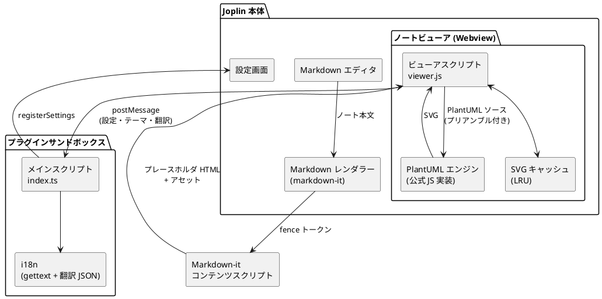
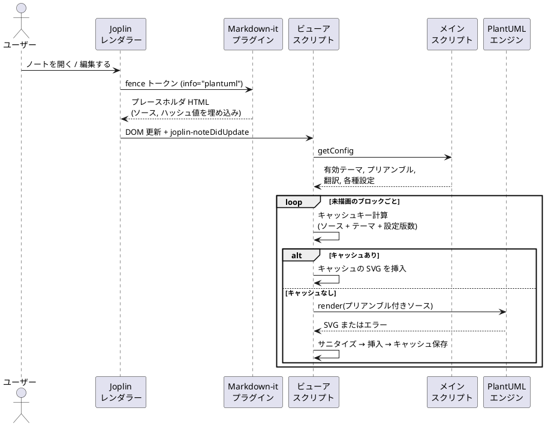
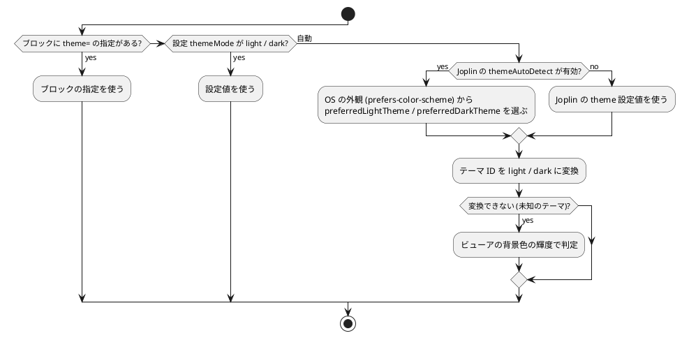

# Joplin PlantUML プラグイン 設計書

| 項目     | 内容                                                                                                                                |
| -------- | ----------------------------------------------------------------------------------------------------------------------------------- |
| 文書種別 | 基本設計書（初版ドラフト）                                                                                                          |
| 対象     | Joplin プラグイン「PlantUML」（仮称。リポジトリ: `joplin-plugin-PlantUML-2`）                                                       |
| 版       | 0.1                                                                                                                                 |
| 作成日   | 2026-11-18                                                                                                                          |
| 状態     | レビュー待ち。「要検証」と記した事項は、実装前のスパイク（技術検証）で確定させる（17章）。オーナーが決定すべき事項は 19章にまとめる |

---

## 1. 概要

### 1.1 目的

Joplin のノート（Markdown）に書かれた PlantUML のコードブロックを、Joplin 本体のノートビューア上で図（SVG）として表示するプラグインを提供する。

Joplin 本体は Mermaid をサポートしており、` ```mermaid ` と書くだけで図が表示される。本プラグインは **「インストールするだけで、Mermaid と同等の使い勝手で PlantUML が使える」** ことを目標とする。

### 1.2 設計方針

1. **ゼロ設定で動く**: インストール直後から、追加のソフトウェア（Java、Graphviz、PlantUML サーバー）や設定なしで描画できる。
2. **オフライン・外部送信なし**: PlantUML の処理は、PlantUML 公式の JavaScript 実装を同梱してローカルで実行する。ノートの内容を外部に送らない。
3. **Joplin の流儀に従う**: Markdown-it コンテンツスクリプト、`joplin-editable` 構造、設定 API、テーマなど、Joplin 本体および Mermaid 実装と同じ仕組み・見た目に揃える。
4. **最初から国際化**: UI 文字列はすべて gettext（`gettext()` 関数）と PO ファイルで管理する。
5. **テーマ追従**: Joplin のテーマ（Light / Dark）に合わせて図のスタイルを自動で切り替える。手動で固定することもできる。

### 1.3 スコープ

| 区分         | 内容                                                                                                                                        |
| ------------ | ------------------------------------------------------------------------------------------------------------------------------------------- |
| 対象（v1.0） | ノートビューアでの描画、Light/Dark スタイル、設定画面、i18n、エラー表示、図のコピー・保存、デスクトップ版（Windows / macOS / Linux）        |
| 対象（v1.x） | モバイル版（Android / iOS）対応、エクスポート（HTML / PDF / 印刷）での描画、ブロック挿入コマンド                                            |
| 対象外       | PlantUML サーバーとの連携、Java 版 PlantUML の呼び出し、エディタ（CodeMirror）上の構文ハイライト・補完、リッチテキストエディタ上での編集 UI |

---

## 2. 用語

| 用語                             | 説明                                                                                             |
| -------------------------------- | ------------------------------------------------------------------------------------------------ |
| メインスクリプト                 | Joplin のプラグインサンドボックスで動く `index.ts`。設定・コマンド・メッセージ処理を担当する     |
| Markdown-it コンテンツスクリプト | Joplin の Markdown レンダラーに組み込まれる Markdown-it プラグイン。Markdown → HTML 変換時に動く |
| ビューア                         | ノートを表示する Webview。コンテンツスクリプトが登録したアセット（JS / CSS）が読み込まれる       |
| ビューアスクリプト               | アセットとしてビューアに読み込まれる JS。PlantUML エンジンを呼び出して SVG を挿入する            |
| PlantUML エンジン                | PlantUML 公式の JavaScript 実装（後述）。PlantUML ソースから SVG を生成する                      |
| プリアンブル                     | テーマ用に PlantUML ソースの先頭へ自動挿入する `skinparam` / `<style>` / `!theme` 記述           |
| 有効テーマ                       | 設定と Joplin のテーマから最終的に決まる `light` または `dark`                                   |

---

## 3. 要求事項との対応

| #   | 要求事項                                                         | 設計上の対応                                                                                                | 参照             |
| --- | ---------------------------------------------------------------- | ----------------------------------------------------------------------------------------------------------- | ---------------- |
| R1  | Markdown 内の PlantUML コードを画像として Joplin 本体で表示する  | Markdown-it コンテンツスクリプトでフェンスを検出し、ビューアで SVG に描画する                               | 5章, 6章, 7章    |
| R2  | Mermaid と同等の使い勝手                                         | 同じフェンス記法、自動描画、テーマ追従、エラー表示、コピー・保存ボタン、`joplin-editable` 構造を採用する    | 6章, 11章, 付録A |
| R3  | 外部サーバーを使わず、PlantUML 公式の JavaScript 実装を使う      | エンジンをプラグインに同梱し、ビューア内でローカル実行する。`!include` などのネットワークアクセスを遮断する | 4.2節, 12章      |
| R4  | `gettext()` と PO ファイルによる i18n。CJK と主要言語に対応      | 英語を原文とし、PO → JSON をビルド時に変換して同梱する。Joplin のロケールから言語を決める                   | 10章             |
| R5  | Light/Dark スタイル。Joplin のテーマに自動追従、または設定で選択 | 「自動 / Light / Dark」の3モードと、テーマごとのプリセットを設定画面で選べるようにする                      | 8章, 9章         |

---

## 4. 前提となる技術要素

### 4.1 Joplin プラグインの仕組み

本プラグインで使う Joplin プラグイン API は以下のとおり。

| API                                                                            | 用途                                                                                       |
| ------------------------------------------------------------------------------ | ------------------------------------------------------------------------------------------ |
| `joplin.contentScripts.register(ContentScriptType.MarkdownItPlugin, id, path)` | Markdown-it プラグインとアセットの登録                                                     |
| `joplin.contentScripts.onMessage(id, handler)`                                 | ビューアスクリプトからの問い合わせ（設定・翻訳の取得など）に応答する                       |
| `webviewApi.postMessage(id, message)`（ビューア側）                            | メインスクリプトへの問い合わせ。応答は Promise で返る                                      |
| `joplin.settings.registerSection` / `registerSettings`                         | 設定画面の作成                                                                             |
| `joplin.settings.value` / `globalValue` / `onChange`                           | 設定値、Joplin 本体のテーマ（`theme`、`themeAutoDetect` など）とロケール（`locale`）の取得 |
| `joplin.commands.register` / `joplin.views.menuItems.create`                   | ブロック挿入コマンド（v1.x）                                                               |
| ビューアのイベント `joplin-noteDidUpdate`                                      | ノート本文の再描画後に、ビューアスクリプトの処理を開始する合図                             |

最低対応バージョン（`app_min_version`）は **Joplin 3.0** とする（モバイル版のプラグイン対応と Markdown-it コンテンツスクリプトの安定性を考慮）。最終値はスパイクで確定する（要検証 V-07）。

### 4.2 PlantUML 公式 JavaScript 実装

PlantUML プロジェクトは、Java 版をブラウザで動かすための公式 JavaScript 版を公開している（TeaVM による JS 変換版と、CheerpJ による JVM 実行版が知られている）。本プラグインでは次の基準で採用するビルドを選ぶ。

| 基準                 | 必須/推奨 | 説明                                                                                                                                                                        |
| -------------------- | --------- | --------------------------------------------------------------------------------------------------------------------------------------------------------------------------- |
| 完全オフラインで動く | 必須      | 実行時に CDN などからランタイムを取得しないこと。CheerpJ 版は既定でランタイムを CDN から読むため、同梱できない場合は不採用                                                  |
| ライセンス           | 必須      | プラグインとして再配布できること（PlantUML 本体は GPL / LGPL / MIT など複数ライセンスで配布されている。採用ビルドのライセンスを確認し、本プラグインのライセンスを合わせる） |
| SVG 出力             | 必須      | テーマ追従と拡大縮小のため、SVG を出力できること                                                                                                                            |
| Graphviz 不要        | 必須      | クラス図・ユースケース図などのレイアウトに外部の `dot` を使わないこと。PlantUML 内蔵の Smetana レイアウト、または同梱できる WASM 版 Graphviz を使う                         |
| サイズ・起動時間     | 推奨      | モバイルでも実用的に読み込めること                                                                                                                                          |
| 非同期 API           | 推奨      | UI を止めないよう、Promise を返すか Web Worker で動かせること                                                                                                               |

**採用方針**: TeaVM 版（単体の JS / WASM として同梱できるもの）を第一候補とする。エンジンは差し替えられるよう、7.6節の `RenderEngine` インターフェースで包む。採用ビルドとそのバージョンはスパイクで確定する（要検証 V-01〜V-04）。

---

## 5. アーキテクチャ

### 5.1 構成

描画処理は Joplin の Mermaid 実装と同じく **ビューア内で実行する**。Markdown-it プラグインはプレースホルダ HTML を出力するだけにして、重いエンジン処理はビューアスクリプトが非同期で行う。

理由:

- Markdown-it の変換処理は同期処理なので、重いエンジンを動かすと入力中の再描画が遅くなる。
- ビューアの Webview はノートを切り替えても再利用されるため、エンジンの読み込みとキャッシュを一度で済ませられる。
- メインスクリプトから SVG を送る方式に比べ、大きなデータのプロセス間転送がない。



### 5.2 描画シーケンス



### 5.3 モジュール一覧

| モジュール                              | 実行場所       | 責務                                                         |
| --------------------------------------- | -------------- | ------------------------------------------------------------ |
| `src/index.ts`                          | サンドボックス | 起動処理、設定登録、コンテンツスクリプト登録、メッセージ応答 |
| `src/settings.ts`                       | サンドボックス | 設定項目の定義、既定値、値の取得                             |
| `src/theme.ts`                          | サンドボックス | Joplin のテーマ ID → `light` / `dark` の判定                 |
| `src/i18n/`                             | 両方           | gettext 実装、ロケール解決、翻訳カタログ                     |
| `src/contentScript/markdownItPlugin.ts` | レンダラー     | fence の検出と HTML 出力、アセット宣言                       |
| `src/contentScript/viewer.ts`           | ビューア       | 描画の制御、キャッシュ、ツールバー、エラー表示               |
| `src/contentScript/engine.ts`           | ビューア       | PlantUML エンジンの読み込みと呼び出し（`RenderEngine`）      |
| `src/contentScript/preamble.ts`         | ビューア       | プリアンブルの挿入と行番号の補正                             |
| `src/contentScript/sanitize.ts`         | ビューア       | SVG のサニタイズ                                             |
| `src/presets/`                          | 両方           | 同梱スタイルプリセット（`joplin-light` / `joplin-dark`）     |

---

## 6. 記法の仕様

### 6.1 対象とするコードブロック

Mermaid と同じく、フェンス付きコードブロックの言語名で判定する。

````markdown
```plantuml
Alice -> Bob : Hello
Bob --> Alice : Hi
```
````

| 項目                       | 仕様                                                                                                                                       |
| -------------------------- | ------------------------------------------------------------------------------------------------------------------------------------------ |
| 言語名                     | `plantuml`（既定）と `puml`。大文字・小文字は区別しない。設定で別名を追加できる                                                            |
| `@startuml` / `@enduml`    | 省略できる。省略時は自動で補う                                                                                                             |
| その他の開始タグ           | `@startmindmap`、`@startgantt`、`@startjson`、`@startyaml`、`@startwbs`、`@startsalt` など、PlantUML が対応する `@startXXX` はそのまま渡す |
| 1ブロック内の複数図        | v1.0 では最初の図だけ描画し、残りは無視したうえで警告を表示する                                                                            |
| インデント・`~~~` フェンス | Markdown-it の標準どおり対応する                                                                                                           |

### 6.2 ブロック単位のオプション

言語名の後ろにオプションを書けるようにする（Markdown-it の info 文字列を利用）。書かなければ設定画面の値が使われる。

````markdown
```plantuml theme=none
...
```
````

| オプション | 値                                 | 説明                                                                |
| ---------- | ---------------------------------- | ------------------------------------------------------------------- |
| `theme`    | `auto` / `light` / `dark` / `none` | このブロックだけテーマを指定する。`none` はプリアンブルを挿入しない |
| `align`    | `left` / `center` / `right`        | 図の配置（既定は `center`）                                         |

Joplin 本体の Markdown エディタや他の Markdown ツールとの互換性を保つため、オプションは任意とし、不明なオプションは無視する。

---

## 7. 描画処理の詳細

### 7.1 Markdown-it プラグインの出力

`markdownIt.renderer.rules.fence` を上書きし、対象の言語名なら以下の HTML を出力する。それ以外は元のルールに処理を任せる。

```html
<div class="joplin-editable joplin-plantuml" data-plantuml-key="{sha1}" data-plantuml-opts="{json}">
  <pre class="joplin-source"
       data-joplin-language="plantuml"
       data-joplin-source-open="```plantuml&#10;"
       data-joplin-source-close="&#10;```">{エスケープ済みソース}</pre>
  <div class="joplin-plantuml-output" aria-busy="true">
    <span class="joplin-plantuml-status">{描画中…}</span>
  </div>
</div>
```

- `joplin-editable` と `pre.joplin-source` は、Joplin 本体が数式や Mermaid で使っている構造。リッチテキストエディタとの往復でソースが失われないようにするため、これに従う。
- `pre.joplin-source` は CSS で非表示にする。
- `data-plantuml-key` はソースのハッシュ値。ビューア側で、同じ図の再描画を避けるために使う。
- 「描画中…」の文字列は、Markdown-it プラグインが翻訳を持たないため、ビューアスクリプトが翻訳済みの文字列に置き換える（初期表示は記号のみのスピナーとする）。

アセットとして `viewer.js`、`plantuml.css`、エンジン本体のファイルを宣言する。エンジンは容量が大きいため、`viewer.js` が **ページ内に PlantUML ブロックがあるときだけ** 動的に読み込む（7.5節）。

### 7.2 ビューアスクリプトの処理の流れ

1. `joplin-noteDidUpdate` イベント（補助として `MutationObserver`）で起動する。
2. メインスクリプトに `getConfig` を問い合わせる。応答は設定の版数つきで短時間キャッシュする。
3. 未処理の `.joplin-plantuml` 要素を集める。
4. 各要素について、キャッシュキー `hash(ソース + 有効テーマ + プリアンブル + 設定版数 + エンジン版数)` を計算する。
5. キャッシュがあれば SVG をすぐに挿入する。なければエンジンの描画キューに入れる。
6. 描画結果をサニタイズして挿入し、キャッシュに保存する。
7. ツールバー（11章）を取り付ける。

### 7.3 ちらつき対策（編集中の再描画）

Joplin は入力のたびにノートを再描画するため、Mermaid と同等以上に滑らかに見せる工夫をする。

| 対策           | 内容                                                                                                                |
| -------------- | ------------------------------------------------------------------------------------------------------------------- |
| SVG キャッシュ | ビューア内に LRU キャッシュ（既定 100 件）を持つ。変更のないブロックは即座に表示される                              |
| 直前の図を残す | 同じ位置のブロックが編集中の場合、新しい図ができるまで直前の SVG を半透明で表示し続ける（高さが急に変わるのを防ぐ） |
| デバウンス     | 描画開始を 300ms 遅らせ、入力が続いている間は最新のソースだけ描画する                                               |
| 直列キュー     | エンジン呼び出しは1件ずつ行い、古い要求は破棄する                                                                   |
| タイムアウト   | 1図あたりの描画時間に上限（既定 10 秒）を設け、超えたらエラー表示にする                                             |

### 7.4 エラー表示

- エンジンが構文エラーを返したら、Mermaid と同様に図の位置へエラーボックスを表示する（エラーメッセージ、行番号、該当行の抜粋）。
- プリアンブルを挿入した分だけ行番号がずれるため、`preamble.ts` が挿入行数を記録して元の行番号に補正する。
- PlantUML 自体がエラー画像（SVG）を返す場合は、その画像を表示しつつ、上に翻訳済みの見出し「PlantUML の構文エラー」を付ける。
- エンジンの読み込み失敗など、プラグイン側の問題は別の文言で表示し、詳細を開発者ツールのコンソールに出力する。

### 7.5 エンジンの読み込み

- `viewer.js` は最初の PlantUML ブロックを見つけたときに、エンジンを動的に読み込む（遅延読み込み）。
- 可能なら Web Worker でエンジンを動かし、ビューアの UI を止めないようにする。Joplin のビューアでアセットの URL から Worker を作れない場合は、Blob URL 経由で作成し、それも不可ならメインスレッドで動かす（要検証 V-05）。
- 読み込み中は「PlantUML エンジンを読み込み中…」と表示する。

### 7.6 エンジン抽象化インターフェース

エンジンの差し替え（ビルドの変更・更新）に備えて、次のインターフェースで包む。

```ts
interface RenderEngine {
  readonly name: string;      // 例: "plantuml-teavm"
  readonly version: string;   // PlantUML のバージョン。キャッシュキーに含める
  init(): Promise<void>;
  renderSvg(source: string, opts: RenderOptions): Promise<RenderResult>;
}

interface RenderOptions {
  timeoutMs: number;
}

type RenderResult =
  | { ok: true; svg: string }
  | { ok: false; message: string; line?: number; svg?: string };
```

---

## 8. テーマとスタイル

### 8.1 PlantUML 側のスタイル手段

PlantUML は次の手段で見た目を変えられる。本プラグインはこれらをプリアンブルとして挿入する。

| 手段               | 例                                      | 用途                                                                       |
| ------------------ | --------------------------------------- | -------------------------------------------------------------------------- |
| `skinparam`        | `skinparam backgroundColor transparent` | 個別の色・フォント指定                                                     |
| `<style>` ブロック | CSS 風の記述                            | 新しいスタイル指定方式。図の種類ごとの指定に向く                           |
| `!theme`           | `!theme cyborg`                         | PlantUML 内蔵テーマ。採用ビルドに含まれているものだけ使える（要検証 V-06） |

### 8.2 テーマモード

設定 `themeMode` で次の3つから選ぶ。

| モード       | 動作                                                |
| ------------ | --------------------------------------------------- |
| 自動（既定） | Joplin のテーマに合わせて `light` / `dark` を決める |
| Light        | 常に Light 用プリセットを使う                       |
| Dark         | 常に Dark 用プリセットを使う                        |

### 8.3 有効テーマの決定



Joplin 本体のテーマ ID と判定結果の対応（`src/theme.ts` に表で持つ）:

| Joplin のテーマ                                             | 判定                                                   |
| ----------------------------------------------------------- | ------------------------------------------------------ |
| Light、Solarized Light                                      | `light`                                                |
| Dark、Solarized Dark、Dracula、Nord、Aritim Dark、OLED Dark | `dark`                                                 |
| 上記以外（将来追加されたテーマ）                            | ビューアの背景色の輝度（相対輝度 0.5 未満なら `dark`） |

テーマを切り替えると Joplin はノートを再描画するので、ビューアスクリプトは `joplin-noteDidUpdate` のたびに有効テーマを確認する。テーマが変わっていればキャッシュキーが変わるため、自動的に描き直される。

### 8.4 同梱プリセット

| プリセット ID      | 対象          | 内容                                                                                        |
| ------------------ | ------------- | ------------------------------------------------------------------------------------------- |
| `plantuml-default` | Light / Dark  | 何も挿入しない（PlantUML 標準の見た目）                                                     |
| `joplin-light`     | Light（既定） | 背景透明、Joplin の Light テーマに合う文字色・線色・塗り色                                  |
| `joplin-dark`      | Dark（既定）  | 背景透明、明るい文字色・線色、暗めの塗り色。PlantUML 標準の黄色系の塗りを暗い色に置き換える |
| `builtin:<name>`   | Light / Dark  | PlantUML 内蔵テーマ（`!theme <name>`）。採用ビルドに含まれるものだけを選択肢に出す          |
| `custom`           | Light / Dark  | 設定画面に書いたプリアンブルをそのまま使う                                                  |

`joplin-dark` の例（値はスパイクで Joplin の配色に合わせて調整する）:

```plantuml
skinparam backgroundColor transparent
skinparam defaultFontColor #DCDCDC
skinparam ArrowColor #A0A0A0
skinparam BorderColor #8A8A8A
skinparam ClassBackgroundColor #2B2B2B
skinparam NoteBackgroundColor #3A3A2A
skinparam NoteBorderColor #8A8A6A
skinparam ParticipantBackgroundColor #2B2B2B
skinparam ActorBackgroundColor #2B2B2B
skinparam SequenceLifeLineBorderColor #707070
```

### 8.5 プリアンブルの挿入規則

- 最初の `@startXXX` 行の **直後** に挿入する。ユーザーが図の中で書いた `skinparam` / `<style>` / `!theme` は後に評価されるため、ユーザーの指定が優先される。
- 設定「背景を透明にする」が有効なら、プリセットに関係なく `skinparam backgroundColor transparent` を加える。
- 設定「フォント」が空でなければ `skinparam defaultFontName` を加える。
- `@startjson` など、`skinparam` を受け付けない図の種類では、対応する `<style>` 記述に切り替えるか、挿入しない（種類ごとの対応表はスパイクで作る）。
- 挿入した行数を記録し、エラー行番号の補正に使う（7.4節）。

### 8.6 CJK のフォント

PlantUML は文字幅を測って図の大きさを決めるため、日本語・中国語・韓国語で文字がはみ出したり詰まったりしやすい。

- 既定では、ビューアの CSS で SVG のテキストに CJK を含むフォントスタック（例: `system-ui, "Noto Sans CJK JP", "Hiragino Sans", "Yu Gothic UI", "Microsoft YaHei", "Malgun Gothic", sans-serif`）を当てる。
- エンジンが文字幅をどう測るか（Canvas で実測するか、内蔵のフォント情報を使うか）で対策が変わるため、スパイクで確認する（要検証 V-08）。
- ユーザーが設定でフォント名を指定できるようにする。

---

## 9. 設定画面

Joplin の「設定 → プラグイン」に「PlantUML」セクションを追加する。ラベルと説明文はすべて翻訳対象とする。

| キー                             | 型               | 既定値         | 詳細設定 | 説明                                                        |
| -------------------------------- | ---------------- | -------------- | -------- | ----------------------------------------------------------- |
| `plantuml.themeMode`             | 列挙             | `auto`         | いいえ   | 自動 / Light / Dark                                         |
| `plantuml.lightPreset`           | 列挙             | `joplin-light` | いいえ   | Light 時のスタイル                                          |
| `plantuml.darkPreset`            | 列挙             | `joplin-dark`  | いいえ   | Dark 時のスタイル                                           |
| `plantuml.transparentBackground` | 真偽値           | `true`         | いいえ   | 図の背景を透明にする                                        |
| `plantuml.showToolbar`           | 真偽値           | `true`         | いいえ   | 図にマウスを乗せたときにツールバーを表示する                |
| `plantuml.lightCustomPreamble`   | 文字列（複数行） | 空             | はい     | Light 用プリセットが `custom` のときに挿入する記述          |
| `plantuml.darkCustomPreamble`    | 文字列（複数行） | 空             | はい     | Dark 用プリセットが `custom` のときに挿入する記述           |
| `plantuml.fontFamily`            | 文字列           | 空             | はい     | 図のフォント名（空なら既定）                                |
| `plantuml.fenceAliases`          | 文字列           | 空             | はい     | 追加の言語名（カンマ区切り。`plantuml`、`puml` は常に有効） |
| `plantuml.renderTimeoutMs`       | 整数             | `10000`        | はい     | 1図あたりの描画時間の上限                                   |
| `plantuml.maxSourceLength`       | 整数             | `100000`       | はい     | 描画するソースの最大文字数                                  |
| `plantuml.cacheSize`             | 整数             | `100`          | はい     | ビューア内キャッシュの件数                                  |

- 列挙型は `SettingItemType.String` と `isEnum: true`、`options` で実装する。
- 複数行入力が Joplin の設定画面で使えない場合は、1行入力にして `\n` で改行を表す（要検証 V-09）。
- 設定を変えるとメインスクリプトの設定版数が上がり、次の再描画からキャッシュキーが変わる。ビューアに即時反映させる手段はスパイクで確認する（要検証 V-10）。

---

## 10. 国際化（i18n）

### 10.1 方針

- 原文は英語とし、ソースコード内では `gettext('...')`（短縮形 `_()`）で囲む。複数形は `ngettext()`、文脈の区別が必要なら `pgettext()` を使う。
- 翻訳は GNU gettext の PO ファイルで管理する。翻訳者は Poedit や Weblate などの一般的なツールで作業できる。
- 実行時は、ビルド時に PO から変換した JSON を読み込む（PO の解析処理を同梱しない）。
- Joplin 本体の翻訳関数はプラグインに公開されていないため、プラグイン内に小さな gettext 実装（または `gettext-parser` 等の軽量ライブラリ）を持つ。

### 10.2 対象言語（v1.0）

| ロケール     | 言語                     | 複数形              |
| ------------ | ------------------------ | ------------------- |
| `en`（原文） | 英語                     | 2形                 |
| `ja`         | 日本語                   | 1形                 |
| `zh_CN`      | 中国語（簡体字）         | 1形                 |
| `zh_TW`      | 中国語（繁体字）         | 1形                 |
| `ko`         | 韓国語                   | 1形                 |
| `de`         | ドイツ語                 | 2形                 |
| `fr`         | フランス語               | 2形（0 は単数扱い） |
| `es`         | スペイン語               | 2形                 |
| `pt_BR`      | ポルトガル語（ブラジル） | 2形                 |
| `it`         | イタリア語               | 2形                 |
| `ru`         | ロシア語                 | 3形                 |

言語の追加は PO ファイルを置くだけで済むようにする（ビルドスクリプトが `locales/*.po` を自動で拾う）。

### 10.3 ロケールの決定

1. `joplin.settings.globalValue('locale')` で Joplin の表示言語を取得する（例: `ja_JP`、`zh_TW`、`pt_BR`）。
2. 次の順で翻訳を探す: 完全一致（`pt_BR`）→ 言語部分のみ（`pt`）→ 対応表による読み替え（`zh_HK` → `zh_TW` など）→ 英語。
3. Joplin は言語を変えると再起動を求めるため、ロケールは起動時に1度だけ決める。

### 10.4 ビューアへの翻訳の受け渡し

ビューアスクリプトは自分でロケールを知る手段がないため、`getConfig` の応答に **ビューアで使う文字列だけの翻訳済み辞書** を入れて渡す。ビューア側の `_()` はこの辞書を引く。

### 10.5 ファイル構成と作業手順

```text
locales/
  plantuml.pot      … 抽出したテンプレート（自動生成）
  ja.po
  zh_CN.po
  ...
scripts/
  i18n-extract.js   … ソースから文字列を抽出して .pot を更新
  i18n-compile.js   … .po → src/i18n/catalog/*.json
```

| コマンド               | 内容                                                                                                                            |
| ---------------------- | ------------------------------------------------------------------------------------------------------------------------------- |
| `npm run i18n:extract` | `_()` / `gettext()` / `ngettext()` / `pgettext()` を抽出し、`plantuml.pot` を更新する。既存の PO に `msgmerge` 相当でマージする |
| `npm run i18n:compile` | PO を JSON に変換する（`npm run dist` から自動で呼ぶ）                                                                          |
| `npm run i18n:check`   | 構文エラー、未翻訳率、プレースホルダの不一致を検査する（CI で実行）                                                             |

### 10.6 文字列の書き方の規則

- 置換箇所は名前付きにする（`_('Rendering failed: {message}', { message })`）。言語によって語順が変わるため、`%s` の並びに頼らない。
- 文を分割して連結しない。文単位で翻訳する。
- 翻訳者向けの補足は `// TRANSLATORS:` コメントで書き、抽出時に PO に残す。
- PlantUML のキーワード（`skinparam`、`@startuml` など）と設定キーは翻訳しない。

---

## 11. 図の UI

Joplin の Mermaid 表示に合わせ、図にマウスを乗せたとき右上に小さなツールバーを出す。

| ボタン         | 動作                                                                                  |
| -------------- | ------------------------------------------------------------------------------------- |
| SVG をコピー   | SVG のテキストをクリップボードへコピーする                                            |
| PNG をコピー   | SVG を Canvas で PNG に変換してクリップボードへコピーする                             |
| 画像を保存     | SVG / PNG を選んでファイルに保存する（ビューアからのダウンロード。可否は要検証 V-11） |
| ソースをコピー | PlantUML のソースをコピーする                                                         |

- ボタンにはアイコンとツールチップ（翻訳済み）を付け、キーボードでも操作できるようにする（`aria-label` を付ける）。
- 図は横幅に合わせて縮小し、はみ出す場合は横スクロールにする（`max-width: 100%`）。
- PlantUML の `[[リンク]]` で作られたリンクをクリックしたとき、`:/ノートID` 形式なら Joplin のノートを開き、外部 URL なら Joplin の通常のリンク処理に任せる。

---

## 12. セキュリティ

| 脅威                                                                          | 対策                                                                                                                                               |
| ----------------------------------------------------------------------------- | -------------------------------------------------------------------------------------------------------------------------------------------------- |
| SVG に含まれるスクリプトの実行                                                | 挿入前に DOMPurify（SVG プロファイル）でサニタイズし、`<script>`、`on*` 属性、`javascript:` URL を取り除く                                         |
| `!include` / `!includeurl` / `!import` による外部・ローカルファイルの読み込み | エンジンへのファイル・ネットワークアクセス手段を与えない。URL を参照する記述はエラーとして表示する（外部サーバーを使わないという要求にも合わせる） |
| 巨大な入力や無限ループによるフリーズ                                          | 最大文字数とタイムアウトを設ける。Worker で動かしている場合はタイムアウト時に Worker を終了して作り直す                                            |
| ノート内容の外部送信                                                          | 通信を一切行わない。依存ライブラリにも通信しないものだけを使い、レビューで確認する                                                                 |

---

## 13. 性能目標

| 指標                                    | 目標（デスクトップ、一般的なノート PC）            |
| --------------------------------------- | -------------------------------------------------- |
| エンジンの初回読み込み                  | 2 秒以内                                           |
| 一般的なシーケンス図（20 行程度）の描画 | 300ms 以内                                         |
| キャッシュがある図の表示                | 16ms 以内（ちらつきなし）                          |
| PlantUML ブロックのないノートへの影響   | エンジンを読み込まないので、ほぼゼロ               |
| プラグインのパッケージサイズ            | 計測して記録する（エンジンが大部分を占める見込み） |

モバイルは目標値をスパイクで決める。

---

## 14. プラットフォームと表示箇所

| 表示箇所                                    | v1.0 | v1.x | 備考                                                                                  |
| ------------------------------------------- | ---- | ---- | ------------------------------------------------------------------------------------- |
| デスクトップのノートビューア                | ○    | ○    | 主な対象                                                                              |
| モバイルのノートビューア                    | −    | ○    | メモリと読み込み時間を確認してから対応する。`manifest.json` の `platforms` で制御する |
| HTML エクスポート / PDF エクスポート / 印刷 | −    | ○    | エクスポート時にビューアスクリプトの描画完了を待てるかを確認する（要検証 V-12）       |
| リッチテキストエディタ                      | −    | △    | `joplin-editable` によりソースは保持される。図の表示は可能な範囲で対応する            |
| Web Clipper、Joplin Server の公開ノート     | −    | −    | 対象外                                                                                |

---

## 15. プロジェクト構成とビルド

Joplin 公式のプラグインジェネレーター（`yo joplin`）の構成を基本とする。

```text
joplin-plugin-PlantUML-2/
├─ src/
│  ├─ index.ts
│  ├─ manifest.json
│  ├─ settings.ts
│  ├─ theme.ts
│  ├─ i18n/
│  │  ├─ gettext.ts
│  │  └─ catalog/        … 生成物（git 管理外）
│  ├─ presets/
│  │  ├─ joplin-light.puml
│  │  └─ joplin-dark.puml
│  └─ contentScript/
│     ├─ markdownItPlugin.ts
│     ├─ viewer.ts
│     ├─ engine.ts
│     ├─ preamble.ts
│     ├─ sanitize.ts
│     └─ plantuml.css
├─ vendor/plantuml/       … PlantUML 公式 JS 実装（バージョン固定、ライセンス同梱）
├─ locales/
├─ scripts/
├─ tests/
├─ docs/
│  └─ design.md           … 本書
├─ plugin.config.json     … extraScripts にコンテンツスクリプトを登録
├─ webpack.config.js
└─ package.json
```

`manifest.json` の主な値（仮）:

```json
{
  "manifest_version": 1,
  "id": "io.github.akiratamcat.plantuml",
  "app_min_version": "3.0",
  "name": "PlantUML",
  "description": "Render PlantUML diagrams offline, just like Mermaid.",
  "platforms": ["desktop"],
  "categories": ["viewer"],
  "keywords": ["plantuml", "diagram", "uml"]
}
```

- プラグイン ID とライセンスは、採用する PlantUML ビルドのライセンスを確認してから確定する（19章 D-01、D-02）。
- PlantUML エンジンは `vendor/` に置いてバージョンを固定し、更新手順（取得元、検証、キャッシュ版数の更新）を `docs/` に残す。

---

## 16. テスト方針

| 種別               | 対象                                                                                                                             | 方法                                                                                                                  |
| ------------------ | -------------------------------------------------------------------------------------------------------------------------------- | --------------------------------------------------------------------------------------------------------------------- |
| 単体テスト         | fence 判定、info オプション解析、プリアンブル挿入、行番号補正、テーマ判定、ロケール解決、gettext                                 | Jest                                                                                                                  |
| 描画テスト         | 代表的な図（シーケンス、クラス、ユースケース、アクティビティ、状態、コンポーネント、マインドマップ、ガント、JSON、CJK を含む図） | エンジンで SVG を生成し、エラーにならないことと主要要素の存在を確認する。見た目は Light/Dark でスナップショットを取る |
| i18n 検査          | すべての PO                                                                                                                      | `i18n:check` を CI で実行する                                                                                         |
| 手動テスト         | Windows / macOS / Linux × Light / Dark / 自動 × 日本語・英語・中国語                                                             | チェックリストで確認する。Mermaid と並べて操作感を比べる                                                              |
| セキュリティテスト | `<script>` 入り SVG、`!includeurl`、巨大入力                                                                                     | 単体テストとして固定する                                                                                              |

---

## 17. 要検証事項（スパイク一覧）

実装前に、以下を小さな試作で確認する。結果は本書に反映する。

優先度の基準:

| 優先度 | 基準                                                                                                                       |
| ------ | -------------------------------------------------------------------------------------------------------------------------- |
| 高     | 結果によってはエンジンの選定や全体構成を変える必要があるもの、または要求事項（R1〜R5）を満たせなくなるもの。最初に確認する |
| 中     | v1.0 の機能の設計に影響するが、代わりの方法があるもの                                                                      |
| 低     | 代わりの方法で v1.0 の機能が成り立つもの、または v1.x の対象のもの                                                         |

| ID   | 優先度 | 内容                                                                                  | 判断への影響                                                   |
| ---- | ------ | ------------------------------------------------------------------------------------- | -------------------------------------------------------------- |
| V-01 | 高     | 採用する PlantUML 公式 JS ビルド（TeaVM 版 / CheerpJ 版）と、その入手方法・バージョン | エンジン全体                                                   |
| V-02 | 高     | 完全オフラインで動くか（実行時の外部取得がないか）                                    | R3 の達成                                                      |
| V-03 | 高     | 採用ビルドのライセンスと再配布条件                                                    | プラグインのライセンス。再配布できなければ別のビルドを選び直す |
| V-04 | 高     | Graphviz を使う図のレイアウト手段（Smetana / WASM 版 Graphviz）と描画品質             | 対応できる図の種類（R1）                                       |
| V-08 | 高     | エンジンの文字幅の測り方と CJK の表示品質                                             | 8.6節。日本語を含む図が実用に耐えるか                          |
| V-05 | 中     | Joplin のビューアで Web Worker を作れるか                                             | 7.5節。作れなければメインスレッドで動かす                      |
| V-07 | 中     | 最低対応バージョンと、`joplin-noteDidUpdate` の挙動                                   | 4.1節。イベントが使えなければ `MutationObserver` で代用する    |
| V-11 | 中     | ビューアから画像をファイル保存できるか                                                | 11章。できなければ「画像を保存」ボタンを外し、コピーのみにする |
| V-06 | 低     | 採用ビルドに含まれる内蔵テーマ（`!theme`）の一覧                                      | 8.4節の選択肢。同梱プリセットだけでも成り立つ                  |
| V-09 | 低     | 設定画面で複数行入力が使えるか                                                        | 9章。使えなければ `\n` で改行を表す                            |
| V-10 | 低     | 設定変更をビューアへ即時反映する手段                                                  | 9章。なければ次の再描画で反映する                              |
| V-12 | 低     | HTML / PDF エクスポート時に非同期描画の完了を待てるか                                 | 14章（v1.x）                                                   |
| V-13 | 低     | モバイルでのメモリ使用量と読み込み時間                                                | 14章（v1.x）                                                   |

---

## 18. 開発計画

| 段階         | 内容                                                                         | 完了条件                                        |
| ------------ | ---------------------------------------------------------------------------- | ----------------------------------------------- |
| 0. スパイク  | 優先度「高」の項目（V-01〜V-04、V-08）を確認し、続けて V-05〜V-07 を確認する | エンジンが決まり、ビューアで1つの図が表示できる |
| 1. MVP       | fence 検出、描画、エラー表示、キャッシュ、ちらつき対策                       | デスクトップで代表的な図が表示できる            |
| 2. テーマ    | 自動判定、プリセット、プリアンブル、設定画面                                 | Light/Dark の切り替えに追従する                 |
| 3. i18n      | gettext 基盤、PO の作成と翻訳（日本語・英語から始める）                      | 設定画面とビューアの文字列が切り替わる          |
| 4. UI 仕上げ | ツールバー、リンク処理、アクセシビリティ                                     | 付録Aの v1.0 項目をすべて満たす                 |
| 5. v1.0 公開 | ドキュメント、Joplin プラグインリポジトリへの公開                            | npm 公開とプラグイン一覧への掲載                |
| 6. v1.x      | モバイル、エクスポート、ブロック挿入コマンド、翻訳言語の拡充                 | 各項目の検証完了                                |

---

## 19. オーナーが決定すべき事項

17章の要検証事項は試作で事実を確かめるものだが、本章の事項は技術的な調査だけでは決まらず、プロジェクトのオーナーが方針として決めるものである。本書の他の章には暫定案を書いてあり、決定したら該当する章を更新する。

| ID   | 決定事項                                | 主な選択肢                                                                                                                                                                          | 暫定案（本書の現在の記載）                                                                                                         | 決定の期限                                                                                            |
| ---- | --------------------------------------- | ----------------------------------------------------------------------------------------------------------------------------------------------------------------------------------- | ---------------------------------------------------------------------------------------------------------------------------------- | ----------------------------------------------------------------------------------------------------- |
| D-01 | プラグインの名前と ID、npm パッケージ名 | 名前は「PlantUML」とするか、既存の PlantUML 系プラグインと区別できる名前にするか                                                                                                    | 名前「PlantUML」、ID `io.github.akiratamcat.plantuml`（15章）。npm パッケージ名は未定（Joplin の慣例で `joplin-plugin-` で始める） | 最初の公開前。ID は公開後に変えると既存の利用者の設定が引き継がれないため、変更できないものとして扱う |
| D-02 | 本プラグインのライセンス                | MIT、GPL-3.0 など。採用する PlantUML ビルドのライセンス（V-03）と両立するものから選ぶ                                                                                               | 未定                                                                                                                               | 段階0（V-03 の確認後）                                                                                |
| D-03 | 描画品質が不十分な図の扱い              | V-04 / V-08 の結果、一部の図の種類が描けない・崩れる場合に、(a) その図を「未対応」と明記して v1.0 を出す、(b) 対応できるまで v1.0 を延ばす                                          | 未定                                                                                                                               | 段階0 の完了時                                                                                        |
| D-04 | v1.0 に含める範囲                       | モバイル版、エクスポート / 印刷を v1.0 に含めるか                                                                                                                                   | 含めず v1.x とする（1.3節、14章）                                                                                                  | 段階1 の開始前                                                                                        |
| D-05 | 最低対応の Joplin バージョン            | 古い Joplin の利用者をどこまで対象にするか                                                                                                                                          | 3.0 以上（4.1節）。V-07 の結果で上がることがある                                                                                   | 段階0 の完了時                                                                                        |
| D-06 | 翻訳の体制と、v1.0 で必須とする言語     | 翻訳を誰が作るか（作者、機械翻訳を下訳にしてネイティブ話者が確認、Weblate などの翻訳サービスで募集）。未翻訳の言語を英語で出してよいか                                              | 日本語・英語は v1.0 で必須。他の9言語の作り方は未定（10.2節）                                                                      | 段階3 の開始前                                                                                        |
| D-07 | 記法の独自拡張                          | ブロックオプション（`theme=`、`align=`）を入れるか。Mermaid にはない独自仕様のため、他の Markdown ツールでは無視される                                                              | 入れる（6.2節）                                                                                                                    | 段階1 の開始前                                                                                        |
| D-08 | 既定の見た目                            | Light 時の既定を `joplin-light` と `plantuml-default`（PlantUML 標準）のどちらにするか。背景透明を既定にするか                                                                      | `joplin-light`、背景透明（8.4節、9章）                                                                                             | 段階2 の開始前                                                                                        |
| D-09 | 他の PlantUML プラグインとの競合        | 同じ ` ```plantuml ` を処理する別のプラグインが入っている場合に、(a) README で併用しないよう案内するだけにする、(b) 検出して警告を表示する | (a) README で案内する | 段階4 の開始前 |                                                                                                                                    |                                                                                                       |
| D-10 | PlantUML エンジンの更新方針             | 新しい PlantUML への追従の頻度。更新すると図の見た目が変わることがある                                                                                                              | 未定（15章で手順のみ規定）                                                                                                         | 最初の公開前                                                                                          |
| D-11 | パッケージサイズの許容範囲              | エンジンが大きい場合に、どこまでのサイズを許すか。モバイル対応（D-04）にも影響する                                                                                                  | 未定（13章で計測のみ規定）                                                                                                         | 段階0 の完了時                                                                                        |
| D-12 | 公開先                                  | npm、Joplin 公式プラグインリポジトリ、GitHub Releases のどれに公開するか                                                                                                            | npm と Joplin 公式プラグインリポジトリ（18章）                                                                                     | 最初の公開前                                                                                          |

---

## 付録A. Mermaid との機能比較（目標）

| 機能                                 | Joplin 本体の Mermaid | 本プラグイン v1.0 | v1.x |
| ------------------------------------ | --------------------- | ----------------- | ---- |
| フェンスを書くだけで描画             | ○                     | ○                 | ○    |
| 追加ソフトウェア不要                 | ○                     | ○                 | ○    |
| オフラインで動作                     | ○                     | ○                 | ○    |
| テーマ（Light/Dark）追従             | ○                     | ○                 | ○    |
| 構文エラーの表示                     | ○                     | ○（行番号つき）   | ○    |
| 画像のコピー・保存                   | ○                     | ○                 | ○    |
| モバイル                             | ○                     | −                 | ○    |
| エクスポート / 印刷                  | ○                     | −                 | ○    |
| リッチテキストエディタでのソース保持 | ○                     | ○                 | ○    |
| UI の多言語対応                      | ○（本体の翻訳）       | ○（11 言語）      | 拡充 |
