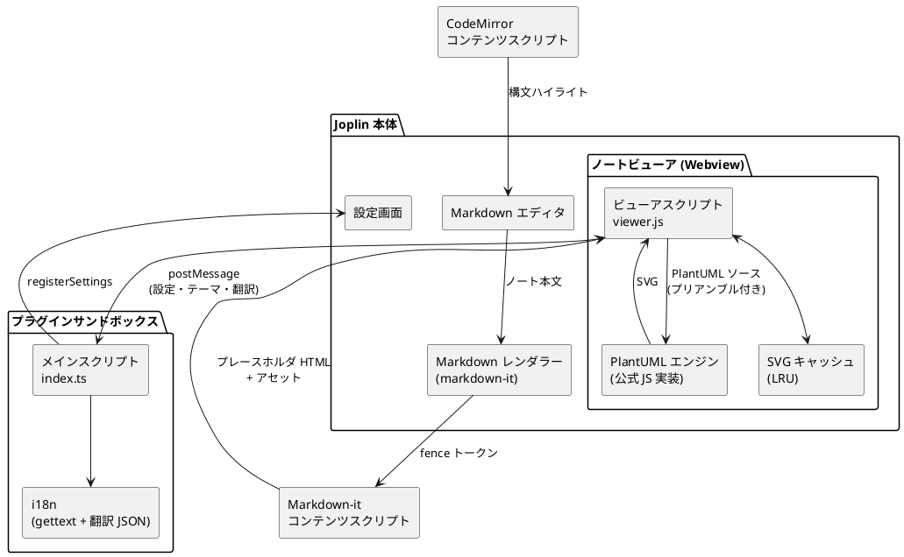
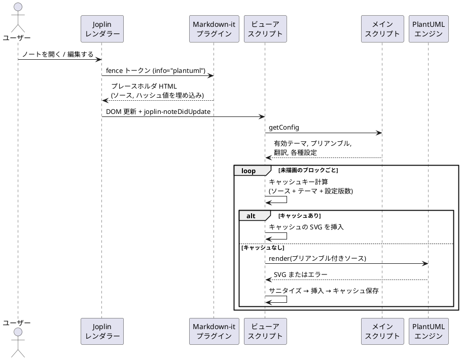

# Joplin PlantUML プラグイン 設計書

| 項目     | 内容                                                                                                                                                           |
| -------- | -------------------------------------------------------------------------------------------------------------------------------------------------------------- |
| 文書種別 | 基本設計書（初版ドラフト）                                                                                                                                     |
| 対象     | Joplin プラグイン「PlantUML」（仮称。ローカルのリポジトリ: `joplin-plugin-PlantUML-2`。GitHub での名前は npm パッケージ名と同じ小文字の名前にする。19章 D-14） |
| 版       | 0.5                                                                                                                                                            |
| 作成日   | 2026-11-18                                                                                                                                                     |
| 作成方法 | 本書は生成 AI（Anthropic の Claude）を用いて作成し、オーナーが出力を逐次確認して修正・承認している（22章）                                                     |
| 状態     | レビュー待ち。「要検証」と記した事項は、実装前のスパイク（技術検証）で確定させる（17章）。オーナーが決定すべき事項は 19章にまとめる                            |

改訂履歴:

| 版  | 日付       | 内容                                                                                                                                                                                                                               |
| --- | ---------- | ---------------------------------------------------------------------------------------------------------------------------------------------------------------------------------------------------------------------------------- |
| 0.1 | 2026-11-18 | 初版                                                                                                                                                                                                                               |
| 0.2 | 2026-11-18 | 追加要求の取り込み: テーマを設定での選択のみに変更、Markdown エディタの構文ハイライト、3文字以上のフェンス、図の最小文字サイズ、MIT ライセンスの決定、ライセンスの章（20章）の追加                                                 |
| 0.3 | 2026-11-18 | GitHub での公開・リリースと Joplin 公式プラグイン一覧への掲載に対応: リポジトリ運用とリリースの章（21章）の追加、`manifest.json` と `package.json` の公開用の項目、公開の決定（D-12）、決定事項 D-14〜D-16、要検証事項 V-16 の追加 |
| 0.4 | 2026-11-18 | 名前の大文字・小文字は各仕組みの規則に従う方針を決定（15.2節）。GitHub のリポジトリ名を npm パッケージ名と同じ小文字の名前に決定（D-14）                                                                                           |
| 0.5 | 2026-11-18 | 生成 AI（Claude）の利用を明記する方針を追加: 生成 AI の利用の章（22章）、設計方針、要求事項 R16、公開前チェックリスト                                                                                                              |

---

## 1. 概要

### 1.1 目的

Joplin のノート（Markdown）に書かれた PlantUML のコードブロックを、Joplin 本体のノートビューア上で図（SVG）として表示するプラグインを提供する。

Joplin 本体は Mermaid をサポートしており、` ```mermaid ` と書くだけで図が表示される。本プラグインは **「インストールするだけで、Mermaid と同等の使い勝手で PlantUML が使える」** ことを目標とする。

### 1.2 設計方針

1. **ゼロ設定で動く**: インストール直後から、追加のソフトウェア（Java、Graphviz、PlantUML サーバー）や設定なしで描画できる。
2. **オフライン・外部送信なし**: PlantUML の処理は、PlantUML 公式の JavaScript 実装を同梱してローカルで実行する。ノートの内容を外部に送らない。
3. **Joplin の流儀に従う**: Markdown-it コンテンツスクリプト、`joplin-editable` 構造、設定 API、テーマなど、Joplin 本体および Mermaid 実装と同じ仕組み・見た目に揃える。
4. **最初から国際化**: UI 文字列はすべて gettext（`gettext()` 関数）と PO ファイルで管理する。
5. **テーマは設定で選ぶ**: 図のスタイル（Light / Dark）は設定画面で選ぶ。Joplin のテーマへの自動追従は行わない。
6. **MIT ライセンスで、エンジンを内蔵して配布する**: 本プラグインは MIT ライセンスとし、PlantUML の JavaScript 実装をプラグインに内蔵した状態で配布する（20章）。
7. **公開を前提に作る**: ソースは GitHub で公開し、GitHub Releases と npm でリリースして、Joplin 公式プラグイン一覧に掲載する（21章）。リポジトリの構成、ドキュメント、ビルドは、第三者が読んで再現できる状態を保つ。
8. **生成 AI の利用を明記する**: 本プラグインは生成 AI（Anthropic の Claude）を全面的に用いて開発する。オーナーが出力を逐次確認して管理していることと合わせて、その事実を README などに明記する（22章）。

### 1.3 スコープ

| 区分         | 内容                                                                                                                                                                                                                                                                                                                          |
| ------------ | ----------------------------------------------------------------------------------------------------------------------------------------------------------------------------------------------------------------------------------------------------------------------------------------------------------------------------- |
| 対象（v1.0） | ノートビューアでの描画、Light/Dark スタイル（設定で選択）、図の最小文字サイズの保証、Markdown エディタ（CodeMirror）での PlantUML の構文ハイライト、設定画面、i18n、エラー表示、図のコピー・保存、デスクトップ版（Windows / macOS / Linux）、GitHub でのソース公開とリリース、npm への公開、Joplin 公式プラグイン一覧への掲載 |
| 対象（v1.x） | モバイル版（Android / iOS）対応、エクスポート（HTML / PDF / 印刷）での描画、ブロック挿入コマンド                                                                                                                                                                                                                              |
| 対象外       | PlantUML サーバーとの連携、Java 版 PlantUML の呼び出し、PlantUML コードの補完、リッチテキストエディタ上での PlantUML の編集、Joplin のテーマへの自動追従                                                                                                                                                                      |

---

## 2. 用語

| 用語                             | 説明                                                                                             |
| -------------------------------- | ------------------------------------------------------------------------------------------------ |
| メインスクリプト                 | Joplin のプラグインサンドボックスで動く `index.ts`。設定・コマンド・メッセージ処理を担当する     |
| Markdown-it コンテンツスクリプト | Joplin の Markdown レンダラーに組み込まれる Markdown-it プラグイン。Markdown → HTML 変換時に動く |
| ビューア                         | ノートを表示する Webview。コンテンツスクリプトが登録したアセット（JS / CSS）が読み込まれる       |
| ビューアスクリプト               | アセットとしてビューアに読み込まれる JS。PlantUML エンジンを呼び出して SVG を挿入する            |
| PlantUML エンジン                | PlantUML 公式の JavaScript 実装（後述）。PlantUML ソースから SVG を生成する                      |
| プリアンブル                     | テーマ用に PlantUML ソースの先頭へ自動挿入する `skinparam` / `<style>` / `!theme` 記述           |
| 有効テーマ                       | 設定とブロック単位の指定から最終的に決まる `light` または `dark`                                 |
| CodeMirror コンテンツスクリプト  | Joplin の Markdown エディタ（CodeMirror 6）に組み込む拡張。PlantUML の構文ハイライトを担当する   |

---

## 3. 要求事項との対応

| #   | 要求事項                                                                                                  | 設計上の対応                                                                                                    | 参照                 |
| --- | --------------------------------------------------------------------------------------------------------- | --------------------------------------------------------------------------------------------------------------- | -------------------- |
| R1  | Markdown 内の PlantUML コードを画像として Joplin 本体で表示する                                           | Markdown-it コンテンツスクリプトでフェンスを検出し、ビューアで SVG に描画する                                   | 5章, 6章, 7章        |
| R2  | Mermaid と同等の使い勝手                                                                                  | 同じフェンス記法、自動描画、エラー表示、コピー・保存ボタン、`joplin-editable` 構造を採用する                    | 6章, 11章, 付録A     |
| R3  | 外部サーバーを使わず、PlantUML 公式の JavaScript 実装を使う                                               | エンジンをプラグインに同梱し、ビューア内でローカル実行する。`!include` などのネットワークアクセスを遮断する     | 4.2節, 12章          |
| R4  | `gettext()` と PO ファイルによる i18n。CJK と主要言語に対応                                               | 英語を原文とし、PO → JSON をビルド時に変換して同梱する。Joplin のロケールから言語を決める                       | 10章                 |
| R5  | Light/Dark スタイル。設定画面で選択する（自動追従はしない。0.2 で変更）                                   | 「Light / Dark」の選択と、テーマごとのプリセットを設定画面で選べるようにする                                    | 8章, 9章             |
| R6  | コード表示の時は構文ハイライトを行う                                                                      | CodeMirror コンテンツスクリプトで、Markdown エディタ内の PlantUML コードブロックを色分けする                    | 7.7節                |
| R7  | PlantUML コードの補完は行わない                                                                           | 対象外とする                                                                                                    | 1.3節                |
| R8  | リッチテキストエディタでの編集は行わない                                                                  | 対象外とする。`joplin-editable` 構造によりソースの保持だけ行う                                                  | 1.3節, 14章          |
| R9  | 3文字以上のコードフェンス（` ```` ` など）にも対応する                                                    | CommonMark の規則どおり3文字以上のフェンスを受け付け、実際のフェンス文字列を保持する                            | 6.1節, 7.1節         |
| R10 | 図の文字が読めないほど小さくならないようにする                                                            | 基本文字サイズをビューアの本文に合わせ、縮小表示しても最小文字サイズを下回らないようにする                      | 8.7節                |
| R11 | MIT ライセンスとする                                                                                      | 本プラグインのコードを MIT ライセンスで公開する                                                                 | 20章                 |
| R12 | PlantUML の JavaScript コードを内蔵した状態で配布する                                                     | エンジンを配布パッケージ（`.jpl`）に含め、実行時のダウンロードを行わない                                        | 15.1節, 20章         |
| R13 | プラグインのコードと外部コードのライセンスを設計書に記載する                                              | ライセンスの章を設ける                                                                                          | 20章                 |
| R14 | GitHub のオーナーのアカウントへ push し、リリースを行う                                                   | 公開リポジトリの構成、ブランチとバージョンの規則、CI、GitHub Releases でのリリース手順を定める                  | 21.1〜21.4節         |
| R15 | Joplin 公式プラグイン一覧に掲載する                                                                       | 一覧の掲載条件（npm パッケージ名・キーワード・`.jpl`・manifest の項目）を満たし、公開前チェックリストで確認する | 15章, 21.5節, 21.6節 |
| R16 | 生成 AI（Claude）を全面的に用いていることを明記する。オーナーが出力を逐次確認・管理していることも記載する | README、本書、CONTRIBUTING、コミットに記載する場所と文面を定める                                                | 22章                 |

---

## 4. 前提となる技術要素

### 4.1 Joplin プラグインの仕組み

本プラグインで使う Joplin プラグイン API は以下のとおり。

| API                                                                            | 用途                                                                 |
| ------------------------------------------------------------------------------ | -------------------------------------------------------------------- |
| `joplin.contentScripts.register(ContentScriptType.MarkdownItPlugin, id, path)` | Markdown-it プラグインとアセットの登録                               |
| `joplin.contentScripts.register(ContentScriptType.CodeMirrorPlugin, id, path)` | Markdown エディタへの構文ハイライト拡張の登録                        |
| `joplin.contentScripts.onMessage(id, handler)`                                 | ビューアスクリプトからの問い合わせ（設定・翻訳の取得など）に応答する |
| `webviewApi.postMessage(id, message)`（ビューア側）                            | メインスクリプトへの問い合わせ。応答は Promise で返る                |
| `joplin.settings.registerSection` / `registerSettings`                         | 設定画面の作成                                                       |
| `joplin.settings.value` / `globalValue` / `onChange`                           | 設定値と Joplin 本体のロケール（`locale`）の取得                     |
| `joplin.commands.register` / `joplin.views.menuItems.create`                   | ブロック挿入コマンド（v1.x）                                         |
| ビューアのイベント `joplin-noteDidUpdate`                                      | ノート本文の再描画後に、ビューアスクリプトの処理を開始する合図       |

最低対応バージョン（`app_min_version`）は **Joplin 3.0** とする（モバイル版のプラグイン対応と Markdown-it コンテンツスクリプトの安定性を考慮）。最終値はスパイクで確定する（要検証 V-07）。

### 4.2 PlantUML 公式 JavaScript 実装

PlantUML プロジェクトは、Java 版をブラウザで動かすための公式 JavaScript 版を公開している（TeaVM による JS 変換版と、CheerpJ による JVM 実行版が知られている）。本プラグインでは次の基準で採用するビルドを選ぶ。

| 基準                 | 必須/推奨 | 説明                                                                                                                                                                                                                        |
| -------------------- | --------- | --------------------------------------------------------------------------------------------------------------------------------------------------------------------------------------------------------------------------- |
| 完全オフラインで動く | 必須      | 実行時に CDN などからランタイムを取得しないこと。CheerpJ 版は既定でランタイムを CDN から読むため、同梱できない場合は不採用                                                                                                  |
| ライセンス           | 必須      | MIT ライセンスの本プラグインに内蔵して再配布できること。PlantUML 本体は GPL のほか、LGPL / Apache-2.0 / EPL / MIT などのライセンスでも配布されている（ライセンスによって含まれる機能が異なる場合がある）。採用基準は 20.3節 |
| SVG 出力             | 必須      | テーマの適用、拡大縮小、文字サイズの調整のため、SVG を出力できること                                                                                                                                                        |
| Graphviz 不要        | 必須      | クラス図・ユースケース図などのレイアウトに外部の `dot` を使わないこと。PlantUML 内蔵の Smetana レイアウト、または同梱できる WASM 版 Graphviz を使う                                                                         |
| サイズ・起動時間     | 推奨      | モバイルでも実用的に読み込めること                                                                                                                                                                                          |
| 非同期 API           | 推奨      | UI を止めないよう、Promise を返すか Web Worker で動かせること                                                                                                                                                               |

**採用方針**: TeaVM 版（単体の JS / WASM として同梱できるもの）を第一候補とする。エンジンは差し替えられるよう、7.6節の `RenderEngine` インターフェースで包む。採用ビルドとそのバージョンはスパイクで確定する（要検証 V-01〜V-04）。

---

## 5. アーキテクチャ

### 5.1 構成

描画処理は Joplin の Mermaid 実装と同じく **ビューア内で実行する**。Markdown-it プラグインはプレースホルダ HTML を出力するだけにして、重いエンジン処理はビューアスクリプトが非同期で行う。

理由:

- Markdown-it の変換処理は同期処理なので、重いエンジンを動かすと入力中の再描画が遅くなる。
- ビューアの Webview はノートを切り替えても再利用されるため、エンジンの読み込みとキャッシュを一度で済ませられる。
- メインスクリプトから SVG を送る方式に比べ、大きなデータのプロセス間転送がない。



### 5.2 描画シーケンス



### 5.3 モジュール一覧

| モジュール                              | 実行場所           | 責務                                                            |
| --------------------------------------- | ------------------ | --------------------------------------------------------------- |
| `src/index.ts`                          | サンドボックス     | 起動処理、設定登録、コンテンツスクリプト登録、メッセージ応答    |
| `src/settings.ts`                       | サンドボックス     | 設定項目の定義、既定値、値の取得                                |
| `src/i18n/`                             | 両方               | gettext 実装、ロケール解決、翻訳カタログ                        |
| `src/contentScript/markdownItPlugin.ts` | レンダラー         | fence の検出と HTML 出力、アセット宣言                          |
| `src/contentScript/viewer.ts`           | ビューア           | 描画の制御、キャッシュ、ツールバー、エラー表示                  |
| `src/contentScript/engine.ts`           | ビューア           | PlantUML エンジンの読み込みと呼び出し（`RenderEngine`）         |
| `src/contentScript/preamble.ts`         | ビューア           | プリアンブルの挿入と行番号の補正                                |
| `src/contentScript/sanitize.ts`         | ビューア           | SVG のサニタイズ                                                |
| `src/contentScript/fontSize.ts`         | ビューア           | 基本文字サイズの決定と、最小文字サイズを守る表示倍率の計算      |
| `src/contentScript/codeMirrorPlugin.ts` | エディタ           | Markdown エディタでの PlantUML の構文ハイライト                 |
| `src/shared/tokenizer.ts`               | エディタ・ビューア | PlantUML の字句解析（ハイライト用。エディタとエラー表示で共用） |
| `src/shared/fence.ts`                   | 両方               | フェンスの判定（言語名、3文字以上のフェンス、info オプション）  |
| `src/presets/`                          | 両方               | 同梱スタイルプリセット（`joplin-light` / `joplin-dark`）        |

---

## 6. 記法の仕様

### 6.1 対象とするコードブロック

Mermaid と同じく、フェンス付きコードブロックの言語名で判定する。

````markdown
```plantuml
Alice -> Bob : Hello
Bob --> Alice : Hi
```
````

| 項目                    | 仕様                                                                                                                                                                                                                                                              |
| ----------------------- | ----------------------------------------------------------------------------------------------------------------------------------------------------------------------------------------------------------------------------------------------------------------- |
| 言語名                  | `plantuml`（既定）と `puml`。大文字・小文字は区別しない。設定で別名を追加できる                                                                                                                                                                                   |
| `@startuml` / `@enduml` | 省略できる。省略時は自動で補う                                                                                                                                                                                                                                    |
| その他の開始タグ        | `@startmindmap`、`@startgantt`、`@startjson`、`@startyaml`、`@startwbs`、`@startsalt` など、PlantUML が対応する `@startXXX` はそのまま渡す                                                                                                                        |
| 1ブロック内の複数図     | v1.0 では最初の図だけ描画し、残りは無視したうえで警告を表示する                                                                                                                                                                                                   |
| フェンスの長さ          | バッククォート（`` ` ``）またはチルダ（`~`）の **3文字以上**。` ```` `（4文字）や `~~~~~` なども受け付ける。閉じフェンスは開きフェンスと同じ文字で、同じ長さ以上とする（CommonMark の規則）。ソース内に ` ``` ` を含めたい場合は、4文字以上のフェンスで囲めばよい |
| インデント              | Markdown-it の標準どおり対応する（最大3文字のインデント）                                                                                                                                                                                                         |

4文字のフェンスの例:

`````markdown
````plantuml
note right
  ```
  ここに ``` を書いても閉じフェンスにならない
  ```
end note
````
`````

### 6.2 ブロック単位のオプション

言語名の後ろにオプションを書けるようにする（Markdown-it の info 文字列を利用）。書かなければ設定画面の値が使われる。

````markdown
```plantuml theme=none
...
```
````

| オプション | 値                          | 説明                                                                |
| ---------- | --------------------------- | ------------------------------------------------------------------- |
| `theme`    | `light` / `dark` / `none`   | このブロックだけテーマを指定する。`none` はプリアンブルを挿入しない |
| `align`    | `left` / `center` / `right` | 図の配置（既定は `center`）                                         |

Joplin 本体の Markdown エディタや他の Markdown ツールとの互換性を保つため、オプションは任意とし、不明なオプションは無視する。

---

## 7. 描画処理の詳細

### 7.1 Markdown-it プラグインの出力

`markdownIt.renderer.rules.fence` を上書きし、対象の言語名なら以下の HTML を出力する。それ以外は元のルールに処理を任せる。

```html
<div class="joplin-editable joplin-plantuml" data-plantuml-key="{sha1}" data-plantuml-opts="{json}">
  <pre class="joplin-source"
       data-joplin-language="plantuml"
       data-joplin-source-open="{開きフェンス}{info 文字列}&#10;"
       data-joplin-source-close="&#10;{閉じフェンス}">{エスケープ済みソース}</pre>
  <div class="joplin-plantuml-output" aria-busy="true">
    <span class="joplin-plantuml-status">{描画中…}</span>
  </div>
</div>
```

- `joplin-editable` と `pre.joplin-source` は、Joplin 本体が数式や Mermaid で使っている構造。リッチテキストエディタとの往復でソースが失われないようにするため、これに従う。
- `{開きフェンス}` と `{閉じフェンス}` には、ノートに書かれた実際のフェンス文字列（Markdown-it の `token.markup`。例: ` ```` `）を入れる。` ``` ` 固定にすると、4文字以上のフェンスで書いたブロックがリッチテキストエディタとの往復で壊れるため。`{info 文字列}` も `plantuml theme=dark` のように元のまま入れる。
- `pre.joplin-source` は CSS で非表示にする。
- `data-plantuml-key` はソースのハッシュ値。ビューア側で、同じ図の再描画を避けるために使う。
- 「描画中…」の文字列は、Markdown-it プラグインが翻訳を持たないため、ビューアスクリプトが翻訳済みの文字列に置き換える（初期表示は記号のみのスピナーとする）。

アセットとして `viewer.js`、`plantuml.css`、エンジン本体のファイルを宣言する。エンジンは容量が大きいため、`viewer.js` が **ページ内に PlantUML ブロックがあるときだけ** 動的に読み込む（7.5節）。

### 7.2 ビューアスクリプトの処理の流れ

1. `joplin-noteDidUpdate` イベント（補助として `MutationObserver`）で起動する。
2. メインスクリプトに `getConfig` を問い合わせる。応答は設定の版数つきで短時間キャッシュする。
3. 未処理の `.joplin-plantuml` 要素を集める。
4. 各要素について、キャッシュキー `hash(ソース + 有効テーマ + プリアンブル + 基本文字サイズ + 設定版数 + エンジン版数)` を計算する。
5. キャッシュがあれば SVG をすぐに挿入する。なければエンジンの描画キューに入れる。
6. 描画結果をサニタイズして挿入し、キャッシュに保存する。
7. 最小文字サイズを守る表示倍率を計算して適用する（8.7節）。
8. ツールバー（11章）を取り付ける。

### 7.3 ちらつき対策（編集中の再描画）

Joplin は入力のたびにノートを再描画するため、Mermaid と同等以上に滑らかに見せる工夫をする。

| 対策           | 内容                                                                                                                |
| -------------- | ------------------------------------------------------------------------------------------------------------------- |
| SVG キャッシュ | ビューア内に LRU キャッシュ（既定 100 件）を持つ。変更のないブロックは即座に表示される                              |
| 直前の図を残す | 同じ位置のブロックが編集中の場合、新しい図ができるまで直前の SVG を半透明で表示し続ける（高さが急に変わるのを防ぐ） |
| デバウンス     | 描画開始を 300ms 遅らせ、入力が続いている間は最新のソースだけ描画する                                               |
| 直列キュー     | エンジン呼び出しは1件ずつ行い、古い要求は破棄する                                                                   |
| タイムアウト   | 1図あたりの描画時間に上限（既定 10 秒）を設け、超えたらエラー表示にする                                             |

### 7.4 エラー表示

- エンジンが構文エラーを返したら、Mermaid と同様に図の位置へエラーボックスを表示する（エラーメッセージ、行番号、該当行の抜粋）。該当行の抜粋は、エディタと同じ字句解析（7.7節）で構文ハイライトして表示する。
- プリアンブルを挿入した分だけ行番号がずれるため、`preamble.ts` が挿入行数を記録して元の行番号に補正する。
- PlantUML 自体がエラー画像（SVG）を返す場合は、その画像を表示しつつ、上に翻訳済みの見出し「PlantUML の構文エラー」を付ける。
- エンジンの読み込み失敗など、プラグイン側の問題は別の文言で表示し、詳細を開発者ツールのコンソールに出力する。

### 7.5 エンジンの読み込み

- `viewer.js` は最初の PlantUML ブロックを見つけたときに、エンジンを動的に読み込む（遅延読み込み）。
- 可能なら Web Worker でエンジンを動かし、ビューアの UI を止めないようにする。Joplin のビューアでアセットの URL から Worker を作れない場合は、Blob URL 経由で作成し、それも不可ならメインスレッドで動かす（要検証 V-05）。
- 読み込み中は「PlantUML エンジンを読み込み中…」と表示する。

### 7.6 エンジン抽象化インターフェース

エンジンの差し替え（ビルドの変更・更新）に備えて、次のインターフェースで包む。

```ts
interface RenderEngine {
  readonly name: string;      // 例: "plantuml-teavm"
  readonly version: string;   // PlantUML のバージョン。キャッシュキーに含める
  init(): Promise<void>;
  renderSvg(source: string, opts: RenderOptions): Promise<RenderResult>;
}

interface RenderOptions {
  timeoutMs: number;
}

type RenderResult =
  | { ok: true; svg: string }
  | { ok: false; message: string; line?: number; svg?: string };
```

### 7.7 Markdown エディタでの構文ハイライト

Markdown エディタ（CodeMirror 6）で PlantUML のコードブロックを表示するとき、PlantUML の構文に沿って色分けする。補完は行わない。

**仕組み**:

- `ContentScriptType.CodeMirrorPlugin` でコンテンツスクリプトを登録する。
- PlantUML 用の字句解析器（`src/shared/tokenizer.ts`）を CodeMirror の `StreamLanguage` として用意する。Joplin の Markdown モードのコードブロック用の言語として組み込めればそれを使う。組み込めない場合は、`ViewPlugin` で画面に見えている範囲の PlantUML ブロックを探し、`Decoration.mark` で色を付ける（要検証 V-14）。
- CodeMirror のパッケージ（`@codemirror/*`）は Joplin が実行時に提供するものを使い、プラグインには同梱しない（同じパッケージが二重に読み込まれると動かないため）。
- 対象ブロックの判定は描画と同じ `src/shared/fence.ts` を使い、3文字以上のフェンスと言語名の別名にも対応する。

**色分けの対象**:

| 種類           | 例                                                | 割り当てるハイライトタグ |
| -------------- | ------------------------------------------------- | ------------------------ |
| 開始・終了タグ | `@startuml`、`@enduml`、`@startmindmap`           | `keyword`（強調）        |
| キーワード     | `participant`、`class`、`if`、`note`、`skinparam` | `keyword`                |
| プリプロセッサ | `!theme`、`!include`、`!define`、`!if`            | `processingInstruction`  |
| コメント       | `' 1行コメント`、`/' 複数行 '/`                   | `comment`                |
| 文字列         | `"Alice"`                                         | `string`                 |
| 矢印           | `->`、`-->`、`<\|--`、`..>`                       | `operator`               |
| 色             | `#FF0000`、`#LightBlue`                           | `color`                  |
| ラベル         | `: メッセージ` 以降                               | 色分けしない             |

**テーマ**: 色そのものは指定せず、CodeMirror の標準のハイライトタグに割り当てる。これにより、Joplin のエディタのテーマ（Light / Dark など）の配色がそのまま使われ、図のテーマ設定とは独立して見やすい色になる。

**性能**: 画面に見えている範囲だけ処理し、入力の遅延を増やさない（13章）。

---

## 8. テーマとスタイル

### 8.1 PlantUML 側のスタイル手段

PlantUML は次の手段で見た目を変えられる。本プラグインはこれらをプリアンブルとして挿入する。

| 手段               | 例                                      | 用途                                                                       |
| ------------------ | --------------------------------------- | -------------------------------------------------------------------------- |
| `skinparam`        | `skinparam backgroundColor transparent` | 個別の色・フォント指定                                                     |
| `<style>` ブロック | CSS 風の記述                            | 新しいスタイル指定方式。図の種類ごとの指定に向く                           |
| `!theme`           | `!theme cyborg`                         | PlantUML 内蔵テーマ。採用ビルドに含まれているものだけ使える（要検証 V-06） |

### 8.2 テーマモード

設定 `themeMode` で次の2つから選ぶ。Joplin 本体のテーマへの自動追従は行わない（0.2 で変更）。

| モード        | 動作                     |
| ------------- | ------------------------ |
| Light（既定） | Light 用プリセットを使う |
| Dark          | Dark 用プリセットを使う  |

Joplin を Dark 系のテーマで使う利用者は、設定で Dark を選ぶ。設定画面の説明文でそのことを案内する。

### 8.3 有効テーマの決定

1. ブロックに `theme=` の指定があれば、それを使う（6.2節）。
2. なければ、設定 `themeMode` の値を使う。

設定を変えると設定版数が上がり、キャッシュキーが変わるため、図は描き直される。自動追従をやめたことで、テーマを切り替える手段は設定の変更だけになった。そのため、設定の変更をビューアへすぐに反映させること（要検証 V-10）の優先度を上げる。

### 8.4 同梱プリセット

| プリセット ID      | 対象          | 内容                                                                                        |
| ------------------ | ------------- | ------------------------------------------------------------------------------------------- |
| `plantuml-default` | Light / Dark  | 何も挿入しない（PlantUML 標準の見た目）                                                     |
| `joplin-light`     | Light（既定） | 背景透明、Joplin の Light テーマに合う文字色・線色・塗り色                                  |
| `joplin-dark`      | Dark（既定）  | 背景透明、明るい文字色・線色、暗めの塗り色。PlantUML 標準の黄色系の塗りを暗い色に置き換える |
| `builtin:<name>`   | Light / Dark  | PlantUML 内蔵テーマ（`!theme <name>`）。採用ビルドに含まれるものだけを選択肢に出す          |
| `custom`           | Light / Dark  | 設定画面に書いたプリアンブルをそのまま使う                                                  |

`joplin-dark` の例（値はスパイクで Joplin の配色に合わせて調整する）:

```plantuml
skinparam backgroundColor transparent
skinparam defaultFontColor #DCDCDC
skinparam ArrowColor #A0A0A0
skinparam BorderColor #8A8A8A
skinparam ClassBackgroundColor #2B2B2B
skinparam NoteBackgroundColor #3A3A2A
skinparam NoteBorderColor #8A8A6A
skinparam ParticipantBackgroundColor #2B2B2B
skinparam ActorBackgroundColor #2B2B2B
skinparam SequenceLifeLineBorderColor #707070
```

### 8.5 プリアンブルの挿入規則

- 最初の `@startXXX` 行の **直後** に挿入する。ユーザーが図の中で書いた `skinparam` / `<style>` / `!theme` は後に評価されるため、ユーザーの指定が優先される。
- 設定「背景を透明にする」が有効なら、プリセットに関係なく `skinparam backgroundColor transparent` を加える。
- 設定「フォント」が空でなければ `skinparam defaultFontName` を加える。
- 設定「図の文字サイズをノートの本文に合わせる」が有効なら `skinparam defaultFontSize` を加える（8.7節）。
- `@startjson` など、`skinparam` を受け付けない図の種類では、対応する `<style>` 記述に切り替えるか、挿入しない（種類ごとの対応表はスパイクで作る）。
- 挿入した行数を記録し、エラー行番号の補正に使う（7.4節）。

### 8.6 CJK のフォント

PlantUML は文字幅を測って図の大きさを決めるため、日本語・中国語・韓国語で文字がはみ出したり詰まったりしやすい。

- 既定では、ビューアの CSS で SVG のテキストに CJK を含むフォントスタック（例: `system-ui, "Noto Sans CJK JP", "Hiragino Sans", "Yu Gothic UI", "Microsoft YaHei", "Malgun Gothic", sans-serif`）を当てる。
- エンジンが文字幅をどう測るか（Canvas で実測するか、内蔵のフォント情報を使うか）で対策が変わるため、スパイクで確認する（要検証 V-08）。
- ユーザーが設定でフォント名を指定できるようにする。

### 8.7 図の文字サイズ

図の文字が読めないほど小さくなることを避けるため、次の2段階で文字サイズを扱う。

**(1) 基本文字サイズをノートの本文に合わせる**

- ビューアの本文の文字サイズ（`getComputedStyle(document.body).fontSize`。Joplin のビューアのフォントサイズ設定が反映された値）を取得し、プリアンブルに `skinparam defaultFontSize <値>` として入れる。
- PlantUML の SVG は、等倍で表示すると 1 単位が CSS の 1px になるため、等倍表示なら図の基本の文字がノートの本文と同じ大きさになる。
- 図の中でユーザーが `skinparam defaultFontSize` などを書いた場合は、ユーザーの指定を優先する（8.5節の規則による）。
- タイトルや注記など、PlantUML が基本サイズと違う大きさで描く要素はそのままにする。
- 設定でこの動作を無効にすると、PlantUML 標準の文字サイズになる。

**(2) 縮小表示しても最小文字サイズを下回らないようにする**

横に長い図は表示幅に合わせて縮小するため（11章）、文字も小さくなる。そこで、描画後に表示倍率を次のように決める。

1. SVG の本来の幅 `W` と、表示領域の幅 `C` から、幅に合わせた倍率 `s = min(1, C / W)` を求める。
2. SVG 内のテキスト要素の `font-size` から最小の文字サイズ `f_min` を求める。
3. `f_min × s` が設定の最小文字サイズ `m` を下回る場合は、倍率を `max(s, min(1, m / f_min))` に引き上げる。図は表示領域からはみ出すので、横スクロールで見られるようにする。
4. 倍率は等倍（1）を上限とし、拡大はしない（ユーザーが意図的に小さい文字を指定した図を大きくしないため）。
5. ペインの幅が変わったら `ResizeObserver` で計算し直す。

Joplin 全体のズーム（表示倍率）は図とノートの本文の両方に同じようにかかるため、計算には影響しない。SVG から文字サイズを確実に読み取れるかは、スパイクで確認する（要検証 V-15）。

---

## 9. 設定画面

Joplin の「設定 → プラグイン」に「PlantUML」セクションを追加する。ラベルと説明文はすべて翻訳対象とする。

| キー                             | 型               | 既定値         | 詳細設定 | 説明                                                        |
| -------------------------------- | ---------------- | -------------- | -------- | ----------------------------------------------------------- |
| `plantuml.themeMode`             | 列挙             | `light`        | いいえ   | Light / Dark                                                |
| `plantuml.lightPreset`           | 列挙             | `joplin-light` | いいえ   | Light 時のスタイル                                          |
| `plantuml.darkPreset`            | 列挙             | `joplin-dark`  | いいえ   | Dark 時のスタイル                                           |
| `plantuml.transparentBackground` | 真偽値           | `true`         | いいえ   | 図の背景を透明にする                                        |
| `plantuml.showToolbar`           | 真偽値           | `true`         | いいえ   | 図にマウスを乗せたときにツールバーを表示する                |
| `plantuml.matchNoteFontSize`     | 真偽値           | `true`         | いいえ   | 図の文字サイズをノートの本文に合わせる（8.7節）             |
| `plantuml.minFontSizePx`         | 整数             | `10`           | いいえ   | 縮小表示時の最小文字サイズ（px）。`0` で無効（8.7節）       |
| `plantuml.editorHighlight`       | 真偽値           | `true`         | いいえ   | Markdown エディタで PlantUML を構文ハイライトする（7.7節）  |
| `plantuml.lightCustomPreamble`   | 文字列（複数行） | 空             | はい     | Light 用プリセットが `custom` のときに挿入する記述          |
| `plantuml.darkCustomPreamble`    | 文字列（複数行） | 空             | はい     | Dark 用プリセットが `custom` のときに挿入する記述           |
| `plantuml.fontFamily`            | 文字列           | 空             | はい     | 図のフォント名（空なら既定）                                |
| `plantuml.fenceAliases`          | 文字列           | 空             | はい     | 追加の言語名（カンマ区切り。`plantuml`、`puml` は常に有効） |
| `plantuml.renderTimeoutMs`       | 整数             | `10000`        | はい     | 1図あたりの描画時間の上限                                   |
| `plantuml.maxSourceLength`       | 整数             | `100000`       | はい     | 描画するソースの最大文字数                                  |
| `plantuml.cacheSize`             | 整数             | `100`          | はい     | ビューア内キャッシュの件数                                  |

- 列挙型は `SettingItemType.String` と `isEnum: true`、`options` で実装する。
- 複数行入力が Joplin の設定画面で使えない場合は、1行入力にして `\n` で改行を表す（要検証 V-09）。
- 設定を変えるとメインスクリプトの設定版数が上がり、次の再描画からキャッシュキーが変わる。ビューアに即時反映させる手段はスパイクで確認する（要検証 V-10）。

---

## 10. 国際化（i18n）

### 10.1 方針

- 原文は英語とし、ソースコード内では `gettext('...')`（短縮形 `_()`）で囲む。複数形は `ngettext()`、文脈の区別が必要なら `pgettext()` を使う。
- 翻訳は GNU gettext の PO ファイルで管理する。翻訳者は Poedit や Weblate などの一般的なツールで作業できる。
- 実行時は、ビルド時に PO から変換した JSON を読み込む（PO の解析処理を同梱しない）。
- Joplin 本体の翻訳関数はプラグインに公開されていないため、プラグイン内に小さな gettext 実装（または `gettext-parser` 等の軽量ライブラリ）を持つ。

### 10.2 対象言語（v1.0）

| ロケール     | 言語                     | 複数形              |
| ------------ | ------------------------ | ------------------- |
| `en`（原文） | 英語                     | 2形                 |
| `ja`         | 日本語                   | 1形                 |
| `zh_CN`      | 中国語（簡体字）         | 1形                 |
| `zh_TW`      | 中国語（繁体字）         | 1形                 |
| `ko`         | 韓国語                   | 1形                 |
| `de`         | ドイツ語                 | 2形                 |
| `fr`         | フランス語               | 2形（0 は単数扱い） |
| `es`         | スペイン語               | 2形                 |
| `pt_BR`      | ポルトガル語（ブラジル） | 2形                 |
| `it`         | イタリア語               | 2形                 |
| `ru`         | ロシア語                 | 3形                 |

言語の追加は PO ファイルを置くだけで済むようにする（ビルドスクリプトが `locales/*.po` を自動で拾う）。

### 10.3 ロケールの決定

1. `joplin.settings.globalValue('locale')` で Joplin の表示言語を取得する（例: `ja_JP`、`zh_TW`、`pt_BR`）。
2. 次の順で翻訳を探す: 完全一致（`pt_BR`）→ 言語部分のみ（`pt`）→ 対応表による読み替え（`zh_HK` → `zh_TW` など）→ 英語。
3. Joplin は言語を変えると再起動を求めるため、ロケールは起動時に1度だけ決める。

### 10.4 ビューアへの翻訳の受け渡し

ビューアスクリプトは自分でロケールを知る手段がないため、`getConfig` の応答に **ビューアで使う文字列だけの翻訳済み辞書** を入れて渡す。ビューア側の `_()` はこの辞書を引く。

### 10.5 ファイル構成と作業手順

```text
locales/
  plantuml.pot      … 抽出したテンプレート（自動生成）
  ja.po
  zh_CN.po
  ...
scripts/
  i18n-extract.js   … ソースから文字列を抽出して .pot を更新
  i18n-compile.js   … .po → src/i18n/catalog/*.json
```

| コマンド               | 内容                                                                                                                            |
| ---------------------- | ------------------------------------------------------------------------------------------------------------------------------- |
| `npm run i18n:extract` | `_()` / `gettext()` / `ngettext()` / `pgettext()` を抽出し、`plantuml.pot` を更新する。既存の PO に `msgmerge` 相当でマージする |
| `npm run i18n:compile` | PO を JSON に変換する（`npm run dist` から自動で呼ぶ）                                                                          |
| `npm run i18n:check`   | 構文エラー、未翻訳率、プレースホルダの不一致を検査する（CI で実行）                                                             |

### 10.6 文字列の書き方の規則

- 置換箇所は名前付きにする（`_('Rendering failed: {message}', { message })`）。言語によって語順が変わるため、`%s` の並びに頼らない。
- 文を分割して連結しない。文単位で翻訳する。
- 翻訳者向けの補足は `// TRANSLATORS:` コメントで書き、抽出時に PO に残す。
- PlantUML のキーワード（`skinparam`、`@startuml` など）と設定キーは翻訳しない。

---

## 11. 図の UI

Joplin の Mermaid 表示に合わせ、図にマウスを乗せたとき右上に小さなツールバーを出す。

| ボタン         | 動作                                                                                  |
| -------------- | ------------------------------------------------------------------------------------- |
| SVG をコピー   | SVG のテキストをクリップボードへコピーする                                            |
| PNG をコピー   | SVG を Canvas で PNG に変換してクリップボードへコピーする                             |
| 画像を保存     | SVG / PNG を選んでファイルに保存する（ビューアからのダウンロード。可否は要検証 V-11） |
| ソースをコピー | PlantUML のソースをコピーする                                                         |

- ボタンにはアイコンとツールチップ（翻訳済み）を付け、キーボードでも操作できるようにする（`aria-label` を付ける）。
- 図は横幅に合わせて縮小する。ただし、文字が最小文字サイズを下回る場合はそれ以上縮小せず、横スクロールにする（8.7節）。
- PlantUML の `[[リンク]]` で作られたリンクをクリックしたとき、`:/ノートID` 形式なら Joplin のノートを開き、外部 URL なら Joplin の通常のリンク処理に任せる。

---

## 12. セキュリティ

| 脅威                                                                          | 対策                                                                                                                                               |
| ----------------------------------------------------------------------------- | -------------------------------------------------------------------------------------------------------------------------------------------------- |
| SVG に含まれるスクリプトの実行                                                | 挿入前に DOMPurify（SVG プロファイル）でサニタイズし、`<script>`、`on*` 属性、`javascript:` URL を取り除く                                         |
| `!include` / `!includeurl` / `!import` による外部・ローカルファイルの読み込み | エンジンへのファイル・ネットワークアクセス手段を与えない。URL を参照する記述はエラーとして表示する（外部サーバーを使わないという要求にも合わせる） |
| 巨大な入力や無限ループによるフリーズ                                          | 最大文字数とタイムアウトを設ける。Worker で動かしている場合はタイムアウト時に Worker を終了して作り直す                                            |
| ノート内容の外部送信                                                          | 通信を一切行わない。依存ライブラリにも通信しないものだけを使い、レビューで確認する                                                                 |

---

## 13. 性能目標

| 指標                                    | 目標（デスクトップ、一般的なノート PC）                                  |
| --------------------------------------- | ------------------------------------------------------------------------ |
| エンジンの初回読み込み                  | 2 秒以内                                                                 |
| 一般的なシーケンス図（20 行程度）の描画 | 300ms 以内                                                               |
| キャッシュがある図の表示                | 16ms 以内（ちらつきなし）                                                |
| PlantUML ブロックのないノートへの影響   | エンジンを読み込まないので、ほぼゼロ                                     |
| エディタでの入力の遅延                  | 構文ハイライトによる遅延を体感できないこと（見えている範囲だけ処理する） |
| プラグインのパッケージサイズ            | 計測して記録する（エンジンが大部分を占める見込み）                       |

モバイルは目標値をスパイクで決める。

---

## 14. プラットフォームと表示箇所

| 表示箇所                                    | v1.0 | v1.x | 備考                                                                                     |
| ------------------------------------------- | ---- | ---- | ---------------------------------------------------------------------------------------- |
| デスクトップのノートビューア                | ○    | ○    | 主な対象                                                                                 |
| モバイルのノートビューア                    | −    | ○    | メモリと読み込み時間を確認してから対応する。`manifest.json` の `platforms` で制御する    |
| HTML エクスポート / PDF エクスポート / 印刷 | −    | ○    | エクスポート時にビューアスクリプトの描画完了を待てるかを確認する（要検証 V-12）          |
| Markdown エディタ（構文ハイライト）         | ○    | ○    | デスクトップの CodeMirror 6 エディタ。モバイルは v1.x で確認する                         |
| リッチテキストエディタ                      | −    | △    | 編集は対象外。`joplin-editable` によりソースは保持される。図の表示は可能な範囲で対応する |
| Web Clipper、Joplin Server の公開ノート     | −    | −    | 対象外                                                                                   |

---

## 15. プロジェクト構成とビルド

Joplin 公式のプラグインジェネレーター（`yo joplin`）の構成を基本とする。

```text
joplin-plugin-PlantUML-2/
├─ src/
│  ├─ index.ts
│  ├─ manifest.json
│  ├─ settings.ts
│  ├─ shared/
│  │  ├─ fence.ts
│  │  └─ tokenizer.ts
│  ├─ i18n/
│  │  ├─ gettext.ts
│  │  └─ catalog/        … 生成物（git 管理外）
│  ├─ presets/
│  │  ├─ joplin-light.puml
│  │  └─ joplin-dark.puml
│  └─ contentScript/
│     ├─ markdownItPlugin.ts
│     ├─ viewer.ts
│     ├─ engine.ts
│     ├─ preamble.ts
│     ├─ sanitize.ts
│     ├─ fontSize.ts
│     ├─ codeMirrorPlugin.ts
│     └─ plantuml.css
├─ vendor/plantuml/       … PlantUML 公式 JS 実装（バージョン固定。LICENSE と取得元の記録を同梱）
├─ locales/
├─ scripts/
├─ tests/
├─ docs/
│  ├─ design.md           … 本書
│  ├─ release.md          … リリース手順（21.4節）
│  └─ images/             … README と Joplin 公式プラグイン一覧に載せるスクリーンショット
├─ .github/
│  ├─ workflows/          … CI とリリースのワークフロー（21.3節、21.4節）
│  ├─ ISSUE_TEMPLATE/     … 不具合報告・要望・翻訳のテンプレート
│  └─ pull_request_template.md
├─ publish/               … ビルド生成物（`.jpl` と `.json`）。git 管理外、npm パッケージには含める
├─ plugin.config.json     … extraScripts にコンテンツスクリプトを登録
├─ webpack.config.js
├─ package.json
├─ README.md              … 英語。npm と Joplin 公式プラグイン一覧に表示される
├─ README.ja.md           … 日本語
├─ CHANGELOG.md           … 変更履歴（21.2節）
├─ CONTRIBUTING.md        … 開発環境、ビルド、翻訳の手順、貢献物が MIT ライセンスになることの案内、生成 AI の利用の規則（22.2節）
├─ SECURITY.md            … 脆弱性の報告方法
├─ LICENSE                … 本プラグインの MIT ライセンス
└─ THIRD_PARTY_NOTICES.md … 同梱する外部コードのライセンス表示（20.4節）
```

`manifest.json` の主な値（仮。`<…>` は GitHub のリポジトリを作成したときに埋める）:

```json
{
  "manifest_version": 1,
  "id": "io.github.akiratamcat.plantuml",
  "version": "1.0.0",
  "app_min_version": "3.0",
  "name": "PlantUML",
  "description": "Render PlantUML diagrams offline, just like Mermaid.",
  "author": "akira tamcat",
  "homepage_url": "https://github.com/<アカウント>/<リポジトリ>",
  "repository_url": "https://github.com/<アカウント>/<リポジトリ>",
  "platforms": ["desktop"],
  "categories": ["viewer", "editor"],
  "keywords": ["plantuml", "diagram", "uml"],
  "screenshots": [{ "src": "docs/images/screenshot-light.png", "label": "Sequence diagram (light)" }],
  "icons": { "128": "icons/icon-128.png" }
}
```

`package.json` の公開用の主な値（仮）:

```json
{
  "name": "joplin-plugin-<名前>",
  "version": "1.0.0",
  "license": "MIT",
  "keywords": ["joplin-plugin", "plantuml"],
  "repository": { "type": "git", "url": "https://github.com/<アカウント>/<リポジトリ>.git" },
  "files": ["publish", "README.md", "LICENSE", "THIRD_PARTY_NOTICES.md"]
}
```

- プラグイン ID と npm パッケージ名は公開前に確定する（19章 D-01）。ライセンスは MIT に決定済み（20章）。
- npm パッケージ名は小文字だけで、`joplin-plugin-` で始める（npm の規則と、Joplin 公式プラグイン一覧の掲載条件のため。21.5節）。大文字・小文字の扱いは 15.2節の方針による。
- `manifest.json` と `package.json` の `version` は常に同じ値にする（21.2節）。
- `author` などの公開される項目にはメールアドレスを載せない。載せる場合は公開用のアドレスを使う。
- `screenshots` と `icons` などの項目名と形式は、公開時点の Joplin の manifest の仕様で確認する（要検証 V-16）。
- PlantUML エンジンは `vendor/` に置いてバージョンを固定し、更新手順（取得元、検証、キャッシュ版数の更新）を `docs/` に残す。

### 15.1 配布パッケージ

- PlantUML エンジンは配布パッケージ（`.jpl`）に **内蔵** する。初回起動時や描画時にダウンロードする方式は取らない（外部サーバーを使わない要求 R3 と、内蔵配布の要求 R12 のため）。
- ビルド（`npm run dist`）で、`vendor/plantuml/` のエンジンファイルをコンテンツスクリプトのアセットとして `dist/` にコピーし、`.jpl` に含める。`.jpl` と、その情報を書いた `.json` は `publish/` に出力される（プラグインジェネレーターの標準）。
- 同じ `.jpl` を、GitHub Releases の添付ファイルと npm パッケージの両方で配布する（21.4節）。
- `.jpl` には `LICENSE` と `THIRD_PARTY_NOTICES.md`、エンジンのライセンス文も含める（20章）。
- パッケージサイズはビルドのたびに記録する（13章、19章 D-11）。

### 15.2 名前の大文字・小文字

名前の大文字・小文字は、それぞれの仕組みの規則に従う（0.4 で決定）。

| 名前                         | 規則                                                   | 本プラグインでの扱い                                          |
| ---------------------------- | ------------------------------------------------------ | ------------------------------------------------------------- |
| npm パッケージ名             | 小文字のみ（npm の規則）                               | 小文字で `joplin-plugin-` で始める名前にする（D-01）          |
| プラグイン ID                | 逆ドメイン形式。慣例として小文字                       | `io.github.akiratamcat.plantuml` のように小文字にする（D-01） |
| GitHub のリポジトリ名        | 大文字も使えるが、URL として `homepage_url` などに入る | npm パッケージ名と同じ小文字の名前にする（D-14）              |
| 表示名（manifest の `name`） | 制限なし                                               | 「PlantUML」のように、製品名の正式な表記に合わせる            |
| git タグ                     | 制限なし                                               | `v1.2.3` の形式（21.2節）                                     |

ローカルのリポジトリのフォルダ名（`joplin-plugin-PlantUML-2`）は公開されないため、変更しなくてよい。GitHub に push するときに、リモートのリポジトリ名を上記の規則で付ける。

---

## 16. テスト方針

| 種別               | 対象                                                                                                                                                                                                         | 方法                                                                                                                  |
| ------------------ | ------------------------------------------------------------------------------------------------------------------------------------------------------------------------------------------------------------ | --------------------------------------------------------------------------------------------------------------------- |
| 単体テスト         | fence 判定（3文字以上のフェンス、バッククォートとチルダ、閉じフェンスの長さ、ソース内の ` ``` `）、info オプション解析、プリアンブル挿入、行番号補正、表示倍率の計算、字句解析、ロケール解決、gettext | Jest |                                                                                                                       |
| 描画テスト         | 代表的な図（シーケンス、クラス、ユースケース、アクティビティ、状態、コンポーネント、マインドマップ、ガント、JSON、CJK を含む図）                                                                             | エンジンで SVG を生成し、エラーにならないことと主要要素の存在を確認する。見た目は Light/Dark でスナップショットを取る |
| i18n 検査          | すべての PO                                                                                                                                                                                                  | `i18n:check` を CI で実行する                                                                                         |
| 手動テスト         | Windows / macOS / Linux × Light / Dark × 日本語・英語・中国語。横に長い図の文字サイズ、エディタの構文ハイライト（Joplin の Light / Dark テーマ）                                                             | チェックリストで確認する。Mermaid と並べて操作感を比べる                                                              |
| セキュリティテスト | `<script>` 入り SVG、`!includeurl`、巨大入力                                                                                                                                                                 | 単体テストとして固定する                                                                                              |
| ライセンス検査     | 同梱する依存パッケージのライセンス                                                                                                                                                                           | 許可したライセンス以外が含まれていないことを CI で検査する（20.4節）                                                  |
| パッケージ検査     | `.jpl` の生成、`manifest.json` と `package.json` の版数の一致、必須項目、`.jpl` に含まれるファイル（エンジン、ライセンス文）、npm パッケージの中身（`npm pack --dry-run`）                                   | CI で検査する（21.3節）                                                                                               |

---

## 17. 要検証事項（スパイク一覧）

実装前に、以下を小さな試作で確認する。結果は本書に反映する。

優先度の基準:

| 優先度 | 基準                                                                                                                       |
| ------ | -------------------------------------------------------------------------------------------------------------------------- |
| 高     | 結果によってはエンジンの選定や全体構成を変える必要があるもの、または要求事項（R1〜R5）を満たせなくなるもの。最初に確認する |
| 中     | v1.0 の機能の設計に影響するが、代わりの方法があるもの                                                                      |
| 低     | 代わりの方法で v1.0 の機能が成り立つもの、または v1.x の対象のもの                                                         |

| ID   | 優先度 | 内容                                                                                                                                                                                                                                                                                               | 判断への影響                                                                                                |
| ---- | ------ | -------------------------------------------------------------------------------------------------------------------------------------------------------------------------------------------------------------------------------------------------------------------------------------------------- | ----------------------------------------------------------------------------------------------------------- |
| V-01 | 高     | 採用する PlantUML 公式 JS ビルド（TeaVM 版 / CheerpJ 版）と、その入手方法・バージョン                                                                                                                                                                                                              | エンジン全体                                                                                                |
| V-02 | 高     | 完全オフラインで動くか（実行時の外部取得がないか）                                                                                                                                                                                                                                                 | R3 の達成                                                                                                   |
| V-03 | 高     | 採用ビルドのライセンスと再配布条件。MIT の本プラグインに内蔵できるか（20.3節）                                                                                                                                                                                                                     | 内蔵できなければ別のビルドを選び直す。なければ 19章 D-13 で判断                                             |
| V-04 | 高     | Graphviz を使う図のレイアウト手段（Smetana / WASM 版 Graphviz）と描画品質                                                                                                                                                                                                                          | 対応できる図の種類（R1）                                                                                    |
| V-08 | 高     | エンジンの文字幅の測り方と CJK の表示品質                                                                                                                                                                                                                                                          | 8.6節。日本語を含む図が実用に耐えるか                                                                       |
| V-05 | 中     | Joplin のビューアで Web Worker を作れるか                                                                                                                                                                                                                                                          | 7.5節。作れなければメインスレッドで動かす                                                                   |
| V-07 | 中     | 最低対応バージョンと、`joplin-noteDidUpdate` の挙動                                                                                                                                                                                                                                                | 4.1節。イベントが使えなければ `MutationObserver` で代用する                                                 |
| V-11 | 中     | ビューアから画像をファイル保存できるか                                                                                                                                                                                                                                                             | 11章。できなければ「画像を保存」ボタンを外し、コピーのみにする                                              |
| V-10 | 中     | 設定変更をビューアへ即時反映する手段（0.2 で「低」から変更。テーマの切り替えが設定のみになったため）                                                                                                                                                                                               | 8.3節、9章。なければ次の再描画で反映する                                                                    |
| V-14 | 中     | Joplin の Markdown エディタ（CodeMirror 6）のコードブロックに PlantUML の言語を組み込めるか。CodeMirror コンテンツスクリプトに必要な Joplin の最低バージョン                                                                                                                                       | 7.7節。組み込めなければ `ViewPlugin` と `Decoration` で色を付ける。最低バージョン（D-05）が上がることがある |
| V-15 | 中     | 採用ビルドの SVG から文字サイズを読み取れるか。`skinparam defaultFontSize` がどの要素に効くか                                                                                                                                                                                                      | 8.7節。読み取れなければ、プリアンブルで指定した文字サイズを `f_min` の代わりに使う                          |
| V-06 | 低     | 採用ビルドに含まれる内蔵テーマ（`!theme`）の一覧                                                                                                                                                                                                                                                   | 8.4節の選択肢。同梱プリセットだけでも成り立つ                                                               |
| V-09 | 低     | 設定画面で複数行入力が使えるか                                                                                                                                                                                                                                                                     | 9章。使えなければ `\n` で改行を表す                                                                         |
| V-16 | 中     | Joplin 公式プラグイン一覧の最新の掲載条件とプラグインガイドライン（npm パッケージの条件、manifest の必須項目・スクリーンショット・アイコンの形式、パッケージサイズの制限の有無、圧縮された JS（エンジン）の扱い、生成 AI の利用に関する規定の有無）。既存のプラグイン ID・npm パッケージ名との重複 | 15章、21.5節。条件を満たせない点があれば、公開前に設計を見直す                                              |
| V-12 | 低     | HTML / PDF エクスポート時に非同期描画の完了を待てるか                                                                                                                                                                                                                                              | 14章（v1.x）                                                                                                |
| V-13 | 低     | モバイルでのメモリ使用量と読み込み時間                                                                                                                                                                                                                                                             | 14章（v1.x）                                                                                                |

---

## 18. 開発計画

| 段階                  | 内容                                                                                                                 | 完了条件                                                                                                             |
| --------------------- | -------------------------------------------------------------------------------------------------------------------- | -------------------------------------------------------------------------------------------------------------------- |
| 0. スパイク           | 優先度「高」の項目（V-01〜V-04、V-08）を確認し、続けて V-05〜V-07、V-14〜V-16 を確認する                             | エンジンが決まり、ビューアで1つの図が表示できる                                                                      |
| 0.5 公開準備          | GitHub リポジトリの作成と push、CI、`README` などの公開用ファイルの雛形（21.1〜21.3節）。D-01、D-15 を決めてから行う | GitHub 上で CI が通る                                                                                                |
| 1. MVP                | fence 検出（3文字以上のフェンスを含む）、描画、エラー表示、キャッシュ、ちらつき対策                                  | デスクトップで代表的な図が表示できる                                                                                 |
| 2. テーマと文字サイズ | Light/Dark の設定、プリセット、プリアンブル、文字サイズの調整、設定画面                                              | 設定の切り替えで図のスタイルが変わり、横に長い図でも文字が最小サイズを下回らない                                     |
| 3. i18n               | gettext 基盤、PO の作成と翻訳（日本語・英語から始める）                                                              | 設定画面とビューアの文字列が切り替わる                                                                               |
| 4. UI 仕上げ          | ツールバー、リンク処理、アクセシビリティ、エディタの構文ハイライト、ライセンス表示（20章）                           | 付録Aの v1.0 項目をすべて満たす                                                                                      |
| 5. v1.0 公開          | README とスクリーンショット、公開前チェックリスト（21.6節）、GitHub Releases でのリリース、npm への公開              | GitHub Releases に v1.0.0 があり、Joplin 公式プラグイン一覧に掲載され、Joplin のプラグイン画面からインストールできる |
| 6. v1.x               | モバイル、エクスポート、ブロック挿入コマンド、翻訳言語の拡充                                                         | 各項目の検証完了                                                                                                     |

---

## 19. オーナーが決定すべき事項

17章の要検証事項は試作で事実を確かめるものだが、本章の事項は技術的な調査だけでは決まらず、プロジェクトのオーナーが方針として決めるものである。本書の他の章には暫定案を書いてあり、決定したら該当する章を更新する。

| ID   | 決定事項                                       | 主な選択肢                                                                                                                                                                                                                                                                                                        | 暫定案（本書の現在の記載）                                                                                                                                    | 決定の期限                                                                                            |
| ---- | ---------------------------------------------- | ----------------------------------------------------------------------------------------------------------------------------------------------------------------------------------------------------------------------------------------------------------------------------------------------------------------- | ------------------------------------------------------------------------------------------------------------------------------------------------------------- | ----------------------------------------------------------------------------------------------------- |
| D-01 | プラグインの名前と ID、npm パッケージ名        | 名前は「PlantUML」とするか、既存の PlantUML 系プラグインと区別できる名前にするか                                                                                                                                                                                                                                  | 名前「PlantUML」、ID `io.github.akiratamcat.plantuml`（15章）。npm パッケージ名は未定（小文字で `joplin-plugin-` で始める。既存のものと重複しないこと。V-16） | 最初の公開前。ID は公開後に変えると既存の利用者の設定が引き継がれないため、変更できないものとして扱う |
| D-02 | 本プラグインのライセンス                       | （決定済み）                                                                                                                                                                                                                                                                                                      | **MIT ライセンスに決定**（0.2。20章）                                                                                                                         | 決定済み                                                                                              |
| D-03 | 描画品質が不十分な図の扱い                     | V-04 / V-08 の結果、一部の図の種類が描けない・崩れる場合に、(a) その図を「未対応」と明記して v1.0 を出す、(b) 対応できるまで v1.0 を延ばす                                                                                                                                                                        | 未定                                                                                                                                                          | 段階0 の完了時                                                                                        |
| D-04 | v1.0 に含める範囲                              | モバイル版、エクスポート / 印刷を v1.0 に含めるか                                                                                                                                                                                                                                                                 | 含めず v1.x とする（1.3節、14章）                                                                                                                             | 段階1 の開始前                                                                                        |
| D-05 | 最低対応の Joplin バージョン                   | 古い Joplin の利用者をどこまで対象にするか                                                                                                                                                                                                                                                                        | 3.0 以上（4.1節）。V-07 の結果で上がることがある                                                                                                              | 段階0 の完了時                                                                                        |
| D-06 | 翻訳の体制と、v1.0 で必須とする言語            | 翻訳を誰が作るか（作者、機械翻訳を下訳にしてネイティブ話者が確認、Weblate などの翻訳サービスで募集）。未翻訳の言語を英語で出してよいか                                                                                                                                                                            | 日本語・英語は v1.0 で必須。他の9言語の作り方は未定（10.2節）                                                                                                 | 段階3 の開始前                                                                                        |
| D-07 | 記法の独自拡張                                 | ブロックオプション（`theme=`、`align=`）を入れるか。Mermaid にはない独自仕様のため、他の Markdown ツールでは無視される                                                                                                                                                                                            | 入れる（6.2節）                                                                                                                                               | 段階1 の開始前                                                                                        |
| D-08 | 既定の見た目                                   | テーマ設定の既定を Light と Dark のどちらにするか。Light 時の既定を `joplin-light` と `plantuml-default`（PlantUML 標準）のどちらにするか。背景透明を既定にするか。最小文字サイズの既定値                                                                                                                         | テーマは Light、`joplin-light`、背景透明、最小文字サイズ 10px（8.4節、8.7節、9章）                                                                            | 段階2 の開始前                                                                                        |
| D-09 | 他の PlantUML プラグインとの競合               | 言語名 `plantuml` のコードブロックを処理する別のプラグインが入っている場合に、(a) README で併用しないよう案内するだけにする、(b) 検出して警告を表示する                                                                                                                                                           | (a) README で案内する                                                                                                                                         | 段階4 の開始前                                                                                        |
| D-10 | PlantUML エンジンの更新方針                    | 新しい PlantUML への追従の頻度。更新すると図の見た目が変わることがある                                                                                                                                                                                                                                            | 未定（15章で手順のみ規定）                                                                                                                                    | 最初の公開前                                                                                          |
| D-11 | パッケージサイズの許容範囲                     | エンジンが大きい場合に、どこまでのサイズを許すか。モバイル対応（D-04）にも影響する                                                                                                                                                                                                                                | 未定（13章で計測のみ規定）                                                                                                                                    | 段階0 の完了時                                                                                        |
| D-12 | 公開先                                         | （決定済み）                                                                                                                                                                                                                                                                                                      | **ソースは GitHub（オーナーのアカウント）、リリースは GitHub Releases と npm、Joplin 公式プラグイン一覧に掲載**（0.3。21章）                                  | 決定済み                                                                                              |
| D-13 | MIT と両立するエンジンがない場合の対応         | V-03 の結果、内蔵できる PlantUML の JS 実装が GPL のものしかない場合に、(a) 本プラグイン全体を GPL で配布する、(b) 機能が限られても MIT などのライセンスの版を使う、(c) 内蔵をやめ、利用者が自分でエンジンを入れる方式にする（R12 を満たさなくなる）                                                              | 未定（20.3節）                                                                                                                                                | 段階0（V-03 の確認後）                                                                                |
| D-14 | GitHub のリポジトリ名                          | （決定済み）                                                                                                                                                                                                                                                                                                      | **npm パッケージ名（D-01）と同じ小文字の名前にする**（0.4。15.2節）。名前そのものは D-01 で決める                                                             | 決定済み                                                                                              |
| D-15 | PlantUML エンジンのファイルを git で管理するか | (a) `vendor/` にコミットする（誰でも同じものでビルドでき、レビューしやすい。リポジトリが大きくなる。GitHub は 50MB を超えるファイルに警告し、100MB を超えるファイルは置けない）、(b) コミットせず、ビルド時に取得元から固定の版をダウンロードし、ハッシュ値で照合する（実行時の取得ではないので R3 には反しない） | エンジンのサイズが分かるまで未定。50MB 未満なら (a) を推奨                                                                                                    | 段階0（V-01 の確認後）                                                                                |
| D-16 | 公開用のアカウントと名前                       | npm の公開に使うアカウント、`author` や著作権表示に出す名前（20.1節では `akira tamcat`）、公開用の連絡先（SECURITY.md に載せる）                                                                                                                                                                                  | 未定                                                                                                                                                          | 段階0.5                                                                                               |

---

## 20. ライセンス

### 20.1 本プラグインのライセンス

- 本プラグインのコードは **MIT ライセンス** で公開する。
- リポジトリのルートに `LICENSE` を置く。著作権表示は `Copyright (c) 2026 akira tamcat` とする。
- `package.json` の `license` を `MIT` にする。ソースファイルの先頭には `SPDX-License-Identifier: MIT` を書く。
- 翻訳（PO ファイル）、同梱スタイルプリセット、ドキュメントも MIT ライセンスに含める。外部の人から翻訳などの貢献を受けるときは、MIT ライセンスで提供されることに同意してもらう（README とプルリクエストのテンプレートで案内する）。

### 20.2 外部コードの一覧

本プラグインが使う外部コードを、配布パッケージに含むかどうかで分けて管理する。下表のライセンスは本書の作成時点の想定であり、採用するバージョンで必ず確認する。

| 外部コード                                                     | 用途                                             | 配布パッケージに含むか   | ライセンス（想定）                        | 備考                                                             |
| -------------------------------------------------------------- | ------------------------------------------------ | ------------------------ | ----------------------------------------- | ---------------------------------------------------------------- |
| PlantUML 公式 JavaScript 実装                                  | 図の生成（エンジン）                             | 含む                     | 採用ビルドによる（要検証 V-03）           | 20.3節の基準を満たすものを採用する                               |
| Viz.js / Graphviz（WASM 版）                                   | 一部の図のレイアウト（Smetana を使う場合は不要） | 使う場合は含む           | Viz.js は MIT、Graphviz は EPL-1.0 の想定 | V-04 の結果で使うかを決める。EPL はソースの入手先の明示が必要    |
| DOMPurify                                                      | SVG のサニタイズ                                 | 含む（バンドル）         | Apache-2.0 または MPL-2.0（デュアル）     | ライセンス文を `THIRD_PARTY_NOTICES.md` に載せる                 |
| gettext の実行時ライブラリ（使う場合）                         | 翻訳の参照                                       | 含む（バンドル）         | MIT などの許容的なライセンスのものを選ぶ  | 自作する場合は不要                                               |
| CodeMirror 6（`@codemirror/*`）                                | エディタの構文ハイライト                         | 含まない                 | MIT                                       | Joplin が実行時に提供するものを使う                              |
| Joplin プラグイン API の型定義                                 | 開発時の型チェック                               | 含まない（ビルド時のみ） | 要確認                                    | プラグインジェネレーターが生成する `api/` のライセンスを確認する |
| `gettext-parser` などのビルドツール、webpack、TypeScript、Jest | ビルド、PO の変換、テスト                        | 含まない                 | MIT など                                  | 配布物に含まれないため、ライセンス表示は不要                     |
| フォント                                                       | −                                                | 含まない                 | −                                         | OS のフォントを使い、フォントファイルは同梱しない                |

### 20.3 PlantUML エンジンの採用基準（ライセンス）

本プラグイン（MIT）にエンジンを内蔵して配布するため、エンジンのライセンスは次の基準で判断する。

| エンジンのライセンス | 判断                 | 条件                                                                                                                                                   |
| -------------------- | -------------------- | ------------------------------------------------------------------------------------------------------------------------------------------------------ |
| MIT、BSD、Apache-2.0 | 採用できる           | ライセンス文と著作権表示を同梱する。Apache-2.0 の場合は NOTICE ファイルがあればそれも同梱する                                                          |
| LGPL、EPL            | 条件付きで採用できる | エンジンを本プラグインのコードと混ぜず、改変しない別ファイルのまま同梱する（利用者が差し替えられる状態にする）。ライセンス文とソースの入手先を同梱する |
| GPL                  | 採用しない           | 内蔵して配布すると、配布物全体が GPL の条件を受けるため、MIT で配布するという方針と両立しない。この場合は 19章 D-13 で対応を決める                     |

PlantUML はライセンスごとに別の版を配布しており、ライセンスによって含まれる機能が異なる場合がある。MIT などの版を選ぶ場合は、使えなくなる機能を確認し、README に記載する。

### 20.4 ライセンス表示の運用

- `THIRD_PARTY_NOTICES.md` に、配布パッケージに含むすべての外部コードの名前、バージョン、著作権表示、ライセンス文を載せる。依存パッケージ分はビルド時にライセンス収集ツール（webpack のライセンスプラグインなど）で自動生成し、PlantUML エンジンなど `vendor/` のものは手で追記する。
- `.jpl` には `LICENSE`、`THIRD_PARTY_NOTICES.md`、エンジンのライセンス文を含める（15.1節）。
- README に「ライセンス」の節を設け、本プラグインが MIT ライセンスであることと、同梱する外部コードのライセンスを案内する。
- CI で依存パッケージのライセンスを検査し、許可リスト（MIT、BSD、ISC、Apache-2.0、MPL-2.0 など）にないライセンスが配布物に入ったらビルドを失敗させる。エンジンは許可リストとは別に、20.3節の基準で個別に確認する。
- エンジンや依存パッケージを更新するときは、ライセンスが変わっていないかを確認する（19章 D-10 の更新手順に含める）。
- GitHub Releases の添付ファイルと npm パッケージにも `LICENSE` と `THIRD_PARTY_NOTICES.md` を含める（21.4節）。どちらもエンジンの再配布にあたるため。
- エンジンを git にコミットする場合（19章 D-15 (a)）は、`vendor/plantuml/` にエンジンのライセンス文と取得元の記録を一緒に置く。公開リポジトリ自体もエンジンの再配布になるため。

---

## 21. リポジトリ運用とリリース

現在はローカルのリポジトリだけで作業している。開発がある程度進んだ段階（18章の段階0.5）で、オーナーの GitHub アカウントに公開リポジトリを作成して push する。

### 21.1 GitHub リポジトリ

| 項目                 | 方針                                                                                                                             |
| -------------------- | -------------------------------------------------------------------------------------------------------------------------------- |
| 公開範囲             | 公開（public）。MIT ライセンスのオープンソースとして公開し、Joplin 公式プラグイン一覧からもリンクされる                          |
| リポジトリ名         | npm パッケージ名と同じ小文字の名前（15.2節、19章 D-14）                                                                          |
| 既定ブランチ         | `main`（ローカルのリポジトリも `main` にそろえ済み）                                                                             |
| 公開する文書         | `README.md`（英語）、`README.ja.md`、`CHANGELOG.md`、`CONTRIBUTING.md`、`SECURITY.md`、`LICENSE`、`THIRD_PARTY_NOTICES.md`、本書 |
| 公開しないもの       | `dist/`、`publish/`、`node_modules/`、生成した翻訳カタログ（`src/i18n/catalog/`）。`.gitignore` で除外する                       |
| Issue テンプレート   | 不具合報告（Joplin の版、OS、PlantUML のソース、スクリーンショット）、機能要望、翻訳                                             |
| 依存パッケージの更新 | Dependabot で更新のプルリクエストを作る。PlantUML エンジンは対象外とし、19章 D-10 の方針で手動で更新する                         |

`README.md` は英語で書く。npm と Joplin 公式プラグイン一覧に表示され、利用者の多くが英語で読むため。内容は、機能の説明、スクリーンショット、インストール方法、使い方（記法と 6.2節のオプション）、設定項目、対応していない図や機能、ライセンス（20.4節）、生成 AI の利用（22.3節）とする。

公開前に、リポジトリに秘密情報（トークン、個人のメールアドレスなど）が含まれていないことを確認する。git のコミット履歴も公開されるため、コミットの作者情報も確認対象とする。

### 21.2 ブランチとバージョン

- 開発は `main` から作業用のブランチを切って行い、プルリクエストで `main` にマージする。
- バージョンは Semantic Versioning（`MAJOR.MINOR.PATCH`）に従う。
  - MAJOR: 設定キーの削除や、記法の互換性がなくなる変更
  - MINOR: 機能の追加、対応言語の追加、PlantUML エンジンの更新（見た目が変わる可能性があるため）
  - PATCH: 不具合の修正、翻訳の修正
- `package.json` と `manifest.json` の `version` は同じ値にし、プラグインジェネレーターの版数更新スクリプト（`npm run updateVersion` 相当）で同時に更新する。CI で一致を検査する（16章）。
- リリースごとに `v1.2.3` の形式の git タグを付ける。
- 変更内容は `CHANGELOG.md` に記録する。利用者に影響する変更（設定、見た目、対応する図）を必ず書く。

### 21.3 CI（GitHub Actions）

プルリクエストと `main` への push で、次を実行する。

| ジョブ                 | 内容                                                                                                                          |
| ---------------------- | ----------------------------------------------------------------------------------------------------------------------------- |
| lint / 型チェック      | ESLint、TypeScript の型チェック                                                                                               |
| テスト                 | 単体テスト、描画テスト（16章）                                                                                                |
| i18n 検査              | `npm run i18n:check`（10.5節）                                                                                                |
| ライセンス検査         | 依存パッケージのライセンスの許可リストとの照合（20.4節）                                                                      |
| ビルドとパッケージ検査 | `npm run dist` で `.jpl` を作り、16章のパッケージ検査を行う。作った `.jpl` は成果物として保存し、レビュー時に試せるようにする |

### 21.4 リリース手順

詳しい手順は `docs/release.md` に書く。流れは次のとおり。

1. `CHANGELOG.md` を更新し、版数を上げる（21.2節）。
2. `main` にマージし、タグ `vX.Y.Z` を push する。
3. タグをきっかけに、GitHub Actions のリリース用ワークフローが次を行う。
   1. CI と同じ検査とビルドを行う。
   2. GitHub Releases にリリースを作成し、`.jpl`、`LICENSE`、`THIRD_PARTY_NOTICES.md` を添付する。リリースノートは `CHANGELOG.md` の該当部分から作る。
   3. npm に公開する。認証には npm の Trusted Publishing（GitHub Actions の OIDC）を使い、使えない場合はリポジトリのシークレットに保存したトークンを使う。
4. Joplin 公式プラグイン一覧に反映されたことと、Joplin のプラグイン画面から新しい版に更新できることを確認する。

リリース前に、`.jpl` を手元の Joplin に手動でインストールして動作を確認する（16章の手動テスト）。

### 21.5 Joplin 公式プラグイン一覧への掲載

Joplin 公式プラグイン一覧は、npm に公開されたプラグインを自動で取り込んで作られる。そのため、npm への公開が掲載の手段になる。現時点で把握している掲載条件と、本プラグインでの対応は次のとおり。条件は公開時点の Joplin のドキュメントとガイドラインで確認し直す（要検証 V-16）。

| 条件                                                                               | 本プラグインでの対応                                    |
| ---------------------------------------------------------------------------------- | ------------------------------------------------------- |
| npm パッケージ名が `joplin-plugin-` で始まる                                       | 19章 D-01 で決める名前をこの形式にする                  |
| npm パッケージのキーワードに `joplin-plugin` を含む                                | `package.json` の `keywords` に入れる（15章）           |
| npm パッケージに `publish/` の `.jpl` と `.json` を含む                            | `package.json` の `files` に `publish` を入れる（15章） |
| プラグイン ID が他のプラグインと重複しない                                         | 公開前に確認する（V-16）                                |
| manifest に名前、説明、版数、作者、ホームページ、リポジトリの URL などが入っている | 15章の `manifest.json` の項目を埋める                   |
| 実行時に外部からコードを取得して実行しない。利用者のデータを無断で送信しない       | エンジンを内蔵し（15.1節）、通信を行わない（12章）      |

一覧で見つけてもらいやすくするため、`categories`、`keywords`、`screenshots`、`icons` を設定する。スクリーンショットは Light と Dark の図を1枚ずつ用意する。

### 21.6 公開前チェックリスト

初回の公開（v1.0.0）の前に次を確認する。`docs/release.md` にも同じ一覧を載せる。

- 19章の決定事項のうち、公開前が期限のもの（D-01、D-10、D-15、D-16 など）がすべて決まっている
- 要検証事項 V-16 の結果を反映済み
- `manifest.json` の `<…>` の仮の値がすべて埋まっている
- `README.md` に、使えない図や機能（19章 D-03 の結果、PlantUML エンジンのライセンスの版による制限）が書かれている
- `LICENSE`、`THIRD_PARTY_NOTICES.md` が最新で、`.jpl`、GitHub Releases、npm パッケージのすべてに含まれている
- リポジトリとコミット履歴に秘密情報や個人情報が含まれていない
- Windows / macOS / Linux の Joplin で、`.jpl` を手動でインストールして動作を確認した
- `README.md` と `README.ja.md` に生成 AI の利用が明記されている（22.3節）

---

## 22. 生成 AI の利用

### 22.1 方針

- 本プラグインは、生成 AI（Anthropic の Claude）を **全面的に** 用いて開発する。設計書、ソースコード、テスト、ドキュメント、翻訳のかなりの割合を Claude で作成する。
- オーナーは Claude の出力を逐次確認し、採用するかどうかを判断し、必要に応じて修正する。開発の方向と最終的な内容はオーナーが管理し、その責任もオーナーが負う。
- この事実を隠さず、利用者と貢献者が分かるように明記する。

### 22.2 明記する場所

| 場所                                | 記載内容                                                                                                                                                               |
| ----------------------------------- | ---------------------------------------------------------------------------------------------------------------------------------------------------------------------- |
| `README.md`（英語）、`README.ja.md` | 「生成 AI の利用について」の節を設ける（22.3節の文面）。npm と Joplin 公式プラグイン一覧にも表示される                                                                 |
| 本書（設計書）                      | 冒頭の文書情報の「作成方法」の行と、本章                                                                                                                               |
| `CONTRIBUTING.md`                   | 本プロジェクトが生成 AI を全面的に用いていること。貢献者が生成 AI を使うことは認めるが、内容を自分で確認したうえで提出し、プルリクエストに使ったことを書くこと         |
| git のコミット                      | Claude が作成に関わったコミットには、`Co-Authored-By: Claude <noreply@anthropic.com>` の形式の行をコミットメッセージの末尾に付ける（モデル名は実際に使ったものを書く） |
| プルリクエスト                      | Claude が作成に関わったものは、説明文にその旨を書く                                                                                                                    |
| `.github/pull_request_template.md`  | 「生成 AI を使ったか」の確認項目を設ける                                                                                                                               |

### 22.3 README の文面（案）

`README.md`（英語）:

```markdown
## AI-assisted development

This plugin is developed with extensive use of generative AI (Anthropic's Claude).
A large share of the design documents, source code, tests, documentation, and
translations was produced with Claude. The maintainer reviews each output step by
step, decides what to adopt, and makes corrections as needed. The maintainer is
responsible for the final content. If you find a problem, please report it on the
Issues page.
```

`README.ja.md`（日本語）:

```markdown
## 生成 AI の利用について

本プラグインは、生成 AI（Anthropic の Claude）を全面的に用いて開発しています。
設計書、ソースコード、テスト、ドキュメント、翻訳のかなりの部分を Claude で作成しました。
作者が Claude の出力を逐次確認し、採用するかどうかの判断と修正を行っており、
最終的な内容の責任は作者が負います。問題を見つけた場合は Issue でお知らせください。
```

### 22.4 品質の確保

生成 AI の出力は誤りを含むことがあるため、オーナーの確認に加えて、次の仕組みで品質を確かめる。

| 対象                       | 確認の方法                                                                                                                                           |
| -------------------------- | ---------------------------------------------------------------------------------------------------------------------------------------------------- |
| 設計書                     | オーナーが内容を確認する。事実関係で不確かなものは「要検証」として残し、試作で確かめる（17章）                                                       |
| ソースコード               | オーナーのレビュー、単体テスト・描画テスト、CI（16章、21.3節）。テストも AI が書く場合は、テストが要求事項を正しく確かめているかをオーナーが確認する |
| 翻訳                       | AI が作った翻訳であることを README に書き、ネイティブ話者による確認と修正を Issue やプルリクエストで受け付ける（19章 D-06）                          |
| 依存パッケージ・外部の情報 | AI が挙げたパッケージ名、API、仕様は、公式のドキュメントや配布元で実在と内容を確かめてから使う                                                       |

### 22.5 注意点

- **他のコードの混入**: AI の出力が既存のコードに似ることがある。特に、GPL の PlantUML 本体のソースコードを MIT の本プラグインのコードに取り込まないよう注意する（20.3節）。外部のコードに由来すると思われる部分は、出所とライセンスを確かめる。
- **著作権の扱い**: AI が生成した部分の著作権の扱いは、国や地域によって異なり、定まっていない点がある。本プラグインでは、オーナーが確認・修正したうえで、全体を MIT ライセンス（20.1節）で公開する。
- **入力する情報**: AI に入力する内容には、秘密情報（トークンなど）や、他人の個人情報を含めない。
- **公開先の規定**: Joplin 公式プラグイン一覧や npm に、生成 AI の利用に関する規定がないかを公開前に確認する（要検証 V-16 に含める）。

---

## 付録A. Mermaid との機能比較（目標）

| 機能                                 | Joplin 本体の Mermaid | 本プラグイン v1.0 | v1.x            |
| ------------------------------------ | --------------------- | ----------------- | --------------- |
| フェンスを書くだけで描画             | ○                     | ○                 | ○               |
| 追加ソフトウェア不要                 | ○                     | ○                 | ○               |
| オフラインで動作                     | ○                     | ○                 | ○               |
| テーマ（Light/Dark）                 | ○（自動追従）         | ○（設定で選択）   | ○（設定で選択） |
| 読める文字サイズの保証               | −                     | ○                 | ○               |
| エディタでの構文ハイライト           | −                     | ○                 | ○               |
| 構文エラーの表示                     | ○                     | ○（行番号つき）   | ○               |
| 画像のコピー・保存                   | ○                     | ○                 | ○               |
| モバイル                             | ○                     | −                 | ○               |
| エクスポート / 印刷                  | ○                     | −                 | ○               |
| リッチテキストエディタでのソース保持 | ○                     | ○                 | ○               |
| UI の多言語対応                      | ○（本体の翻訳）       | ○（11 言語）      | 拡充            |
