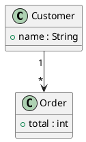
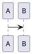
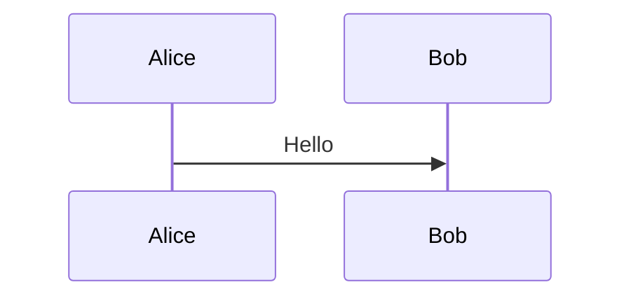

# dg-plantuml MVP test note

Paste this note into Joplin to check stage 1 (design 16.3: M-02, M-03, M-06, M-08, M-09, M-14, M-16).

## 1. Sequence (no @startuml)

```plantuml
Alice -> Bob : Hello
Bob --> Alice : Hi
```

## 2. Class diagram (Smetana layout)



## 3. CJK

```plantuml
actor 利用者
participant "サーバー" as S
利用者 -> S : 注文する（日本語）
S --> 利用者 : 完成 / 完成了 / 완료
```

## 4. Block options: theme=dark, align=left

```plantuml theme=dark align=left
Alice -> Bob : dark, left
```

## 5. theme=none (no preamble: white background)

```plantuml theme=none
Alice -> Bob : none
```

## 6. Four backticks with ``` inside

````plantuml
note over Alice
  ```
  not a close fence
  ```
end note
````

## 7. Tilde fence, puml

~~~puml
@startmindmap
* root
** a
** b
@endmindmap
~~~

## 8. Emoji

```plantuml
Alice -> Bob : <:smile:> <:+1:>
```

## 9. Syntax error (line 3)

```plantuml
@startuml
Alice -> Bob
this is bad
@enduml
```

## 10. Standard library (not available, line 1)

```plantuml
!include <C4/C4_Container>
Person(user, "User")
```

## 11. Several diagrams in one block



## 12. Mermaid, for comparison


