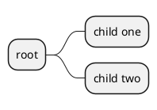
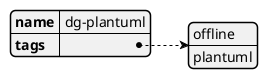

# dg-plantuml stage 2 test note

For the manual tests M-04, M-05 and M-12 (design 16.3). See stage2-manual-tests.ja.md.

## 1. Sequence with a note

```plantuml
actor User
participant "Web server" as W
User -> W : request
W --> User : response
note right of W : a note
```

## 2. Class diagram (class icons must keep their colours)

```plantuml
class Customer {
  +name : String
}
interface Payable
Customer ..|> Payable
Customer "1" --> "*" Order
```

## 3. Activity (start and end nodes must stay filled)

```plantuml
start
:Step one;
if (ok?) then (yes)
  :Done;
else (no)
  :Retry;
endif
stop
```

## 4. Mind map (follows the note font size and the diagram font)



## 5. JSON



## 6. Wide diagram (M-05: scaled down, then scrolls sideways; about 1,300 characters for M-12)

```plantuml
Participant0 -> Participant1 : message 0
Participant1 -> Participant2 : message 1
Participant2 -> Participant3 : message 2
Participant3 -> Participant4 : message 3
Participant4 -> Participant5 : message 4
Participant5 -> Participant6 : message 5
Participant6 -> Participant7 : message 6
Participant7 -> Participant8 : message 7
Participant8 -> Participant9 : message 8
Participant9 -> Participant10 : message 9
Participant10 -> Participant11 : message 10
Participant11 -> Participant12 : message 11
Participant12 -> Participant13 : message 12
Participant13 -> Participant14 : message 13
Participant14 -> Participant15 : message 14
Participant15 -> Participant16 : message 15
Participant16 -> Participant17 : message 16
Participant17 -> Participant18 : message 17
Participant18 -> Participant19 : message 18
Participant19 -> Participant20 : message 19
Participant20 -> Participant21 : message 20
Participant21 -> Participant22 : message 21
Participant22 -> Participant23 : message 22
Participant23 -> Participant24 : message 23
Participant24 -> Participant25 : message 24
Participant25 -> Participant26 : message 25
Participant26 -> Participant27 : message 26
Participant27 -> Participant28 : message 27
Participant28 -> Participant29 : message 28
Participant29 -> Participant30 : message 29
```

## 7. Block options (always win over the settings)

```plantuml theme=dark
Alice -> Bob : theme=dark
```

```plantuml theme=light
Alice -> Bob : theme=light
```

```plantuml theme=none
Alice -> Bob : theme=none
```

## 8. Font size written in the diagram (wins over "Match the font size of the note")

```plantuml
skinparam defaultFontSize 10
Alice -> Bob : always size 10
```

## 9. Language name "uml" (drawn only when "Other language names" contains uml)

```uml
Alice -> Bob : uml alias
```
